```{r setup, include=FALSE}
options(htmltools.dir.version = FALSE)
library(knitr)
opts_chunk$set(
  prompt = T,
  fig.align="center",
  dpi=300,
  cache=T,
  engine.opts = list(bash = "-l")
  )

knit_hooks$set(
  prompt = function(before, options, envir) {
    options(
      prompt = if (options$engine %in% c('sh','bash', 'zsh')) '$ ' else 'R> ',
      continue = if (options$engine %in% c('sh','bash', 'zsh')) '$ ' else '+ '
      )
})

options(repos = c(CRAN = "https://cran.rstudio.com/"))

if (!require("fontawesome", character.only = TRUE)) {
  install.packages("fontawesome", dependencies = TRUE)
  library(fontawesome, character.only = TRUE)
}
```

# Welcome back! 🌍 {background-color="#1B3A6B"}

## Recap of last class

:::{style="margin-top: 50px; font-size: 26px;"}
:::{.columns}
:::{.column width=58%}
- Last time: [bias]{.alert} in AI systems, and who pays for it
- Robert Williams, Detroit 2020: a facial recognition match, [30 hours in a cell]{.alert}
- Six types: historical, representation, measurement, aggregation, evaluation and deployment
- Delete race from the data and the [proxies]{.alert} do the work: ZIP code, test scores
- The [impossibility theorem]{.alert}: no model satisfies every fairness criterion at once
- Today: fairness is a values question, so [how are governments responding?]{.alert}
:::

:::{.column width=42%}
:::{style="text-align: center; margin-top: 30px;"}
[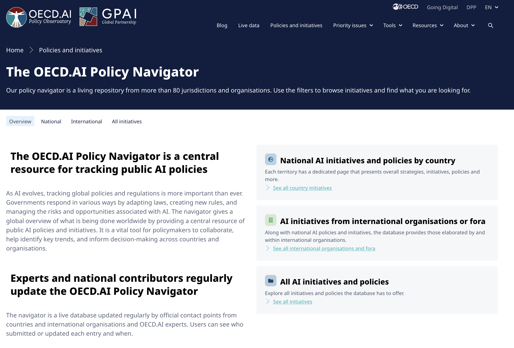{width="100%"}](#){data-modal-type="image" data-modal-url="figures/ai-regulation-map.png"}

Source: [OECD AI Policy Observatory](https://oecd.ai/en/dashboards/overview)
:::
:::
:::
:::

## Lecture overview
### What we will cover today

:::{style="margin-top: 20px; font-size: 26px;"}

:::{.columns}
:::{.column width=50%}
**Part 1: Why regulate AI?**

- The case for government intervention
- Different regulatory philosophies

**Part 2: The EU AI Act**

- Risk-based approach
- Prohibited, high-risk, and low-risk systems
- Compliance requirements
:::

:::{.column width=50%}
**Part 3: The US approach**

- Sectoral regulation vs comprehensive laws
- Executive orders and agency guidance
- State-level initiatives

**Part 4: Other approaches**

- China's AI regulations
- The global race for AI governance
- What this means for practitioners
:::
:::
:::

## Meme of the day 😄

:::{style="text-align: center; margin-top: 30px;"}
<!-- Suggested image: Regulation meme about AI -->
[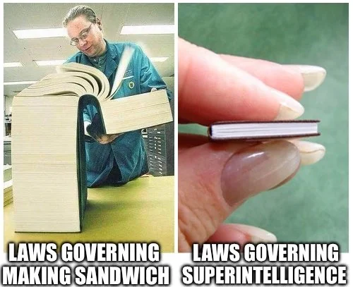{width="50%"}](#){data-modal-type="image" data-modal-url="figures/meme-of-the-day.webp"}

Source: [r/agi](https://www.reddit.com/r/agi/comments/1klizks/how_do_you_feel_about_ai_regulation_will_it/)
:::

# Why regulate AI? 🤔 {background-color="#1B3A6B"}

## The case for intervention

:::{style="margin-top: 30px; font-size: 22px;"}
:::{.columns}
:::{.column width=55%}
**Market failures:**

- [Information asymmetry]{.alert}: users can't evaluate AI systems
  - How accurate is this hiring algorithm? Nobody knows
  - Is this chatbot hallucinating? Hard to tell
- [Externalities]{.alert}: harms fall on people who never chose the system, like deepfake victims
- [Collective action problems]{.alert}: company A deploys unsafe AI, company B must follow or lose market share

**Rights and dignity:**

- Some uses violate [fundamental rights]{.alert}
- Facial recognition in public spaces
- Manipulation of democratic processes
:::

:::{.column width=45%}
:::{style="text-align: center;"}
[{width="100%"}](#){data-modal-type="image" data-modal-url="figures/market-failure.jpg"}

:::{style="background: rgba(45, 69, 99, 0.1); padding: 15px; border-radius: 10px; font-size: 18px; margin-top: 15px;"}
"Move fast and break things" maybe works for social media features. It's [less appealing when the things being broken]{.alert} are people's careers (or even lives)!
:::
:::
:::
:::
:::

## The case against (heavy) intervention

:::{style="margin-top: 30px; font-size: 22px;"}
:::{.columns}
:::{.column width=55%}
**Innovation concerns:**

- Regulation [slows development]{.alert}
- Compliance costs burden small companies
- Innovation may move to laxer jurisdictions

**Technical challenges:**

- Technology moves faster than law
- [General-purpose systems]{.alert} defy categorisation
- Enforcement needs technical expertise

**Existing laws may suffice:**

- Discrimination and consumer protection laws already apply 
- The question is [where to draw the line]{.alert} and who gets to draw it
:::

:::{.column width=45%}
:::{style="text-align: center;"}
[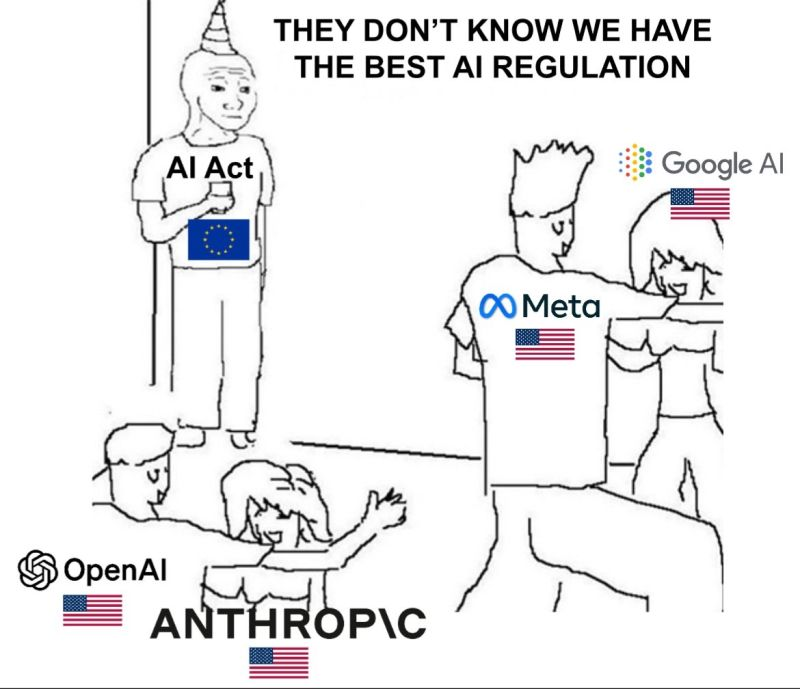{width="100%"}](#){data-modal-type="image" data-modal-url="figures/innovation-regulation.jpg"}

Source: [X.com](https://x.com/pascal_bornet/status/1892786338015171026)
:::
:::
:::
:::

## Regulatory philosophies

:::{style="margin-top: 30px; font-size: 25px;"}
:::{.columns}
:::{.column width=100%}
| Approach | Philosophy | Example |
|----------|------------|---------|
| [**Precautionary**]{.alert} | Prove safety before deployment | EU AI Act's prohibited uses |
| [**Innovation-first**]{.alert} | Regulate only after harms emerge | Early US approach to internet |
| [**Risk-based**]{.alert} | Stricter rules for higher-risk uses | EU AI Act's tiered system |
| [**Sectoral**]{.alert} | Different rules for different industries | US healthcare vs finance AI |
| [**Self-regulation**]{.alert} | Industry develops own standards | Many current AI ethics guidelines |

:::{style="margin-top: 20px;"}
[No single approach dominates]{.alert}

- EU leans precautionary/risk-based
- US leans sectoral/innovation-first (but changing)
- China mixes state control with innovation goals
- Most countries are still figuring it out
:::
:::
:::
:::

# The EU AI Act 🇪🇺 {background-color="#1B3A6B"}

## The world's first comprehensive AI law

:::{style="margin-top: 30px; font-size: 18px;"}
:::{.columns}
:::{.column width=58%}
**Timeline:**

- April 2021: European Commission proposal
- December 2023: deal struck; March 2024: Parliament vote
- August 2024: Entry into force
- 2025: Bans (February) and General Purpose AI rules (August) apply
- July 2026: [Digital Omnibus](https://www.europarl.europa.eu/thinktank/es/document/EPRS_BRI(2026)782651){.alert} delays high-risk rules to December 2027 (August 2028 for products)

**Scope:**

- [Extraterritorial reach](https://www.morganlewis.com/pubs/2024/07/the-eu-artificial-intelligence-act-is-here-with-extraterritorial-reach){.alert}: any AI sold in the EU, wherever it was built
- Covers providers, deployers, importers, distributors
- The EU market is large, so many companies may [apply EU rules worldwide]{.alert}

**Approach:**

- [Risk-based]{.alert}: rules depend on potential harm
- Horizontal and technology-neutral: all sectors, no named techniques
:::

:::{.column width=42%}
:::{style="text-align: center;"}
[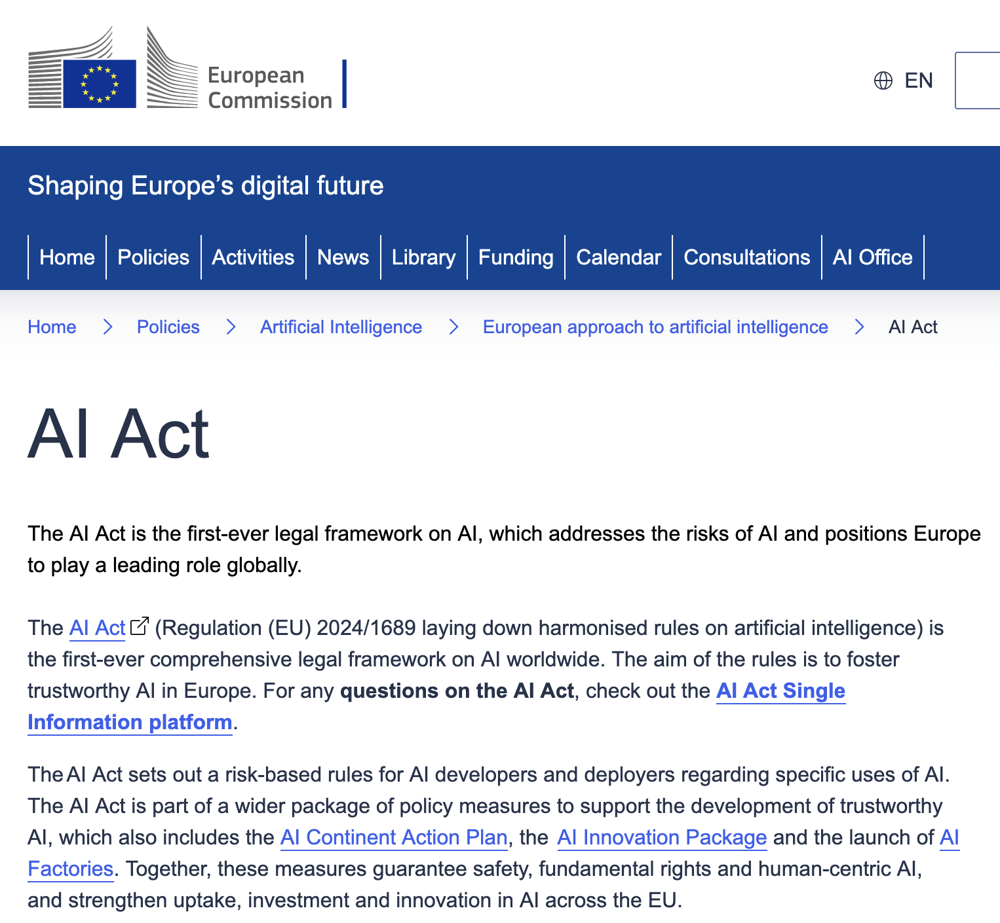{width="100%"}](#){data-modal-type="image" data-modal-url="figures/eu-ai-act.png"}

Source: [European Commission](https://digital-strategy.ec.europa.eu/en/policies/regulatory-framework-ai)
:::
:::
:::
:::

## The risk pyramid

:::{style="margin-top: 30px; font-size: 22px;"}
:::{.columns}
:::{.column width=55%}
**Unacceptable risk (banned):**

- Social scoring, public or private
- Real-time face ID in public by police (with exceptions)
- Emotion recognition at work and school
- Predictive policing by profiling alone
- From December 2026: [nudifier apps]{.alert} and AI child abuse imagery

**High risk (strict requirements):**

- Biometric identification
- Critical infrastructure
- Employment and worker management
- Essential services (credit, insurance)
- Law enforcement and border control
- Justice and democratic processes
:::

:::{.column width=45%}
:::{style="text-align: center; margin-top: -20px;"}
[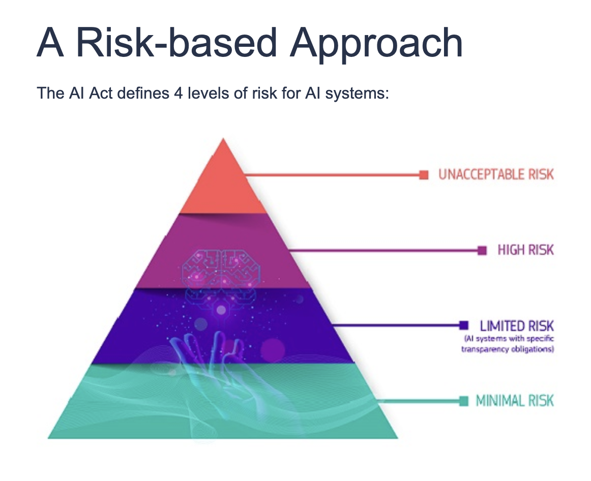{width="60%"}](#){data-modal-type="image" data-modal-url="figures/risk-pyramid.png"}
:::

**Limited risk (transparency only):**

- Chatbots (must disclose AI)
- Emotion recognition (must inform)
- Deep fakes (must label)

**Minimal risk (no requirements):**

- Most consumer applications: spam filters, video games, etc
:::
:::
:::

## High-risk system requirements

:::{style="margin-top: 30px; font-size: 22px;"}
:::{.columns}
:::{.column width=55%}
**Before deployment:**

- [Conformity assessment]{.alert} and [risk management system]{.alert}
- [Technical documentation]{.alert}
- [Logging and traceability]{.alert}

**During operation:**

- [Human oversight]{.alert} capability
- [Accuracy, robustness, cybersecurity]{.alert}
- Register in [EU database]{.alert}; report serious incidents

**Deployers (users):**

- Follow instructions and monitor issues
:::

:::{.column width=45%}
:::{style="background: rgba(45, 69, 99, 0.1); padding: 15px; border-radius: 10px; font-size: 22px; margin-top: 30px;"}
**Data governance:**

- Training data: [relevant, representative, as error-free as possible]{.alert}; must be checked for biases
- Must [demonstrate compliance]{.alert}

**Transparency:**

- Clear information on capabilities and limitations, instructions for use, and contact details for oversight
:::
:::
:::
:::

## General-Purpose AI (GPAI) rules

:::{style="margin-top: 30px; font-size: 21px;"}
:::{.columns}
:::{.column width=55%}
The Act sets special rules for [foundation models]{.alert} like GPT-5, Claude, and Gemini

**All GPAI providers must:**

- Maintain technical documentation
- Share information with companies that use the model
- Respect copyright, including creators' opt-outs
- Publish training content summaries

**"Systemic risk" GPAI (more powerful models) must also:**

- Conduct model evaluations including [adversarial testing]{.alert}
- Assess and mitigate systemic risks
- Track and report [serious incidents]{.alert}
- Ensure adequate [cybersecurity]{.alert}
:::

:::{.column width=45%}
:::{style="text-align: center;"}
[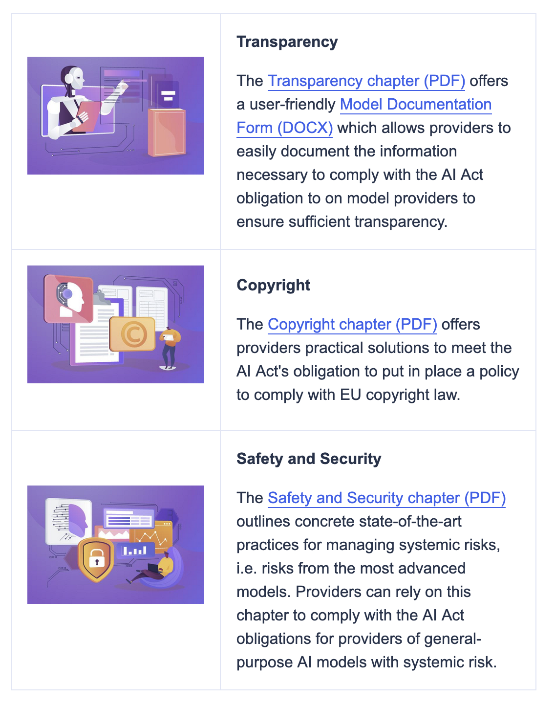{width="70%"}](#){data-modal-type="image" data-modal-url="figures/foundation-models.png"}

Source: [European Commission](https://digital-strategy.ec.europa.eu/en/policies/contents-code-gpai)
:::
:::
:::
:::

## Open-source models: a partial exemption

:::{style="margin-top: 30px; font-size: 23px;"}
:::{.columns}
:::{.column width=55%}
- Free-licence open weights skip the [documentation duties]{.alert}
- Copyright rules and the training summary still apply
- [Systemic-risk]{.alert} models (trained with big computing power) face the stricter tier
- Open models allow [independent scrutiny]{.alert}, a partial substitute for oversight
- Supports European open-source research

**Criticism:**

- A [loophole]{.alert}: open models can still cause harm once third parties deploy them
- Deployers are responsible, but small ones may lack the resources
:::

:::{.column width=45%}
:::{style="text-align: center; margin-top: 30px;"}
[{width="80%"}](#){data-modal-type="image" data-modal-url="figures/mistral.webp"}

:::{style="background: rgba(45, 69, 99, 0.1); padding: 15px; border-radius: 10px; font-size: 21px; margin-top: 15px; text-align: left;"}
**Example:** [Mistral](https://mistral.ai/), a French AI company, releases many open models. [Epoch AI](https://epoch.ai/data-insights/models-over-1e25-flop) estimates its largest (like Mistral Large 2) pass the systemic-risk threshold, so they face the stricter rules. Smaller ones are largely exempt
:::
:::
:::
:::
:::

## Penalties and enforcement

:::{style="margin-top: 30px; font-size: 21px;"}
:::{.columns}
:::{.column width=55%}
**Maximum fines:**

| Violation | Max fine |
|-----------|----------|
| Prohibited AI practices | [€35M or 7% global turnover]{.alert} |
| High-risk non-compliance | €15M or 3% global turnover |
| Incorrect information | €7.5M or 1% global turnover |

**For comparison:**

- GDPR (General Data Protection Regulation) maximum: €20M or 4% turnover
- EU AI Act is [stricter]{.alert} for the worst violations

**Enforcement:**

- National [market surveillance authorities]{.alert}
- New [AI Office](https://digital-strategy.ec.europa.eu/en/policies/ai-office){.alert} at EU level for GPAI
- Complaints mechanism for affected individuals
:::

:::{.column width=45%}
:::{style="text-align: center;"}
[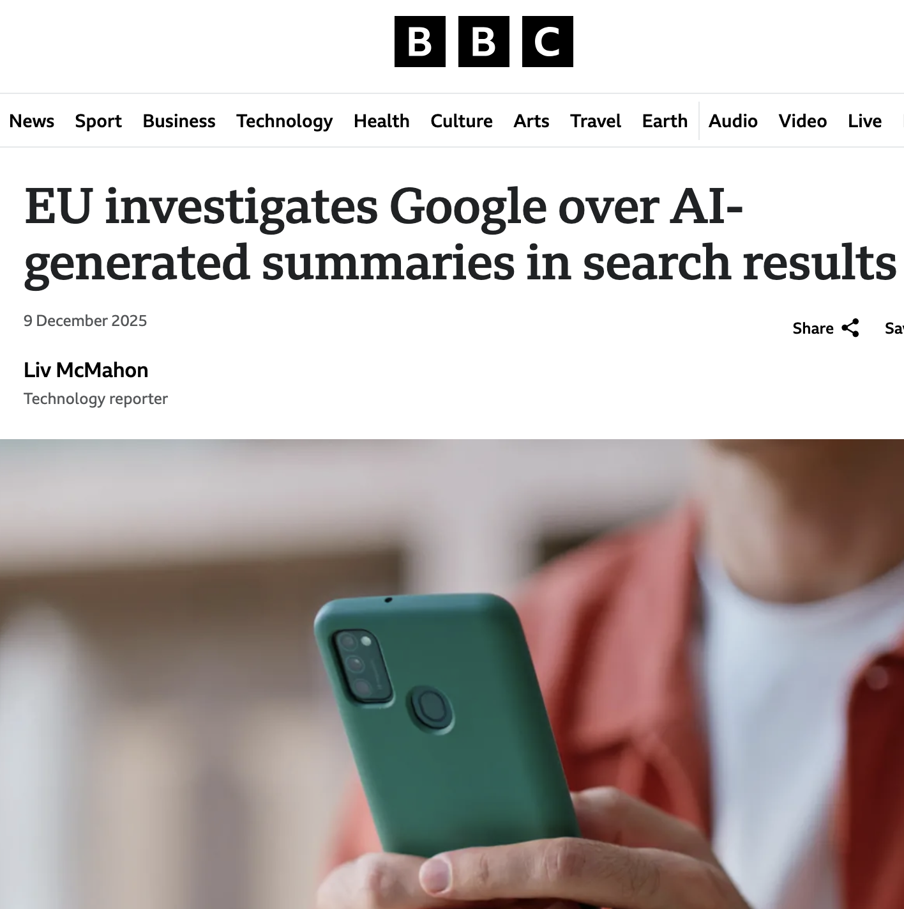{width="70%"}](#){data-modal-type="image" data-modal-url="figures/eu-ai-fines.png"}

Source: [BBC News](https://www.bbc.com/news/articles/crl95eg33k1o) (a competition probe, not an AI Act case)

:::{style="font-size: 18px; margin-top: 15px;"}
For a company like Google (2024 revenue ~$350B), a 7% fine would be [~$24.5 billion]{.alert}. That gets attention.
:::
:::
:::
:::
:::

## Where would these fit? 🤔

:::{style="margin-top: 30px; font-size: 19px;"}
**Quick reference for the four risk levels:**

- [Prohibited]{.alert}: banned outright
- [High risk]{.alert}: allowed, but with strict requirements
- [Limited risk]{.alert}: interacts with people directly, so users must be told they are dealing with AI
- [Minimal risk]{.alert}: low-stakes uses with no specific requirements

:::{.columns}
:::{.column width=50%}
:::{.fragment}
1. ChatGPT used for customer service
:::
:::{.fragment}
   - [Limited risk]{.alert} – must disclose it's AI
:::
:::{.fragment}
2. An AI system that scores job applicants
:::
:::{.fragment}
   - [High risk]{.alert} – employment decisions
:::
:::{.fragment}
3. Spotify's music recommendation algorithm
:::
:::{.fragment}
   - [Minimal risk]{.alert} – entertainment
:::
:::{.fragment}
4. Facial recognition at airport security
:::
:::{.fragment}
   - [Depends]{.alert}: scanning crowds is high risk; a passport check is not
:::
:::

:::{.column width=50%}
:::{.fragment}
:::{style="background: rgba(45, 69, 99, 0.1); padding: 15px; border-radius: 10px; margin-top: 15px; font-size: 18px;"}
The classification often depends on [context and use]{.alert}, not just the technology itself
:::
:::
:::
:::
:::

# The US approach 🇺🇸 {background-color="#1B3A6B"}

## No comprehensive federal AI law (yet)

:::{style="margin-top: 30px; font-size: 18px;"}
:::{.columns}
:::{.column width=55%}
The US took a [different path]{.alert} from the EU: [no single AI authority]{.alert}

**Sectoral approach:**

- [Food and Drug Administration (FDA)](https://www.fda.gov/medical-devices/software-medical-device-samd/artificial-intelligence-software-medical-device) regulates medical devices
- [Securities and Exchange Commission (SEC)](https://www.sec.gov/ai) oversees securities markets
- [Equal Employment Opportunity Commission (EEOC)](https://www.eeoc.gov/newsroom/eeoc-launches-initiative-artificial-intelligence-and-algorithmic-fairness) applies discrimination law

**Recent developments:**

- **October 2023**: Biden's [Executive Order on AI](https://bidenwhitehouse.archives.gov/briefing-room/presidential-actions/2023/10/30/executive-order-on-the-safe-secure-and-trustworthy-development-and-use-of-artificial-intelligence/)
- **July 2025**: Trump's [America's AI Action Plan](https://www.whitehouse.gov/wp-content/uploads/2025/07/Americas-AI-Action-Plan.pdf)
- State-level initiatives ([Colorado](https://leg.colorado.gov/bills/sb24-205), [California](https://leginfo.legislature.ca.gov/), [Illinois](https://www.ilga.gov/legislation/ilcs/ilcs3.asp?ActID=4015&ChapterID=68))

**Philosophy:**

- [Innovation-friendly]{.alert} compared to EU
- Voluntary commitments from companies
- Existing laws apply to AI uses
:::

:::{.column width=45%}
:::{style="text-align: center;"}
[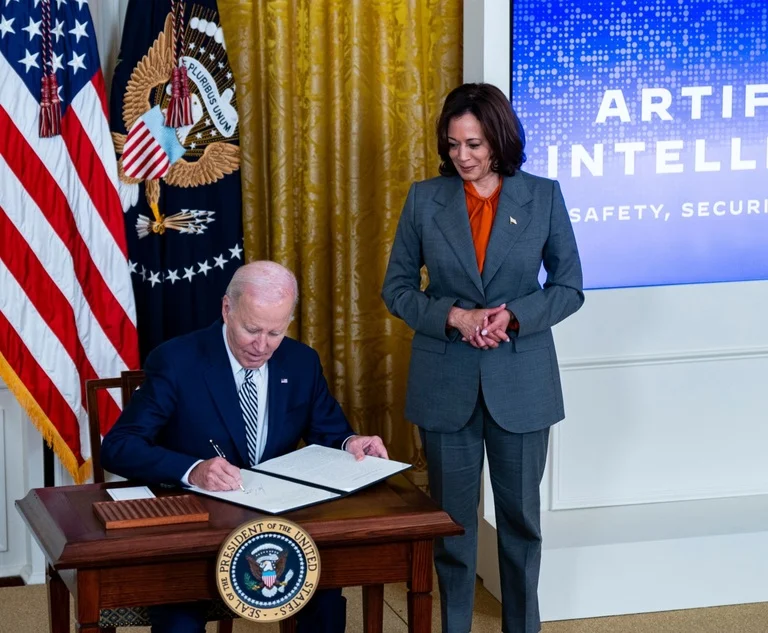{width="100%"}](#){data-modal-type="image" data-modal-url="figures/us-ai-regulation.webp"}

Source: [Law.com](https://www.law.com/legaltechnews/2023/11/01/white-houses-ai-executive-order-opens-the-door-wide-to-new-rules-enforcement-actions/?slreturn=20260214023811)
:::
:::
:::
:::

## Biden's Executive Order (2023)

:::{style="margin-top: 30px; font-size: 20px;"}
:::{.columns}
:::{.column width=55%}
**Requirements:**

- Developers of powerful AI must [share safety test results]{.alert} with government
- Standards for [red-teaming]{.alert} AI systems
- Guidelines for [watermarking]{.alert} AI-generated content
- Protections against AI-enabled fraud

**Focus on national security:**

- Report [large training runs]{.alert}
- Cloud providers must report foreign customers
- Protect critical infrastructure

**Limitations:**

- The next president can [reverse]{.alert} it (and did!)
- Some provisions are [voluntary]{.alert} or guidance
- Congress hasn't passed comprehensive legislation
:::

:::{.column width=45%}
:::{style="text-align: center;"}
[{width="100%"}](#){data-modal-type="image" data-modal-url="figures/biden-ai-eo.webp"}

Biden's AI meeting, June 2023. Summary: [Congress.gov](https://www.congress.gov/crs-product/R47843)
:::
:::
:::
:::

## America's AI Action Plan (2025)

:::{style="margin-top: 30px; font-size: 21px;"}
:::{.columns}
:::{.column width=55%}
**Priorities:**

- [American AI dominance]{.alert} over global competitors
- Fewer regulatory barriers
- Focus on [national security applications]{.alert}
- Energy and faster permitting for AI data centres
- [March 2026 framework](https://www.whitehouse.gov/wp-content/uploads/2026/03/03.20.26-National-Policy-Framework-for-Artificial-Intelligence-Legislative-Recommendations.pdf): asks Congress to [pre-empt]{.alert} state AI laws

**Changes from Biden era:**

- Less emphasis on AI safety requirements
- More focus on [competition with China]{.alert}
- Voluntary commitments over mandates, to avoid "overregulation"
:::

:::{.column width=45%}
**Implications:**

- US-EU [regulatory divergence]{.alert} may increase
- Companies face different rules in different markets
- "Race to the bottom" concerns

:::{style="text-align: center;"}
[{width="80%"}](#){data-modal-type="image" data-modal-url="figures/ai-competition.avif"}

Source: [Voice of America](https://www.voanews.com/a/trump-signals-aggressive-stance-as-us-races-china-in-ai-development/7947068.html)
:::
:::
:::
:::

## State-level action

:::{style="margin-top: 30px; font-size: 20px;"}
:::{.columns}
:::{.column width=60%}
With limited federal action, states are filling gaps:

**[Colorado AI Act (2024)](https://leg.colorado.gov/bills/sb24-205):**

- First comprehensive state AI law
- [Replaced in May 2026](https://leg.colorado.gov/bills/sb26-189) by a narrower law: notices, explanations, human review (from 2027)

**California:**

- [Senate Bill 53 (2025)](https://leginfo.legislature.ca.gov/faces/billNavClient.xhtml?bill_id=202520260SB53): frontier AI developers must publish safety plans and report incidents
- Often sets [national trends]{.alert}

**Illinois and New York City:**

- [Illinois](https://www.ilga.gov/legislation/ilcs/ilcs3.asp?ActID=4015&ChapterID=68): AI Video Interview Act, must disclose AI in hiring
- [New York City](https://www.nyc.gov/site/dca/about/automated-employment-decision-tools.page): first US jurisdiction to require [bias audits for hiring AI](https://rules.cityofnewyork.us/rule/automated-employment-decision-tools-updated/)
:::

:::{.column width=40%}
:::{style="text-align: center;"}
[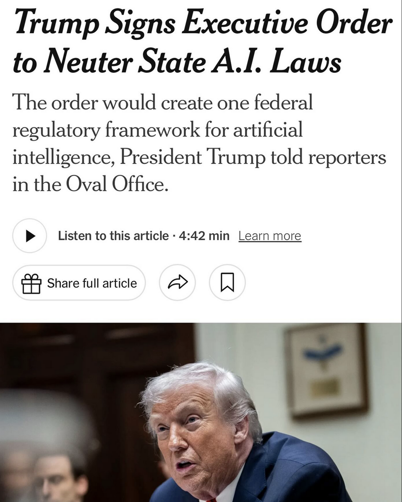{width="70%"}](#){data-modal-type="image" data-modal-url="figures/state-ai-laws.png"}

:::{style="background: rgba(45, 69, 99, 0.1); padding: 15px; border-radius: 10px; font-size: 18px; margin-top: 15px; text-align: left;"}
[Executive Order 14365](https://www.federalregister.gov/documents/2025/12/16/2025-23092/ensuring-a-national-policy-framework-for-artificial-intelligence) (December 2025) tells the Justice Department to challenge state AI laws. Companies want one federal rule, not a [patchwork]{.alert}.
:::
:::
:::
:::
:::

# Global perspectives 🌏 {background-color="#1B3A6B"}

## China's AI governance

:::{style="margin-top: 30px; font-size: 20px;"}
:::{.columns}
:::{.column width=55%}
China has been [very active]{.alert} on AI regulation:

**Features:**

- [Content control]{.alert}: AI must uphold "socialist values"
- [Registration]{.alert} for public-facing AI
- Three core regulations (the "trio"):
  - [Algorithm Recommendation Provisions (2022)](https://digichina.stanford.edu/work/translation-internet-information-service-algorithmic-recommendation-management-provisions-effective-march-1-2022/)
  - [Deep Synthesis Provisions (2023)](https://www.chinalawtranslate.com/en/deep-synthesis/)
  - [Generative AI Measures (2023)](https://www.chinalawtranslate.com/en/generative-ai-interim/): first binding generative AI rules worldwide
- [Amended Cybersecurity Law (2026)](https://iclg.com/practice-areas/cybersecurity-laws-and-regulations/01-generative-ai-and-cyber-risk-in-china): first AI provisions in national law (January 2026)

**Contradictions:**

- Regulates facial recognition but [deploys it extensively]{.alert}
- Restricts AI manipulation but uses AI for surveillance
- Innovation priorities clash with content control
:::

:::{.column width=45%}
:::{style="text-align: center;"}
[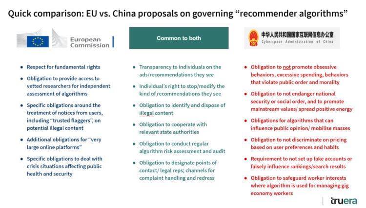{width="100%"}](#){data-modal-type="image" data-modal-url="figures/china-ai.jpg"}

Source: [Corporate Compliance Insights](https://www.corporatecomplianceinsights.com/regulating-artificial-intelligence-china-west/)

:::{style="background: rgba(45, 69, 99, 0.1); padding: 15px; border-radius: 10px; font-size: 18px; margin-top: 15px;"}
China's approach: regulate [commercial AI carefully]{.alert}, but [state use is largely unrestricted]{.alert}
:::
:::
:::
:::
:::

## Other approaches

:::{style="margin-top: 30px; font-size: 20px;"}
:::{.columns}
:::{.column width=55%}
**United Kingdom:**

- ["Pro-innovation" approach](https://www.gov.uk/government/publications/ai-regulation-a-pro-innovation-approach): sector regulators apply existing frameworks
- No comprehensive AI law (yet)
- [AI Security Institute](https://www.aisi.gov.uk/) (renamed in 2025) tests frontier models

**Canada:**

- [AIDA (Artificial Intelligence and Data Act)](https://ised-isde.canada.ca/site/innovation-better-canada/en/artificial-intelligence-and-data-act) [died in parliament](https://www.mcinnescooper.com/publications/the-demise-of-the-artificial-intelligence-and-data-act-aida-5-key-lessons/) in January 2025
- No AI law since

**Brazil:**

- [Comprehensive AI bill (PL 2338/2023)](https://artificialintelligenceact.com/brazil-ai-act/) passed the Senate, now in the Chamber of Deputies
- Influenced by EU approach
:::

:::{.column width=45%}
**International coordination:**

| Initiative | Focus |
|------------|-------|
| [OECD AI Principles](https://oecd.ai/en/ai-principles) | Soft law, voluntary |
| [G7 Hiroshima Process](https://www.soumu.go.jp/hiroshimaaiprocess/en/index.html) | International norms |
| [UN Scientific Panel on AI](https://www.un.org/independent-international-scientific-panel-ai/en) | Global evidence, dialogue |
| [Council of Europe AI Convention](https://www.coe.int/en/web/artificial-intelligence/the-framework-convention-on-artificial-intelligence) | Human rights focus |
| [ISO/IEC 42001](https://www.iso.org/standard/42001) | Technical standards |

:::{style="background: rgba(45, 69, 99, 0.1); padding: 15px; border-radius: 10px; font-size: 18px; margin-top: 15px;"}
[No global consensus on AI governance.]{.alert} The "Brussels Effect" (EU rules becoming global standards) may apply, as with GDPR.
:::
:::
:::
:::

## Comparing approaches

:::{style="margin-top: 60px; font-size: 22px;"}
:::{.columns}
:::{.column width=100%}
| Aspect | EU | US | China | UK |
|--------|----|----|-------|-------|
| [Framework]{.alert} | Comprehensive law | Sectoral | Multiple regulations | Guidance + sectors |
| [Philosophy]{.alert} | Risk-based, precautionary | Innovation-first | State control + innovation | Pro-innovation |
| [Enforcement]{.alert} | AI Office + national bodies | Existing agencies | Cyberspace Admin | Sector regulators |
| [Prohibited uses]{.alert} | Social scoring, some biometrics | Few explicit bans | Political content | Minimal |
| [GPAI rules]{.alert} | Yes, tiered | Voluntary (federal) | Yes, content-focused | None (AISI tests models) |
| [Extraterritorial]{.alert} | Yes | Limited | Yes | No |
:::
:::
:::

# What this means for users {background-color="#1B3A6B"}

## Practical implications

:::{style="margin-top: 30px; font-size: 25px;"}
:::{.columns}
:::{.column width=55%}
**If you're building AI systems:**

- Know your [use case classification]{.alert}
- Document training data and development
- Build in [human oversight]{.alert}
- Plan for [audits]{.alert} early

**If you're deploying AI systems:**

- Understand what system you're using
- Ensure appropriate [human review]{.alert}
- Inform affected individuals
- Know your [liability]{.alert}
:::

:::{.column width=45%}
**If you're affected by AI systems:**

- You may have [transparency rights]{.alert}
- Challenge automated decisions
- Report problems to authorities

:::{style="background: rgba(45, 69, 99, 0.1); padding: 15px; border-radius: 10px; font-size: 23px; margin-top: 60px;"}
**Compliance as competitive advantage:**

Companies that document their data and build in oversight now will have less to fix later
:::
:::
:::
:::

## The regulatory trajectory

:::{style="margin-top: 30px; font-size: 21px;"}
:::{.columns}
:::{.column width=55%}
**Where we're heading:**

- More jurisdictions will regulate AI
- [Convergence]{.alert} likely around high-risk categories
- Interoperability challenges will persist

**Open question:**

- Can regulation keep pace with technology?

**What we do know:**

- Every major economy is working on AI rules
- Companies that sell globally will face multiple regimes
- The EU's rules will likely shape other countries
:::

:::{.column width=45%}
:::{style="text-align: center;"}
[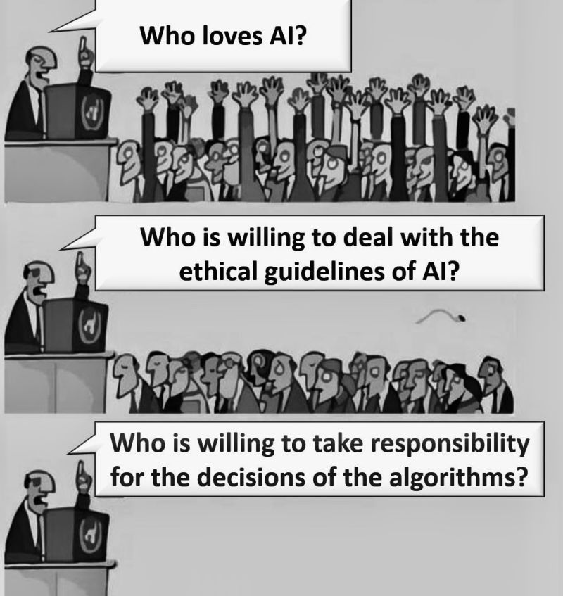{width="100%"}](#){data-modal-type="image" data-modal-url="figures/ai-future-regulation.jpg"}

Source: [LinkedIn](https://www.linkedin.com/posts/senkorasic_stealing-this-meme-to-point-out-that-1-activity-7244270295614722049-RBRU)
:::
:::
:::
:::

# Summary {background-color="#1B3A6B"}

## Main takeaways

:::{style="margin-top: 30px; font-size: 22px;"}
:::{.columns}
:::{.column width=55%}
**Why regulate?**

- Market failures (information asymmetry, externalities) and rights protection

**EU AI Act**

- First comprehensive AI law, with four risk tiers
- Strict rules for high-risk systems; fines up to 7% of global turnover

**US approach**

- Innovation-first and sectoral, with no comprehensive law
- States fill the gaps
:::

:::{.column width=45%}
**Global picture**

- No international consensus
- EU likely to set de facto global standards
- China: extensive but contradictory

**For practitioners**

- Know your use case's risk class
- Build compliance in from the start
- Document everything; plan for human oversight

:::{style="background: rgba(45, 69, 99, 0.1); padding: 15px; border-radius: 10px; margin-top: 15px; font-size: 18px;"}
How do you hold someone accountable for a decision made by a machine? Every framework we covered tries to answer it!
:::
:::
:::
:::

# ... and that's all for today! 🎉 {background-color="#1B3A6B"}