```{r setup, include=FALSE}
options(htmltools.dir.version = FALSE)
library(knitr)
opts_chunk$set(
  prompt = T,
  fig.align="center",
  dpi=300,
  cache=T,
  engine.opts = list(bash = "-l")
  )

knit_hooks$set(
  prompt = function(before, options, envir) {
    options(
      prompt = if (options$engine %in% c('sh','bash', 'zsh')) '$ ' else 'R> ',
      continue = if (options$engine %in% c('sh','bash', 'zsh')) '$ ' else '+ '
      )
})

options(repos = c(CRAN = "https://cran.rstudio.com/"))

if (!require("fontawesome", character.only = TRUE)) {
  install.packages("fontawesome", dependencies = TRUE)
  library(fontawesome, character.only = TRUE)
}
```

# Welcome back! {background-color="#1B3A6B"}

## Recap of last class

:::{style="margin-top: 20px; font-size: 24px;"}
:::{.columns}
:::{.column width=58%}
- [EU AI Act]{.alert}: first comprehensive AI law
- Risk tiers: banned, high, limited, minimal
- Fines up to [7% of global turnover]{.alert}
- High-risk rules delayed to December 2027
- [US]{.alert}: sectoral rules plus state laws
- A [2025 executive order]{.alert} targets state AI laws
- [China]{.alert}: censorship, innovation, algorithm registry
- [No global consensus; principles likely to converge]{.alert}
- Today: how does AI intersect with [privacy]{.alert}?
:::

:::{.column width=42%}
:::{style="text-align: center; margin-top: 30px;"}
[{width="100%"}](#){data-modal-type="image" data-modal-url="figures/privacy-illustration.jpg"}
:::
:::
:::
:::

## Lecture overview
### What we will cover today

:::{style="margin-top: 20px; font-size: 26px;"}

:::{.columns}
:::{.column width=50%}
[Part 1: Privacy in the AI age]{.alert}

- Why AI makes privacy harder
- Data collection at unprecedented scale
- Inferring sensitive traits

[Part 2: Legal frameworks]{.alert}

- GDPR and data protection principles
- Rights of individuals
- US privacy landscape
:::

:::{.column width=50%}
[Part 3: Technical approaches]{.alert}

- Differential privacy
- Federated learning
- Synthetic data

[Part 4: Challenges and tensions]{.alert}

- Case study: Clearview AI
- Discussion: where's your line on privacy?
- What can you do?
:::
:::
:::

## Meme of the day

:::{style="text-align: center; margin-top: 30px;"}
[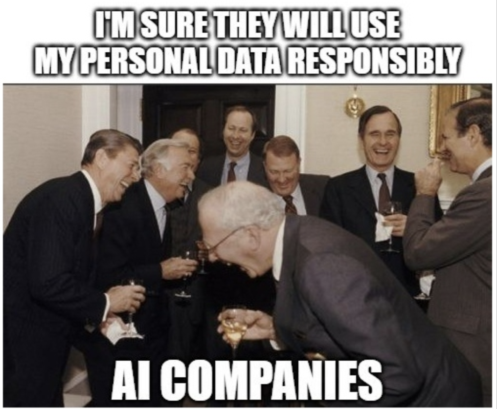{width="50%"}](#){data-modal-type="image" data-modal-url="figures/privacy-meme.png"}

Source: [CanIPhish](https://caniphish.com/blog/ai-memes)
:::

## Good news of the day

:::{style="text-align: center; margin-top: 30px;"}
[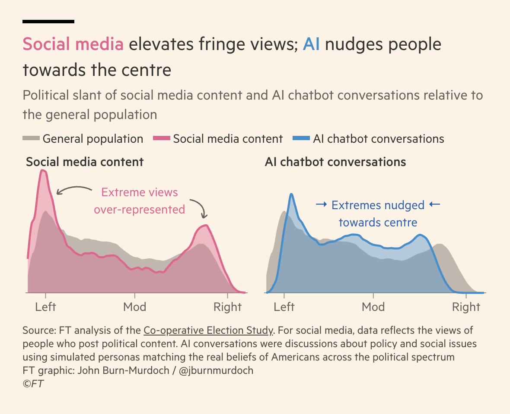{width="55%"}](#){data-modal-type="image" data-modal-url="figures/ai-polarisation.png"}

Source: [Financial Times](https://www.ft.com/content/3880176e-d3ac-4311-9052-fdfeaed56a0e)
:::

# Privacy in the AI age {background-color="#1B3A6B"}

## Why AI makes privacy harder

:::{style="margin-top: 30px; font-size: 20px;"}
:::{.columns}
:::{.column width=55%}
Older privacy laws did not anticipate these problems:

**Scale of collection:**

- Old surveillance needed staff; AI runs [24/7, almost for free]{.alert}
- Every click, scroll and location ping becomes data

**Inference capabilities:**

- AI [predicts sensitive traits]{.alert} from harmless data
- Shopping → health, typing → mood, friends → politics
- [It infers what you never disclosed]{.alert}

**Persistence:**

- [Data doesn't decay]{.alert}: today's models affect you forever
- Decisions follow you across contexts
- ["Right to be forgotten" is technically hard]{.alert}
:::

:::{.column width=45%}
:::{style="text-align: center;"}
[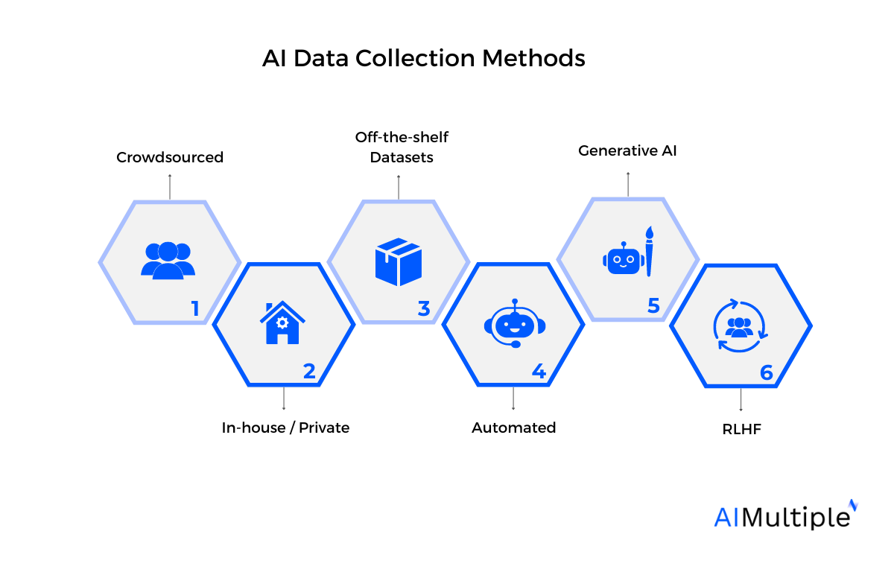{width="100%"}](#){data-modal-type="image" data-modal-url="figures/data-collection.png"}

Source: [AI Multiple](https://research.aimultiple.com/data-collection-methods/)

:::{style="background: rgba(45, 69, 99, 0.1); padding: 15px; border-radius: 10px; font-size: 21px; margin-top: 15px;"}
"If you're not paying for the product, you are the product." [Even paying customers]{.alert} are often the product
:::
:::
:::
:::
:::

## What can be inferred from your data?

:::{style="margin-top: 30px; font-size: 22px;"}
:::{.columns}
:::{.column width=55%}
**Research shows AI can predict:**

:::{style="font-size: 26px;"}
| Data source | Inferred |
|-------------|----------|
| [Facebook likes]{.alert} | Political views, sexuality, personality |
| [Smartphone sensors]{.alert} | Depression, anxiety, Parkinson's |
| [Typing patterns]{.alert} | Age, gender, emotional state |
| [Purchase history]{.alert} | Pregnancy, health conditions |
| [Location data]{.alert} | Home address, workplace, religion |
| [Voice recordings]{.alert} | Emotional state, health, age |
:::

**Example: Target and pregnancy**

- Target mailed baby coupons to a pregnant teen
- Her father complained: she was "still in high school"
- Days later, he apologised: she was pregnant
- [The algorithm knew before her family did]{.alert} ([NYT](https://www.nytimes.com/2012/02/19/magazine/shopping-habits.html))
:::

:::{.column width=45%}
:::{style="text-align: center;"}
[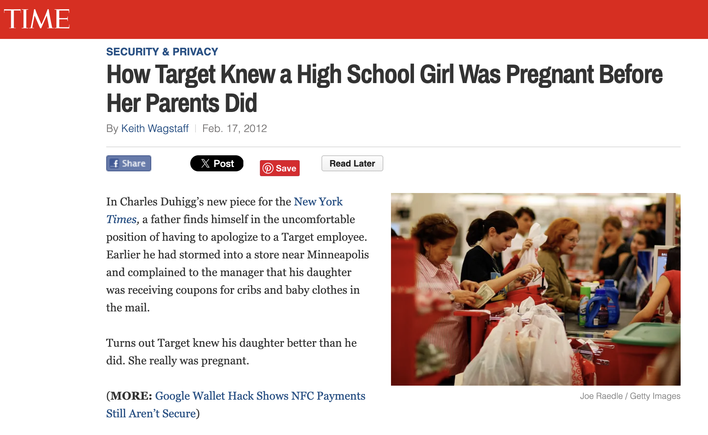{width="100%"}](#){data-modal-type="image" data-modal-url="figures/target.png"}

Source: [Time](https://web.archive.org/web/20130116004534/http://techland.time.com/2012/02/17/how-target-knew-a-high-school-girl-was-pregnant-before-her-parents/)

:::{style="background: rgba(230, 57, 70, 0.1); padding: 15px; border-radius: 10px; font-size: 21px; margin-top: 15px;"}
You can control what you share, but you [cannot control what can be inferred]{.alert} from it
:::
:::
:::
:::
:::

## Training data and privacy

:::{style="margin-top: 30px; font-size: 21px;"}
:::{.columns}
:::{.column width=55%}
**The training data problem:**

- Web-scale data includes [personal information]{.alert}
- Models can [memorise and regurgitate]{.alert} training data
- Your name, address or phone number may be in there

**Demonstrated attacks:**

- [Carlini et al. (2021)](https://arxiv.org/abs/2012.07805) pulled [verbatim data]{.alert} from GPT-2
- Leaked: names, phone numbers, emails
- Extraction attacks keep improving

**The consent problem:**

- Most people don't know what's in training sets
- "Publicly available" ≠ "consented to AI training"
:::

:::{.column width=45%}
:::{style="text-align: center;"}
[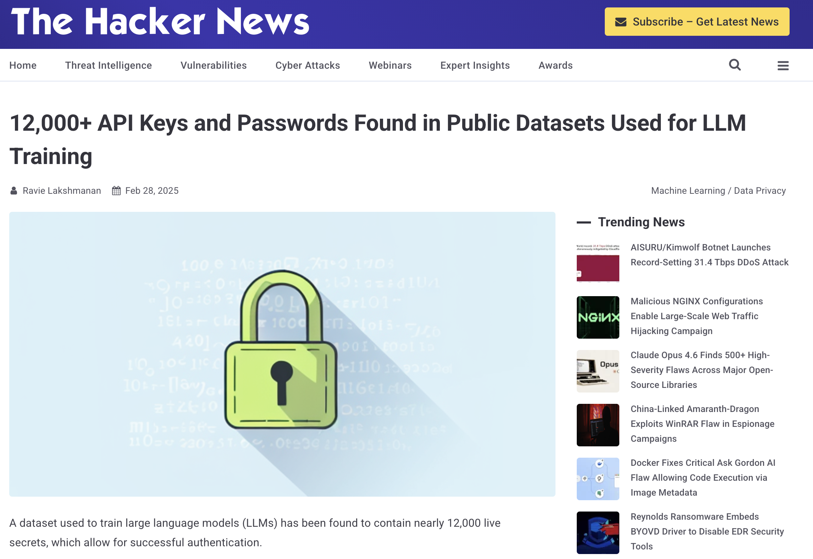{width="100%"}](#){data-modal-type="image" data-modal-url="figures/training-data.png"}

Source: [The Hacker News](https://thehackernews.com/2025/02/12000-api-keys-and-passwords-found-in.html)

:::{style="font-size: 18px; margin-top: 15px;"}
An LLM may [know things about you]{.alert} that you never told it
:::
:::
:::
:::
:::

## Discussion: would you share?

:::{style="margin-top: 30px; font-size: 24px;"}
:::{.columns}
:::{.column width=62%}
**Quick poll (raise your hand):**

Would you share your data if...

:::{.incremental}
1. A health app predicts disease but [sells data to insurers]{.alert}?
2. A smart speaker helps but [records all conversations]{.alert}?
3. A job site tailors results but [shares with employers]{.alert}?
4. A social app connects friends but [profiles you for ads]{.alert}?
5. An AI tutor helps you learn but [reports to your school]{.alert}?
:::
:::

:::{.column width=38%}
:::{.fragment}
**[The privacy paradox](https://www.sciencedirect.com/science/article/pii/S0736585317302022):**

- People value privacy but [share anyway]{.alert}

**Why?**

- Benefits come now, but harms come later
- Default settings favour sharing
- Terms of service are unreadable
- "Everyone does it"
- [We're bad at judging risk]{.alert}
:::
:::
:::
:::

# Legal frameworks {background-color="#1B3A6B"}

## GDPR fundamentals

:::{style="margin-top: 10px; font-size: 22px;"}
:::{.columns}
:::{.column width=62%}
The [General Data Protection Regulation]{.alert} ([2016/679](https://eur-lex.europa.eu/eli/reg/2016/679/oj/eng), in force since 2018) is the EU's comprehensive privacy law

**Main principles:**

1. [Lawfulness, fairness, transparency]{.alert}
2. [Purpose limitation]{.alert}: use data only for the stated purpose
3. [Data minimisation]{.alert}: collect only what's necessary
4. [Accuracy]{.alert}: keep data correct
5. [Storage limitation]{.alert}: delete it when no longer needed
6. [Integrity and confidentiality]{.alert}: protect data properly
7. [Accountability]{.alert}: demonstrate compliance

**Six lawful bases:** consent, contract, legal obligation, vital interests, public task and legitimate interests

- [Legitimate interests]{.alert} is the most contested basis
- Firms use it to skip consent, even for AI training
:::

:::{.column width=38%}
:::{style="text-align: center;"}
[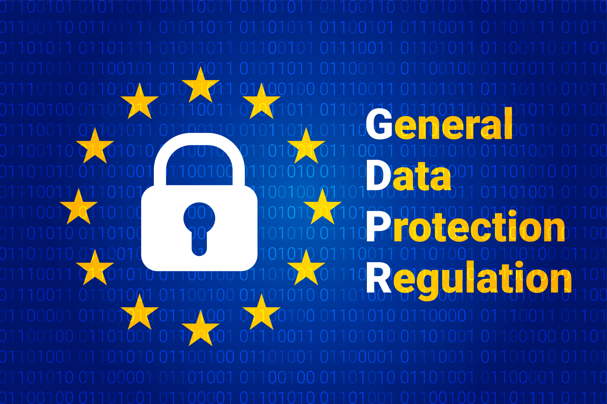{width="100%"}](#){data-modal-type="image" data-modal-url="figures/gdpr.jpg"}

:::{style="background: rgba(45, 69, 99, 0.1); padding: 15px; border-radius: 10px; font-size: 21px; margin-top: 15px;"}
Like the EU AI Act, GDPR covers anyone processing EU residents' data, [wherever they are]{.alert}. A US startup with EU users must comply
:::
:::
:::
:::
:::

## Individual rights under GDPR

:::{style="margin-top: 30px; font-size: 21px;"}
:::{.columns}
:::{.column width=55%}
**You have the right to:**

:::{style="font-size: 26px;"}
| Right | What it means |
|-------|---------------|
| [Access]{.alert} | Get a copy of your data |
| [Rectification]{.alert} | Correct inaccurate data |
| [Erasure]{.alert} | "Right to be forgotten" |
| [Portability]{.alert} | Move data to another service |
| [Restriction]{.alert} | Limit processing |
| [Object]{.alert} | Stop certain processing |
| [Automated decisions]{.alert} | Ask for a human in significant ones |
:::

**[Article 22](https://gdpr-info.eu/art-22-gdpr/): automated decisions**

- Right [not to be subject]{.alert} to purely automated decisions
- Consequential decisions need [human involvement]{.alert}
- Exceptions: contracts and explicit consent
:::

:::{.column width=45%}
:::{style="text-align: center;"}
[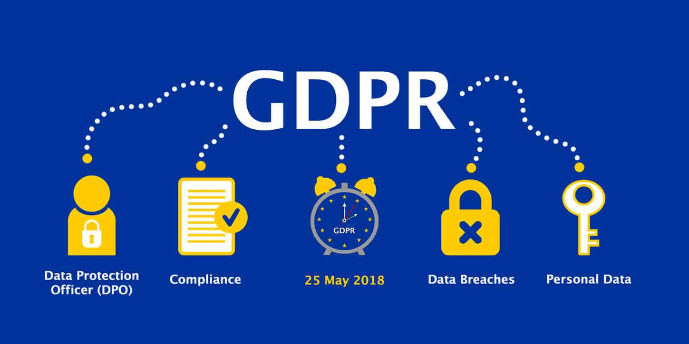{width="100%"}](#){data-modal-type="image" data-modal-url="figures/gdpr-02.jpg"}

Source: [GDPR.eu (Proton)](https://gdpr.eu/what-is-gdpr/)

:::{style="background: rgba(45, 69, 99, 0.1); padding: 15px; border-radius: 10px; font-size: 18px; margin-top: 15px;"}
**In practice**, [these rights are hard to use]{.alert}: firms hide forms, reply slowly or claim exemptions
:::
:::
:::
:::
:::

## GDPR and AI tensions

:::{style="margin-top: 30px; font-size: 24px;"}
:::{.columns}
:::{.column width=60%}
1. **Purpose limitation vs model training**
   - Can data given for X train a model for Y?
   - AI companies claim [legitimate interest]{.alert}
2. **Data minimisation vs big data**
   - AI wants more data; GDPR wants the minimum
   - What's "necessary" for an LLM? Everything?
3. **Right to explanation vs black boxes**
   - You can ask why an AI decided about you
   - Many AI systems [can't explain themselves]{.alert}
4. **Right to erasure vs model training**
   - Can you demand removal from a trained model?
   - "Unlearning" is technically hard
:::

:::{.column width=40%}
:::{style="text-align: center;"}
[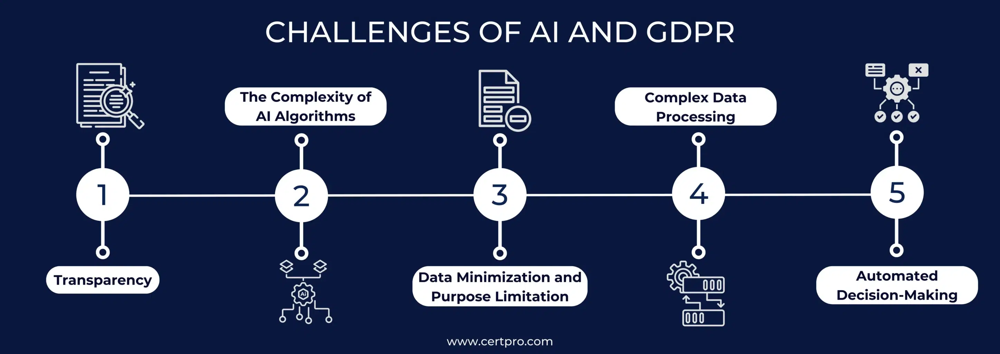{width="100%"}](#){data-modal-type="image" data-modal-url="figures/gdpr-ai.webp"}

Source: [CertPro](https://certpro.com/ai-and-gdpr/)

:::{style="font-size: 21px; margin-top: 15px;"}
GDPR predates LLMs; [applying 2018 law to 2026 technology]{.alert} raises open questions
:::
:::
:::
:::
:::

## US privacy landscape

:::{style="margin-top: 30px; font-size: 20px;"}
:::{.columns}
:::{.column width=55%}
**No comprehensive federal law**, just a [patchwork]{.alert} of sector rules:

:::{style="font-size: 25px;"}
| Law | Scope | Protects |
|-----|-------|----------|
| [HIPAA](https://www.hhs.gov/hipaa/index.html) | Healthcare data | Patient medical records |
| [FERPA](https://www2.ed.gov/policy/gen/guid/fpco/ferpa/index.html) | Education records | Student academic data |
| [COPPA](https://www.ftc.gov/legal-library/browse/rules/childrens-online-privacy-protection-rule-coppa) | Children's data | Under-13 online activity |
| [GLBA](https://www.ftc.gov/legal-library/browse/statutes/gramm-leach-bliley-act) | Financial data | Bank and loan records |
| [FCRA](https://www.ftc.gov/legal-library/browse/statutes/fair-credit-reporting-act) | Credit reporting | Credit scores and history |
| [ECPA](https://bja.ojp.gov/program/it/privacy-civil-liberties/authorities/statutes/1285) | Electronic comms | Emails, calls, stored data |
:::

**States fill the gap:**

- [[California (CCPA/CPRA)](https://oag.ca.gov/privacy/ccpa)]{.alert}: closest to GDPR
- [[Virginia](https://law.lis.virginia.gov/vacodefull/title59.1/chapter53/), [Colorado](https://coag.gov/resources/colorado-privacy-act/), [Connecticut](https://portal.ct.gov/ag/sections/privacy/the-connecticut-data-privacy-act)]{.alert}: similar frameworks
- [[Illinois BIPA](https://www.ilga.gov/legislation/ilcs/ilcs3.asp?ActID=3004&ChapterID=57)]{.alert}: biometric data; individuals can sue
- [[23 states](https://natlawreview.com/article/vermont-makes-23-states-comprehensive-data-privacy-laws)]{.alert} have such laws ([Vermont](https://legislature.vermont.gov/bill/status/2026/S.71) joined June 2026)
:::

:::{.column width=45%}
:::{style="text-align: center;"}
[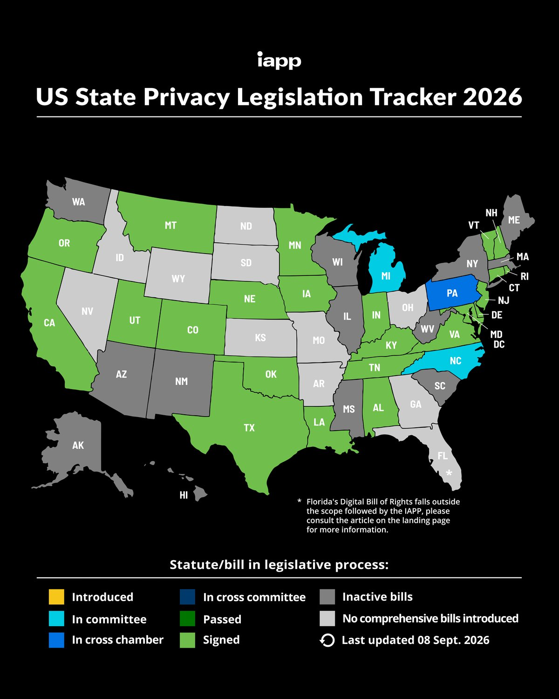{width="85%"}](#){data-modal-type="image" data-modal-url="figures/us-privacy-map.png"}

Source: [IAPP](https://iapp.org/resources/article/us-state-privacy-legislation-tracker)
:::
:::
:::
:::

## GDPR enforcement

:::{style="margin-top: 30px; font-size: 22px;"}
:::{.columns}
:::{.column width=60%}
**Selected major fines:**

| Company | Fine | Violation |
|---------|------|-----------|
| [Meta (2023)](https://www.edpb.europa.eu/news/news/2023/12-billion-euro-fine-facebook-result-edpb-binding-decision_en) | [€1.2B]{.alert} | Sent EU data to the US without adequate safeguards |
| [Amazon (2021)](https://dataprivacymanager.net/luxembourg-dpa-issues-e746-million-gdpr-fine-to-amazon/) | €746M | Targeted ads without valid consent ([fine annulled in 2026](https://ppc.land/luxembourg-court-annuls-amazons-eu746m-gdpr-fine-sends-case-back-to-regulator/), breach upheld) |
| [Meta (2022)](https://www.dataprotection.ie/en/news-media/press-releases/data-protection-commission-announces-decision-instagram-inquiry) | €405M | Exposed children's contact details on Instagram |
| [Google (2022)](https://www.cnil.fr/en/cookies-cnil-fines-google-total-150-million-euros-and-facebook-60-million-euros-non-compliance) | €150M | Made rejecting cookies harder than accepting them |
| [TikTok (2023)](https://www.dataprotection.ie/en/news-media/press-releases/DPC-announces-345-million-euro-fine-of-TikTok) | €345M | Failed to protect children's data and settings |

**Patterns:**

- Big tech is the main target
- Regulators focus on data transfers, consent and children
- Fines are [getting larger]{.alert}
- Enforcement varies; critics call Ireland's regulator slow
:::

:::{.column width=40%}
:::{style="text-align: center;"}
[{width="80%"}](#){data-modal-type="image" data-modal-url="figures/gdpr-fines.avif"}

Source: [Secureframe](https://secureframe.com/hub/gdpr/fines-and-penalties)

:::{style="font-size: 18px; margin-top: 15px;"}
Meta made [~$135 billion in 2023]{.alert}. Is €1.2B a fine or a cost of doing business?
:::
:::
:::
:::
:::

# Technical approaches to privacy {background-color="#1B3A6B"}

## Differential privacy

:::{style="margin-top: 30px; font-size: 22px;"}
:::{.columns}
:::{.column width=55%}
[Differential privacy]{.alert} adds random noise to results, so no one can tell if [you]{.alert} are in the data ([Dwork & Roth, 2014](https://www.cis.upenn.edu/~aaroth/Papers/privacybook.pdf))

- "How many patients have diabetes?" True answer: 137
- Released: 134 or 141, close enough for research
- Patterns stay visible, but individuals stay hidden

[Epsilon (ε)]{.alert} is set by the data owner before release:

- ε limits how much [one person]{.alert} can change a result
- Small ε (below 1): more noise, strong privacy
- Large ε (around 10): less noise, weak privacy
- Small ε: no one can tell if the count is 136 or 137
:::

:::{.column width=45%}
:::{style="text-align: center;"}
[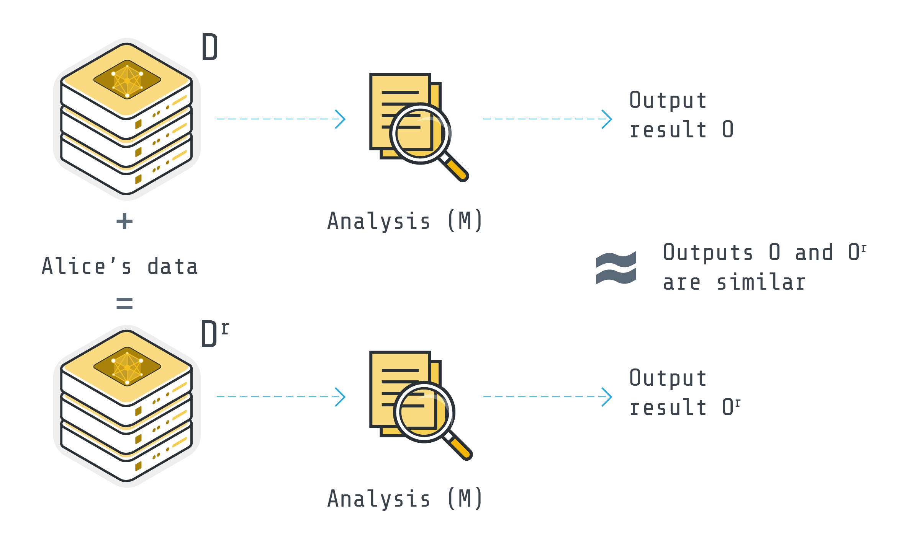{width="100%"}](#){data-modal-type="image" data-modal-url="figures/dp-intro.png"}

Source: [Flower AI](https://flower.ai/docs/framework/explanation-differential-privacy.html)

:::{style="background: rgba(45, 69, 99, 0.1); padding: 15px; border-radius: 10px; font-size: 21px; margin-top: 15px;"}
**Used by**: [Apple](https://machinelearning.apple.com/research/learning-with-privacy-at-scale) (emoji suggestions), [Google](https://research.google/pubs/rappor-randomized-aggregatable-privacy-preserving-ordinal-response/) (Chrome stats), [US Census](https://www.census.gov/newsroom/press-releases/2021/2020-census-key-parameters.html) (2020, ε = 19.61)
:::
:::
:::
:::
:::

## Federated learning

:::{style="margin-top: 15px; font-size: 23px;"}
:::{.columns}
:::{.column width=60%}
[Federated learning]{.alert} trains models without pooling the data ([McMahan et al., 2017](https://arxiv.org/abs/1602.05629))

**How it works:**

1. A server sends the [same model]{.alert} to many devices
2. Each device trains it on its [local data]{.alert}
3. Each returns only [what it learned]{.alert} (weights)
4. The server [averages]{.alert} updates and repeats

**Privacy gains and limits:**

- Raw data [never leaves your device]{.alert}
- Updates can still [leak information]{.alert}
- Coordinating thousands of devices is hard
:::

:::{.column width=40%}
:::{style="text-align: center;"}
<!-- Suggested image: Federated learning diagram -->
[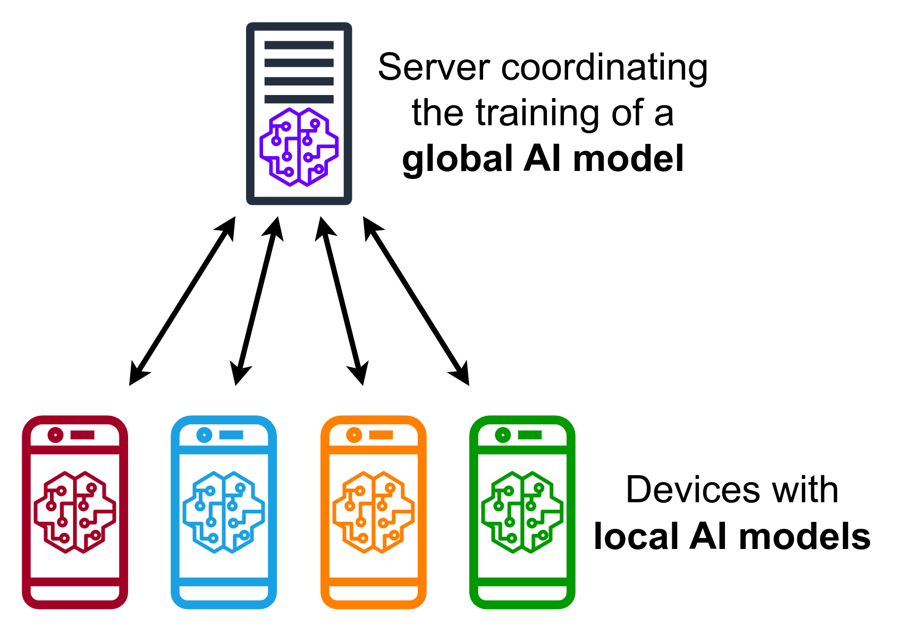{width="100%"}](#){data-modal-type="image" data-modal-url="figures/federated-learning.png"}

Source: [Wikipedia](https://en.wikipedia.org/wiki/Federated_learning)

:::{style="font-size: 21px; margin-top: 15px;"}
**Example**: Google's phone keyboard ([Gboard](https://research.google/blog/federated-learning-collaborative-machine-learning-without-centralized-training-data/)) learns from your typing, but your texts stay on your phone
:::
:::
:::
:::
:::

## Synthetic data for privacy

:::{style="margin-top: 30px; font-size: 24px;"}
:::{.columns}
:::{.column width=58%}
[Synthetic data]{.alert} looks real but isn't ([Jordon et al., 2022](https://arxiv.org/abs/2205.03257))

**How it works:**

- Train a generative model on real data
- Generate [new, fake records]{.alert}
- Train your AI on the fakes

**Benefits and limits:**

- Fewer direct links to real people
- But generators can still [[leak training records](https://www.usenix.org/conference/usenixsecurity22/presentation/stadler)]{.alert}
- Easier to share for research
- May [miss rare cases]{.alert}
:::

:::{.column width=42%}
:::{style="text-align: center;"}
<!-- Suggested image: Synthetic data illustration -->
[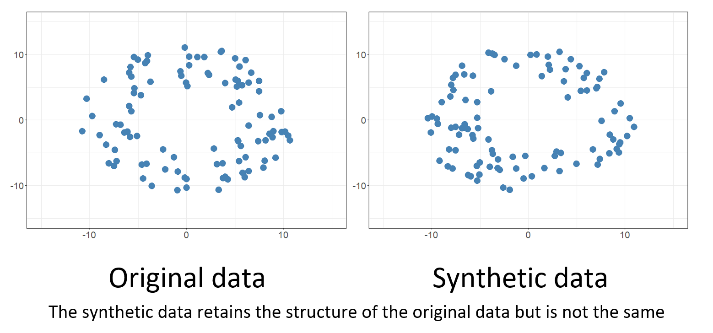{width="100%"}](#){data-modal-type="image" data-modal-url="figures/synthetic-data.png"}

Source: [GOV.UK](https://dataingovernment.blog.gov.uk/2020/08/20/synthetic-data-unlocking-the-power-of-data-and-skills-for-machine-learning/)

:::{style="background: rgba(45, 69, 99, 0.1); padding: 15px; border-radius: 10px; font-size: 21px; margin-top: 15px;"}
**Used by**: health researchers ([fake patient records](https://digital.nhs.uk/services/artificial-data)), banks ([fraud detection tests](https://www.jpmorgan.com/technology/artificial-intelligence/initiatives/synthetic-data))
:::
:::
:::
:::
:::

## Do these techniques actually help?

:::{style="margin-top: 30px; font-size: 22px;"}
:::{.columns}
:::{.column width=50%}
**What they can do:**

- Allow research on sensitive health data
- Give engineers concrete tools
- Differential privacy is [provable]{.alert}
- Federated learning keeps data [on the device]{.alert}

**What they cannot do:**

- Stop data collection in the first place
- Fix the [power imbalance]{.alert} with platforms
- Make users understand data use
:::

:::{.column width=50%}
**However:**

- The best protection is [not collecting data]{.alert}
- AI firms' logic: more data = more profit
- Technical fixes work *within* the system, not on it

:::{style="background: rgba(230, 57, 70, 0.1); padding: 15px; border-radius: 10px; font-size: 21px; margin-top: 15px;"}
**Beware "privacy washing"**: differential privacy with [large ε]{.alert} (weak privacy), or federated learning that still collects metadata
:::
:::
:::
:::

# Challenges and tensions {background-color="#1B3A6B"}

## Case study: Clearview AI

:::{style="margin-top: 30px; font-size: 22px;"}
:::{.columns}
:::{.column width=55%}
- Jan 2020: the [NYT](https://www.nytimes.com/2020/01/18/technology/clearview-privacy-facial-recognition.html) exposed [3 billion scraped photos]{.alert}
- Clearview now has over 70 billion social media photos
- It built a face search engine [without consent or notice]{.alert}
- Sold to [thousands of US police agencies]{.alert}
- Police ran [~1M searches](https://www.bbc.com/news/technology-65057011) by 2023

**Legal fallout:**

- The [ACLU sued](https://www.aclu.org/cases/aclu-v-clearview-ai) under [Illinois BIPA]{.alert} (2020)
- 2022 settlement [bans sales]{.alert} to most private firms
- [France (CNIL)](https://www.cnil.fr/en/facial-recognition-20-million-euros-penalty-against-clearview-ai) and [Italy](https://www.edpb.europa.eu/news/national-news/2022/facial-recognition-italian-sa-fines-clearview-ai-eur-20-million_en): €20M fine each
- [Netherlands](https://www.loc.gov/item/global-legal-monitor/2024-10-16/netherlands-face-recognition-company-clearview-ai-fined-for-violating-eus-general-data-protection-regulation/): €30.5M fine (2024)
- Australia, Canada: ordered to delete data
- UK: still in court
:::

:::{.column width=45%}
:::{style="text-align: center;"}
[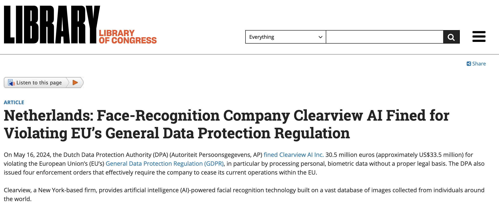{width="100%"}](#){data-modal-type="image" data-modal-url="figures/clearview-ai.png"}

Source: [Library of Congress](https://www.loc.gov/item/global-legal-monitor/2024-10-16/netherlands-face-recognition-company-clearview-ai-fined-for-violating-eus-general-data-protection-regulation/)

:::{style="background: rgba(230, 57, 70, 0.1); padding: 15px; border-radius: 10px; font-size: 21px; margin-top: 15px;"}
Sold as police-only, but accounts went to [retailers, banks and investors' friends]{.alert}. Critics call it a ["perpetual police line-up"](https://www.bbc.com/news/technology-65057011)
:::
:::
:::
:::
:::

## Quick quiz: what's wrong and how would you fix it? {#sec-privacy-quiz}

:::{style="margin-top: 100px; font-size: 28px;"}
:::{.incremental}
1. A social media company uses your messages to train an AI without telling you

2. A shopping app logs your location every 30 seconds, even when closed

3. A company keeps customer data "just in case" with no deletion policy

4. An AI hiring tool rejects candidates without any human review
:::

:::{style="margin-top: 40px; font-size: 18px;"}
[[Possible answers]{.button}](#sec-appendix-privacy-quiz)
:::
:::

## Where's your line? {#sec-wheres-your-line}

:::{style="margin-top: 30px; font-size: 22px;"}
:::{.columns}
:::{.column width=50%}
**Scenario:**

A new app offers free health monitoring. It tracks:

- Your heart rate and sleep
- Your location and activity
- What you eat and drink
- Your social interactions

In exchange, it provides:

- Personalised health advice
- Early warning of health issues
- Discounts from health insurers
- Connection with others like you
:::

:::{.column width=50%}
**Discuss:**

1. Would you use this app?
2. What would make you change your mind?
3. What data would be "too much"?
4. Does it matter if a firm, hospital or state runs it?

:::{style="background: rgba(45, 69, 99, 0.1); padding: 15px; border-radius: 10px; font-size: 18px; margin-top: 15px;"}
No right answer: [identify your own values]{.alert} and the trade-offs you'll accept
:::

:::{style="margin-top: 15px; font-size: 18px;"}
[[Points to raise]{.button}](#sec-appendix-wheres-your-line)
:::
:::
:::
:::

## What can you do?

:::{style="margin-top: 30px; font-size: 24px;"}
:::{.columns}
:::{.column width=55%}
**Individual actions:**

- Review your privacy settings
- Use [privacy tools]{.alert} ([Signal](https://signal.org/), [DuckDuckGo](https://duckduckgo.com/), [Firefox](https://www.mozilla.org/firefox/))
- Limit location sharing
- Use a different email for each service
- Use your [GDPR](https://gdpr-info.eu/art-15-gdpr/)/[CCPA](https://oag.ca.gov/privacy/ccpa) rights (access, deletion)
- Be [sceptical of "personalisation"]{.alert}

**Limits of individual action:**

- Opting out often means losing the service
- Privacy is [collective]{.alert}: others' data reveals yours
- The power imbalance is structural
:::

:::{.column width=45%}
**Collective action:**

- Back privacy laws
- Demand transparency from companies
- Support [EFF](https://www.eff.org/), [EPIC](https://epic.org/) or [noyb](https://noyb.eu/)
- Choose privacy-respecting services
- Vote for pro-privacy candidates

:::{style="background: rgba(45, 69, 99, 0.1); padding: 15px; border-radius: 10px; font-size: 18px; margin-top: 15px;"}
Signal over WhatsApp helps, but only [legislation]{.alert} changes how insurers use your health data
:::
:::
:::
:::

# Summary {background-color="#1B3A6B"}

## Main takeaways

:::{style="margin-top: 30px; font-size: 24px;"}
:::{.columns}
:::{.column width=55%}
**AI and privacy**

- [Collection at unprecedented scale]{.alert}
- [Inference]{.alert} makes "non-sensitive" data sensitive
- Models can memorise and leak personal data

**Legal frameworks**

- GDPR: comprehensive and rights-based; US: sectoral patchwork
- AI development and data protection [pull against each other]{.alert}

**Technical approaches**

- Noise, decentralised training, artificial data
- All have trade-offs
:::

:::{.column width=45%}
**Key insights**

- [Collection is the core problem]{.alert}
- The same data enables benefits and surveillance
- Privacy is [collective]{.alert}, not just individual
- Technical fixes don't address [power imbalances]{.alert}
- Rules and oversight decide whether data helps or harms
:::
:::
:::

# ... and that's all for today! 🎉 {background-color="#1B3A6B"}

# Appendix {background-color="#1B3A6B"}

## Quick quiz: possible answers {#sec-appendix-privacy-quiz}

:::{style="margin-top: 20px; font-size: 22px;"}
:::{.columns}
:::{.column width=50%}
**1. Messages used to train AI**

- Breaks [transparency]{.alert} and [purpose limitation]{.alert}
- Fix: tell users and ask for opt-in consent

**2. Location every 30 seconds**

- Breaks [data minimisation]{.alert}
- Fix: track only while the app is open
- Use approximate location where possible
:::

:::{.column width=50%}
**3. Data kept "just in case"**

- Breaks [storage limitation]{.alert}
- Old data adds breach risk for no benefit
- Fix: set retention periods, then delete

**4. Hiring tool with no human review**

- Breaks [GDPR Article 22]{.alert} on automated decisions
- Fix: a human reviews every rejection
- Candidates can ask why and contest it
:::
:::

:::{style="margin-top: 15px; font-size: 18px;"}
[[Back to the quiz]{.button}](#sec-privacy-quiz)
:::
:::

## Where's your line: points to raise {#sec-appendix-wheres-your-line}

:::{style="margin-top: 20px; font-size: 22px;"}
:::{.columns}
:::{.column width=50%}
**1. Would you use it?**

- The app is free, so your data likely pays for it
- [Insurer discounts]{.alert} can turn into higher premiums

**2. What would change your mind?**

- Data stays on your phone
- No sale to third parties
- Easy deletion when you quit
:::

:::{.column width=50%}
**3. What is "too much"?**

- Location, diet and sleep [reveal health conditions]{.alert}
- Social data exposes your friends too

**4. Who runs it?**

- Tech firm: ads and data sales
- Hospital: [HIPAA]{.alert} applies
- Most health apps fall [outside HIPAA]{.alert}
- Government: hard to opt out
:::
:::

:::{style="margin-top: 15px; font-size: 18px;"}
[[Back to the discussion]{.button}](#sec-wheres-your-line)
:::
:::
