```{r setup, include=FALSE}
options(htmltools.dir.version = FALSE)
library(knitr)
opts_chunk$set(
  prompt = T,
  fig.align="center",
  dpi=300,
  cache=T,
  engine.opts = list(bash = "-l")
  )

knit_hooks$set(
  prompt = function(before, options, envir) {
    options(
      prompt = if (options$engine %in% c('sh','bash', 'zsh')) '$ ' else 'R> ',
      continue = if (options$engine %in% c('sh','bash', 'zsh')) '$ ' else '+ '
      )
})

options(repos = c(CRAN = "https://cran.rstudio.com/"))

if (!require("fontawesome", character.only = TRUE)) {
  install.packages("fontawesome", dependencies = TRUE)
  library(fontawesome, character.only = TRUE)
}
```

# Welcome back! 💼 {background-color="#1B3A6B"}

## Recap of last class

:::{style="margin-top: 40px; font-size: 25px;"}
:::{.columns}
:::{.column width=50%}
- AI collects data at scale and [infers sensitive traits]{.alert}
- [EU data law (GDPR)]{.alert}: rights of access, erasure, portability
- US: [sectoral laws]{.alert} (health, finance) plus 23 state privacy laws
- [Differential privacy, federated learning, synthetic data]{.alert} help, with trade-offs
- Collected data can help people or [track them]{.alert}
- Today: [what does AI mean for jobs and the economy?]{.alert}
:::

:::{.column width=50%}
:::{style="text-align: center; margin-top: -30px;"}
[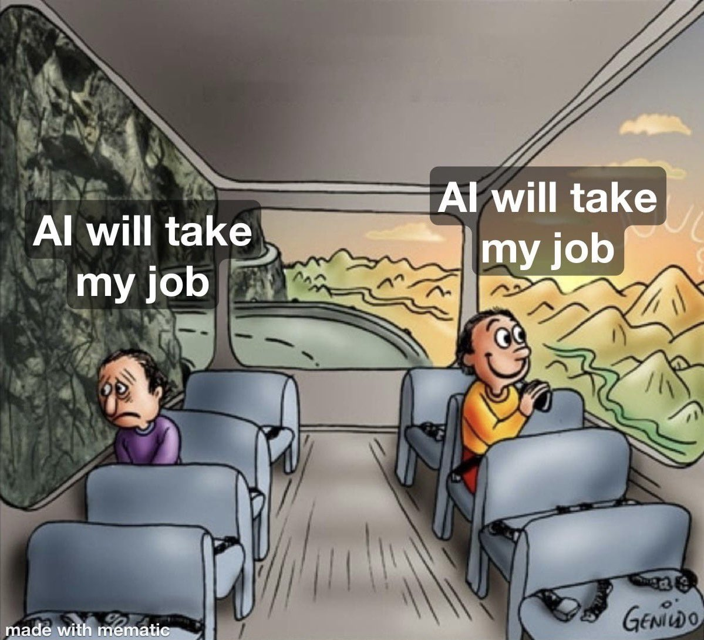{width="100%"}](#){data-modal-type="image" data-modal-url="figures/automation-worker.jpg"}

Source: [X.com](https://x.com/johnkoetsier/status/1603234885791285248)
:::
:::
:::
:::

## Lecture overview
### What we will cover today

:::{style="margin-top: 40px; font-size: 24px;"}

:::{.columns}
:::{.column width=50%}
[Part 1: The automation question]{.alert}

- Historical perspective on technology and jobs
- Why "this time might be different"
- Task-based framework for thinking about AI

[Part 2: Current evidence]{.alert}

- What are people using AI for?
- Productivity effects
- Early job market signals
:::

:::{.column width=50%}
[Part 3: Economic scenarios]{.alert}

- Optimistic views: augmentation and new tasks
- Pessimistic views: displacement and polarisation
- What economists think

[Part 4: What does this mean for you?]{.alert}

- Skills that may remain valuable
- Adapting to an AI-influenced economy
- The graduate job market in 2026
:::
:::
:::

## Meme of the day 😄

:::{style="text-align: center; margin-top: 40px;"}
[{width="40%"}](#){data-modal-type="image" data-modal-url="figures/ai-jobs-meme.webp"}

Source: [r/ProgrammerHumor](https://www.reddit.com/r/ProgrammerHumor/comments/11wozfs/finally_thanks_ai_s/)
:::

# The automation question {background-color="#1B3A6B"}

## This isn't the first time

:::{style="margin-top: 40px; font-size: 20px;"}
:::{.columns}
:::{.column width=55%}
**Historical fears of technological unemployment:**

:::{style="margin-top: 30px; margin-bottom: 30px;"}
| Era | Technology | Fear | Outcome |
|-----|------------|------|---------|
| 1810s | Power looms | [Luddites destroy machines](https://www.smithsonianmag.com/history/what-the-luddites-really-fought-against-264412/) | [Factory jobs grew, weavers' wages collapsed](https://shapingwork.mit.edu/research/research-insight-what-can-the-early-industrial-revolution-teach-us-about-technology-and-work-in-the-age-of-ai/) |
| 1930s | Mechanisation | [Keynes: "technological unemployment"](http://www.econ.yale.edu/smith/econ116a/keynes1.pdf) | [Post-war prosperity](https://en.wikipedia.org/wiki/Post%E2%80%93World_War_II_economic_expansion) |
| 1960s | Mainframes | [JFK warns of job losses](https://www.jfklibrary.org/archives/other-resources/john-f-kennedy-speeches/grand-rapids-mi-19600607) | [Service sector expansion](https://conversableeconomist.com/2014/12/01/automation-and-job-loss-the-fears-of-1964/) |
| 1990s | Personal computers | [Rifkin's *The End of Work* (1995)](https://en.wikipedia.org/wiki/The_End_of_Work) | [New jobs created](https://www.aeaweb.org/articles?id=10.1257/jep.33.2.3) |
| 2010s | Robots | [Manufacturing decline](https://www.technologyreview.com/2024/01/27/1087041/technological-unemployment-elon-musk-jobs-ai/) | [Local job and wage losses](https://www.nber.org/papers/w23285) |
:::

- Technology destroys some jobs and creates others
- The net effect has been [positive]{.alert} over time, but adjustment is painful
:::

:::{.column width=45%}
:::{style="text-align: center; margin-top: 30px;"}
[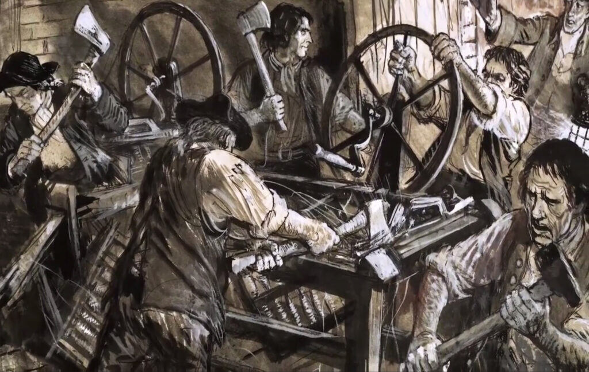{width="100%"}](#){data-modal-type="image" data-modal-url="figures/luddites.jpg"}

Source: [Current Affairs](https://www.currentaffairs.org/news/2021/06/the-luddites-were-right)

:::{style="background: rgba(45, 69, 99, 0.1); padding: 15px; border-radius: 10px; font-size: 18px; margin-top: 15px;"}
[So far, fears of mass unemployment haven't materialised]{.alert}. But past performance doesn't guarantee future results! 😅
:::
:::
:::
:::
:::

## Why this time might be different

:::{style="margin-top: 40px; font-size: 19px;"}
:::{.columns}
:::{.column width=55%}
**Previous automation:**

- Targeted [physical tasks]{.alert}, leaving thinking to humans
- Each machine did one task: a loom weaves, an ATM dispenses cash

**AI is different:**

- Targets [cognitive tasks]{.alert} too, including creative work
- One model writes essays, analyses data and makes images
- Improves [fast]{.alert}

**Counter-argument:**

- Similar claims were made before
- We keep underestimating how people adapt
- New tasks we can't imagine will emerge
:::

:::{.column width=45%}
:::{style="text-align: center;"}
[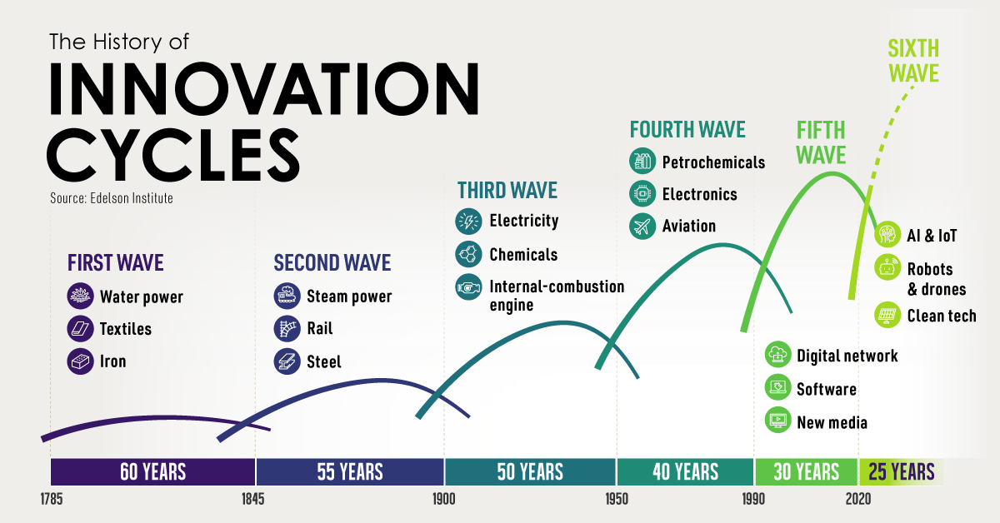{width="100%"}](#){data-modal-type="image" data-modal-url="figures/automation-waves.jpg"}

Source: [Edelson Institute](https://www.visualcapitalist.com/the-history-of-innovation-cycles/)

:::{style="font-size: 18px; margin-top: 15px;"}
AI will change work. We don't know [how fast]{.alert}, or [who loses out]{.alert} during the transition
:::
:::
:::
:::
:::

## Tasks vs jobs

:::{style="margin-top: 40px; font-size: 20px;"}
:::{.columns}
:::{.column width=55%}
**Task-based view ([Acemoglu & Restrepo, 2019](https://www.aeaweb.org/articles?id=10.1257/jep.33.2.3); [HBR explainer](https://hbr.org/2024/05/ai-is-making-economists-rethink-the-story-of-automation)):**

- Think about [tasks]{.alert} being automated, not [jobs]{.alert} being replaced
- Most jobs bundle many tasks, and [AI may automate only some]{.alert}

**Example: Lawyer**

:::{style="display: flex; justify-content: center; font-size: 26px;"}
| Task | AI capability |
|------|---------------|
| Document review | [High]{.alert} |
| Legal research | High |
| Contract drafting | Medium-high |
| Client counselling | Medium |
| Court appearance | Low |
| Negotiation | Low |
| Judgment calls | Low |
:::
:::

:::{.column width=45%}
**What changes for lawyers:**

- AI does the grunt work, so firms need fewer lawyers per case
- Lawyers shift to [counselling clients and arguing in court]{.alert}
- The job survives, but [what about the lawyers firms don't hire?]{.alert}

:::{style="text-align: center;"}
[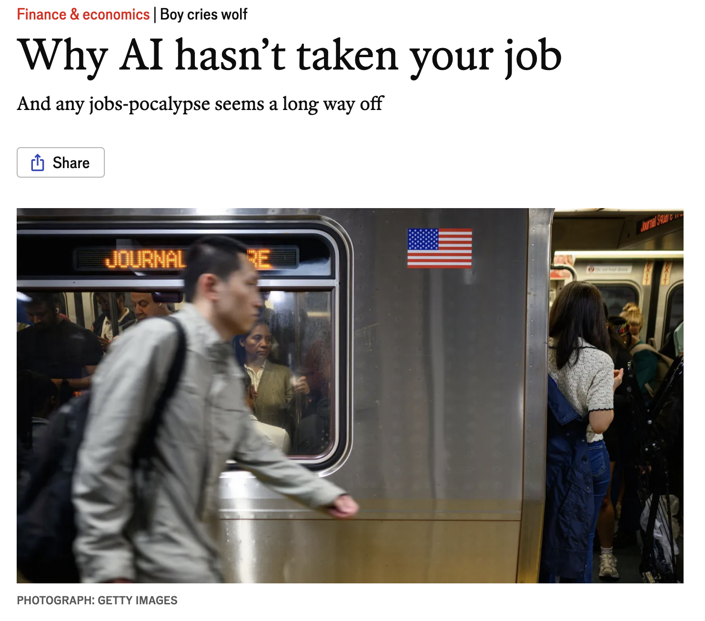{width="55%"}](#){data-modal-type="image" data-modal-url="figures/economist-ai-labour.png"}

Source: [The Economist](https://www.economist.com/finance-and-economics/2025/05/26/why-ai-hasnt-taken-your-job)
:::
:::
:::
:::

## Which tasks are most exposed?

:::{style="margin-top: 40px; font-size: 20px;"}
:::{.columns}
:::{.column width=55%}
**High exposure to AI:**

- Translation and summarisation
- Content generation (text, code, images)
- Data analysis and pattern recognition
- Customer service (text-based)

**Lower exposure (for now):**

- Unpredictable physical work (construction, plumbing)
- In-person work (nursing, firefighting)
- Real-time judgment (emergency medicine, crisis management)
- Close personal relationships (therapy, social work)
:::

:::{.column width=45%}
**Exposure by occupation** (it rises with wages, with exceptions):

:::{style="display: flex; justify-content: center; font-size: 26px;"}
| Occupation | Exposure |
|------------|----------|
| Telemarketers | Very high |
| Accountants | High |
| Paralegals | High |
| Software developers | Medium-high |
| Teachers | Medium |
| Nurses | Medium-low |
| Electricians | Low |
| Plumbers | Low |
:::

Source: [Eloundou et al. (2023)](https://arxiv.org/abs/2303.10130)
:::
:::
:::

# Current evidence {background-color="#1B3A6B"}

## What are people using AI for?

:::{style="margin-top: 40px; font-size: 20px;"}
:::{.columns}
:::{.column width=55%}
**[OpenAI's research on ChatGPT use (2025)](https://www.nber.org/system/files/working_papers/w34255/w34255.pdf):**

:::{style="display: flex; justify-content: center; font-size: 26px; margin-top: 30px; margin-bottom: 30px;"}
| Category | Jul 2024 | Jun 2025 |
|----------|----------|----------|
| Practical Guidance | ~29% | ~29% |
| Writing | ~36% | ~24% |
| Seeking Information | ~14% | ~24% |
| Technical Help | ~12% | ~5% |
| Multimedia | ~2% | ~7% |
:::

- Only [27% of use is work-related]{.alert}
- Work messages (Jun 2025): Writing ~40%, Practical Guidance ~24%, Technical Help ~10%
- Writing's share fell as people found other uses
- Technical help may have moved to coding tools (Copilot, Codex)
:::

:::{.column width=45%}
:::{style="text-align: center;"}
[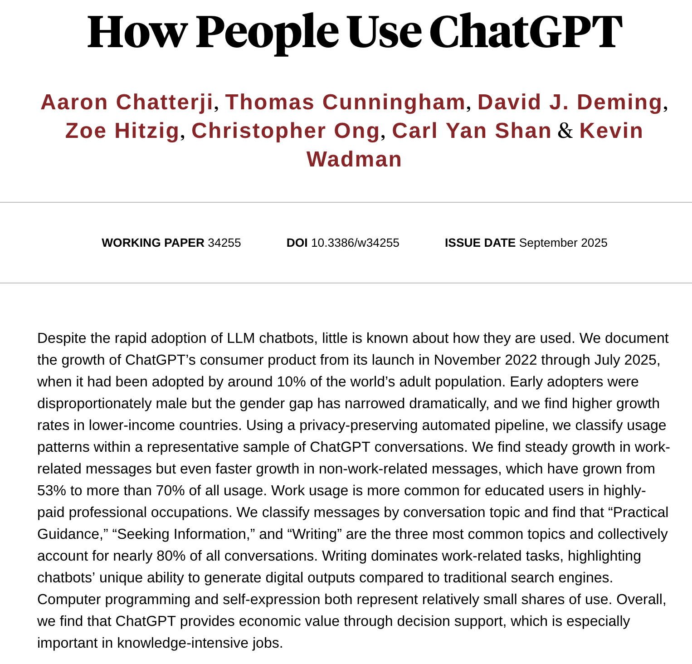{width="100%"}](#){data-modal-type="image" data-modal-url="figures/how-people-use-chatgpt.png"}

Source: [OpenAI (2025)](https://openai.com/index/how-people-are-using-chatgpt/)
:::
:::
:::
:::

## Productivity effects: early evidence

:::{style="margin-top: 40px; font-size: 20px;"}
:::{.columns}
:::{.column width=55%}
**Positive effects:**

- Customer service [(Brynjolfsson et al., 2025)](https://academic.oup.com/qje/article/140/2/889/7990658): 15% more productive, most for [novices]{.alert}
- Programmers [(GitHub, 2022)](https://github.blog/news-insights/research/research-quantifying-github-copilots-impact-on-developer-productivity-and-happiness/): 55% faster with Copilot
- Consultants [(BCG, 2023)](https://www.bcg.com/publications/2023/how-people-create-and-destroy-value-with-gen-ai): 40% better on tasks AI handles well
- Writers [(Noy & Zhang, 2023)](https://www.science.org/doi/10.1126/science.adh2586): 40% faster, 18% better quality

**Caveats:**

- Most studies are [short-term]{.alert}
- Often sponsored by AI companies
- Lab settings differ from real work
:::

:::{.column width=45%}
**Across studies:**

- [Novices gain more]{.alert} than experts, so skill gaps narrow
- Experts sometimes do worse with AI
- Benefits concentrated in [specific tasks]{.alert}

:::{style="text-align: center; margin-top: 15px;"}
[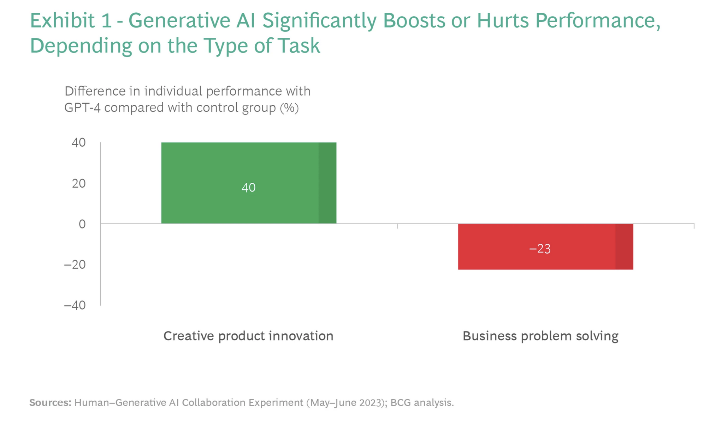{width="100%"}](#){data-modal-type="image" data-modal-url="figures/productivity-gains.png"}

Source: [Boston Consulting Group (2023)](https://www.bcg.com/publications/2023/how-people-create-and-destroy-value-with-gen-ai)
:::
:::
:::
:::

## The graduate job drought

:::{style="margin-top: 40px; font-size: 21px;"}
:::{.columns}
:::{.column width=55%}
**Evidence (2024-2026):**

- [Entry-level postings]{.alert} down sharply ([Rest of World](https://restofworld.org/2025/engineering-graduates-ai-job-losses/); [IEEE Spectrum](https://spectrum.ieee.org/ai-effect-entry-level-jobs))
- [Brynjolfsson et al. (2026)](https://digitaleconomy.stanford.edu/publication/canaries-in-the-coal-mine-six-facts-about-the-recent-employment-effects-of-artificial-intelligence/): 22-25 year-olds in AI-exposed jobs, employment [19% below]{.alert} less-exposed peers' trend

**UK ([Financial Times, 2026](https://www.ft.com/content/c89496b1-bc8d-425e-b86b-ec89402410e4)):**

- Graduate vacancies at their lowest outside the pandemic
- Hiring stabilised in autumn 2026 (+4%, [ISE](https://www.hrgrapevine.com/content/article/2026-10-15-graduate-jobs-stabilise-as-ai-misconduct-hits-record-high))

**Why employers cut junior roles:**

- AI does tasks juniors used to do
- AI needs no healthcare, holidays or mentoring
:::

:::{.column width=45%}
:::{style="text-align: center;"}
[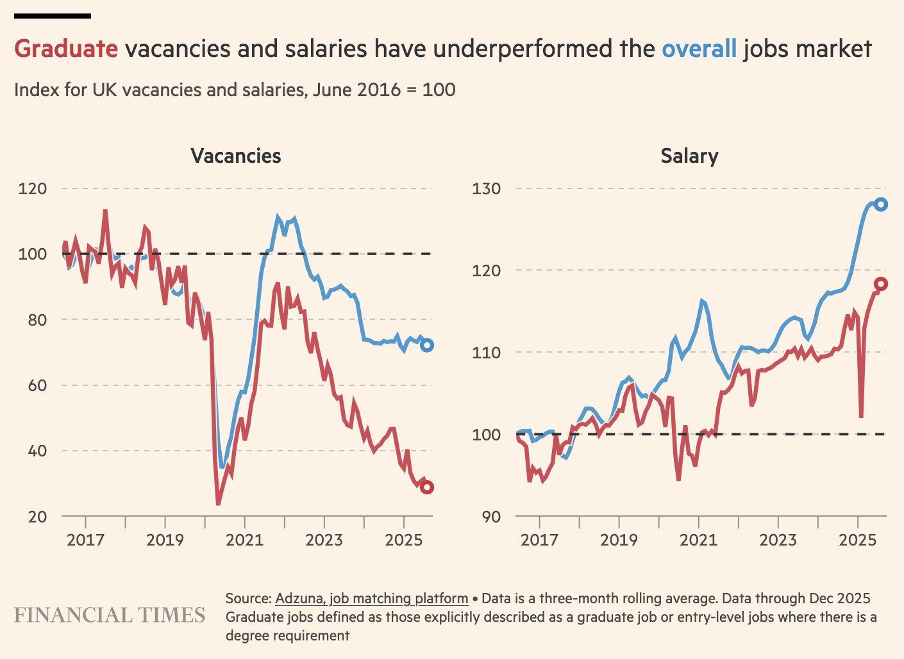{width="100%"}](#){data-modal-type="image" data-modal-url="figures/graduate-jobs.png"}

Source: [Financial Times (2026)](https://www.ft.com/content/c89496b1-bc8d-425e-b86b-ec89402410e4)

:::{style="background: rgba(230, 57, 70, 0.1); padding: 15px; border-radius: 10px; font-size: 18px; margin-top: 15px;"}
If companies replace junior roles with AI, [where do you get your first job?]{.alert}
:::
:::
:::
:::
:::

## But the aggregate numbers are confusing

:::{style="margin-top: 40px; font-size: 20px;"}
:::{.columns}
:::{.column width=55%}
**What we're not seeing (yet):**

- Mass unemployment
- Dramatic productivity surge
- Clear sectoral collapse

**What we are seeing:**

- [Slower hiring]{.alert} rather than mass firing
- Some sectors growing, others shrinking
- Effects concentrated in some regions
- [Young workers]{.alert} are hit, experienced ones much less

**Possible reasons:**

- Adoption takes time (most firms are still experimenting)
- Current AI handles many tasks poorly
- Regulation, contracts and inertia slow adoption
:::

:::{.column width=45%}
:::{style="text-align: center;"}
[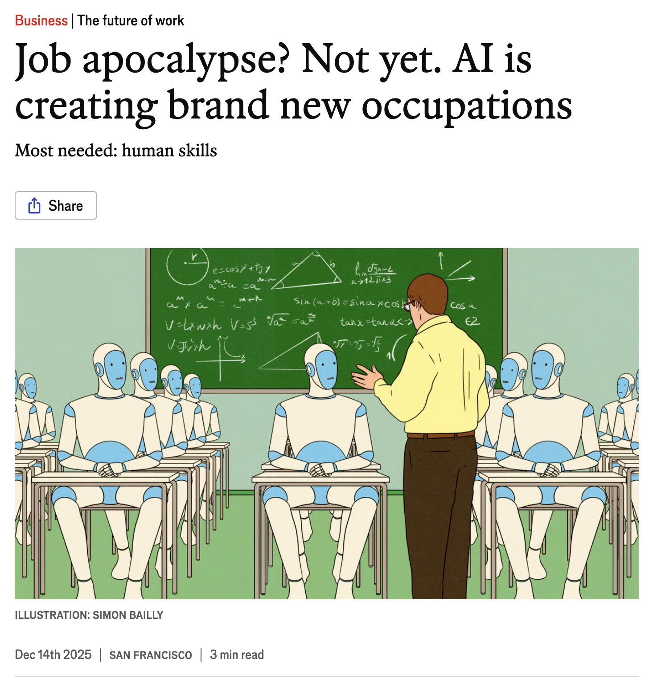{width="100%"}](#){data-modal-type="image" data-modal-url="figures/jobs-apocalypse.png"}

Source: [The Economist](https://www.economist.com/business/2025/12/14/job-apocalypse-not-yet-ai-is-creating-brand-new-occupations)
:::
:::
:::
:::


## What careful estimates show

:::{style="margin-top: 30px; font-size: 18px;"}
:::{.columns}
:::{.column width=50%}
**[Humlum & Vestergaard (2026)](https://www.nber.org/papers/w33777):**

- 25,000 Danish workers, 7,000 workplaces
- Surveys linked to [payroll records]{.alert}, not self-reports
- Compares adopters and non-adopters, before and after ChatGPT
- [No effect on earnings or hours]{.alert} after two years (rules out effects above 2%)
- Adopters saved about 3% of their hours (2025 estimate)

:::{style="text-align: center;"}
[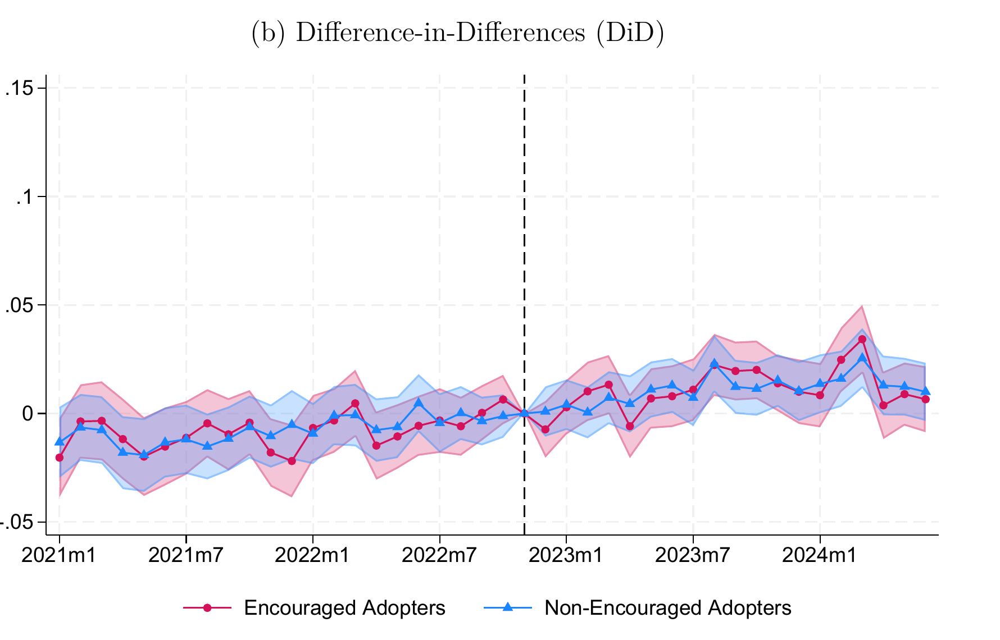{width="62%"}](#){data-modal-type="image" data-modal-url="figures/humlum-did.png"}

Source: [Humlum & Vestergaard (2026)](https://www.nber.org/papers/w33777)
:::
:::

:::{.column width=50%}
**[Yale Budget Lab tracker](https://budgetlab.yale.edu/research/tracking-impact-ai-labor-market):**

- Share of US workers by AI exposure (low, middle, high)
- Monthly CPS data to September 2026
- The three shares are [flat since 2023]{.alert}

:::{style="text-align: center;"}
[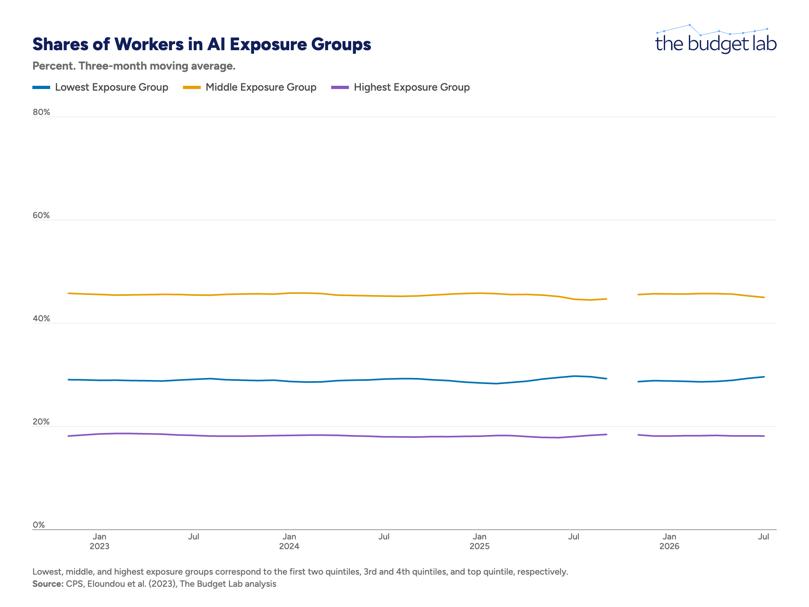{width="62%"}](#){data-modal-type="image" data-modal-url="figures/budgetlab-exposure.png"}

Source: [The Budget Lab at Yale (2026)](https://budgetlab.yale.edu/research/tracking-impact-ai-labor-market)
:::
:::
:::
:::

# Economic scenarios {background-color="#1B3A6B"}

## The optimistic view

:::{style="margin-top: 40px; font-size: 19px;"}
:::{.columns}
:::{.column width=55%}
**Augmentation:**

- AI makes workers [more productive]{.alert}
- Higher productivity → higher incomes → more demand → more jobs

**New tasks:**

- [New kinds of work]{.alert}: prompt engineering, AI training, oversight
- Jobs we can't imagine yet, like social media manager in 1990

**Past waves:**

- Technology has always created more jobs than it destroyed
- "Lump of labour fallacy": there isn't a fixed amount of work
:::

:::{.column width=45%}
:::{style="text-align: center;"}
[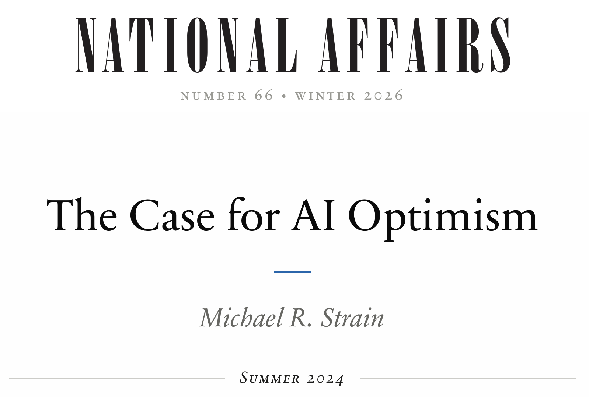{width="60%"}](#){data-modal-type="image" data-modal-url="figures/optimistic-future.png"}
[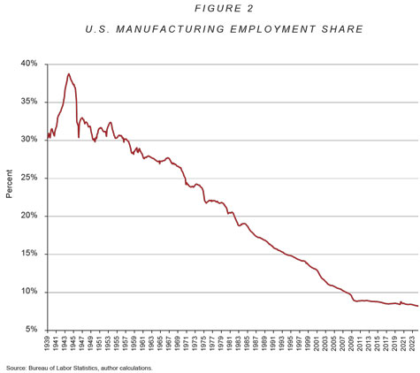{width="60%"}](#){data-modal-type="image" data-modal-url="figures/strainchart2verysmall.jpg"}

Source: [Michael R. Strain](https://nationalaffairs.com/publications/detail/the-case-for-ai-optimism)
:::
:::
:::
:::

## The pessimistic view

:::{style="margin-top: 40px; font-size: 21px;"}
:::{.columns}
:::{.column width=55%}
**Displacement:**

- AI replaces workers [faster than new jobs emerge]{.alert}
- The transition could be long, and many workers never recover
- Workers' skills don't match the new jobs

**Polarisation:**

- High-skill jobs pay more
- Low-skill service jobs persist (hard to automate)
- The middle is [hollowed out]{.alert}, so inequality rises

**Who gains:**

- Productivity gains go to [capital (owners), not labour (workers)]{.alert}
- Wages race to the bottom
:::

:::{.column width=45%}
:::{style="text-align: center;"}
[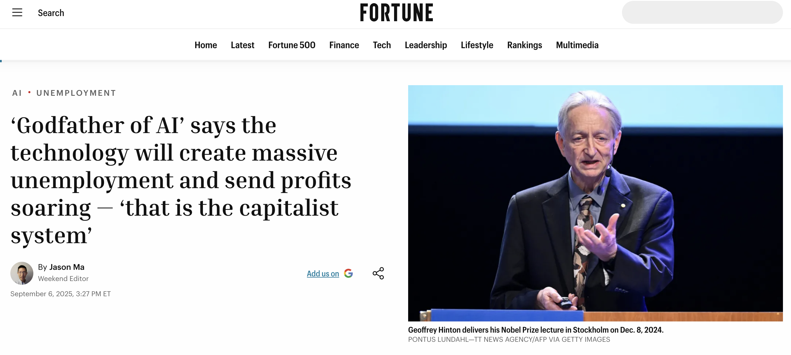{width="100%"}](#){data-modal-type="image" data-modal-url="figures/pessimistic-future-02.png"}

Source: [Fortune](https://fortune.com/2025/09/06/godfather-of-ai-geoffrey-hinton-massive-unemployment-soaring-profits-capitalist-system/)

:::{style="background: rgba(230, 57, 70, 0.1); padding: 15px; border-radius: 10px; font-size: 18px; margin-top: 15px;"}
Pessimists note that the horse population never recovered from the car. [What if we are the horses?]{.alert}
:::
:::
:::
:::
:::

## What economists think

:::{style="margin-top: 40px; font-size: 19px;"}
:::{.columns}
:::{.column width=55%}
**Economist polls ([Clark Center, 2023](https://kentclarkcenter.org/surveys/ai-and-the-labor-market/) and [2026](https://kentclarkcenter.org/surveys/ai-work-and-education/)):**

- Most are [uncertain]{.alert} whether AI will raise inequality (10 agree, 19 uncertain, 3 disagree)
- Few expect a [big rise in unemployment]{.alert} (5 agree, 25 uncertain, 11 disagree)
- Most expect [less certain returns]{.alert} to education (27 of 41 agree)

**MIT economists:**

- [Acemoglu (2025)](https://economics.mit.edu/sites/default/files/2024-04/The%20Simple%20Macroeconomics%20of%20AI.pdf): AI adds at most [~0.7% to productivity]{.alert} over 10 years
- [Acemoglu, Autor & Johnson (2023)](https://shapingwork.mit.edu/research/can-we-have-pro-worker-ai/): AI now leans to [replacing]{.alert} workers rather than [augmenting]{.alert} them, but policy can shift it

**[Jones (2026)](https://web.stanford.edu/~chadj/AIandEconomicFuture.pdf), on leave at Anthropic:**

- Growth is held back by [weakest links]{.alert}: tasks AI can't do yet
- Big gains may take [decades]{.alert}, giving workers time to adjust
:::

:::{.column width=45%}
:::{style="text-align: center;"}
[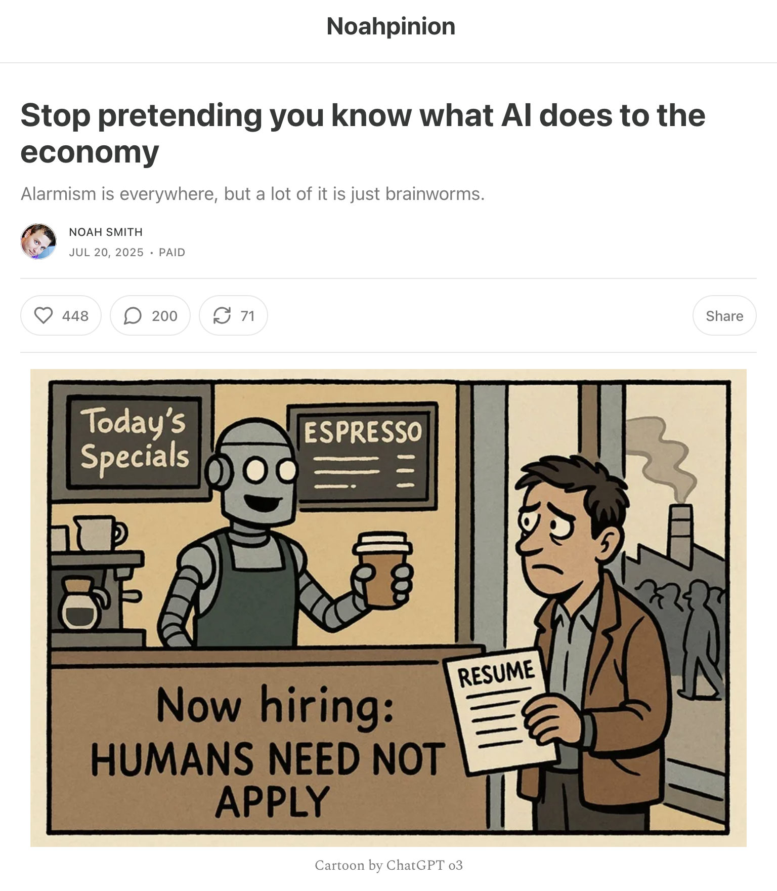{width="60%"}](#){data-modal-type="image" data-modal-url="figures/dont-know.png"}

Source: [Noah Smith](https://www.noahpinion.blog/p/stop-pretending-you-know-what-ai)

:::{style="background: rgba(45, 69, 99, 0.1); padding: 15px; border-radius: 10px; font-size: 18px; margin-top: 15px;"}
[Nobody knows.]{.alert} Anyone who claims certainty is [selling something]{.alert}. The range of possible outcomes is very wide
:::
:::
:::
:::
:::

## Discussion: your predictions

:::{style="margin-top: 40px; font-size: 25px;"}
:::{.columns}
:::{.column width=50%}
**Quick exercise:**

Think about a job you might want after graduation

1. List 3-4 main tasks in that job
2. For each task, could AI do it?
   - Now?
   - In 1 year?
   - In 5 years?
3. What tasks would remain human?
4. How might the job change rather than disappear?
:::

:::{.column width=50%}
**Share with us!**

- What job did you pick?
- Which tasks seemed most automatable?
- Which seemed most human?
- Did this make you more or less worried?
:::
:::
:::

# What does this mean for you? {background-color="#1B3A6B"}

## Skills that may remain valuable

:::{style="margin-top: 40px; font-size: 20px;"}
:::{.columns}
:::{.column width=55%}
**Social skills ([Deming, 2017](https://academic.oup.com/qje/article-abstract/132/4/1593/3861633)):**

- [Building relationships]{.alert} and trust
- Emotional intelligence
- Cultural and contextual judgment

**Knowing how to work with AI ([WEF Future of Jobs Report, 2025](https://www.weforum.org/publications/the-future-of-jobs-report-2025/)):**

- When to use it, and when not to
- [Checking AI outputs]{.alert} critically
- Asking the right questions (garbage in, garbage out)

**Domain expertise ([McKinsey, 2025](https://www.mckinsey.com/mgi/our-research/agents-robots-and-us-skill-partnerships-in-the-age-of-ai)):**

- [Judgment in novel situations]{.alert}
- Ethical reasoning and values
- Taking responsibility for decisions
:::

:::{.column width=45%}
:::{style="text-align: center;"}
[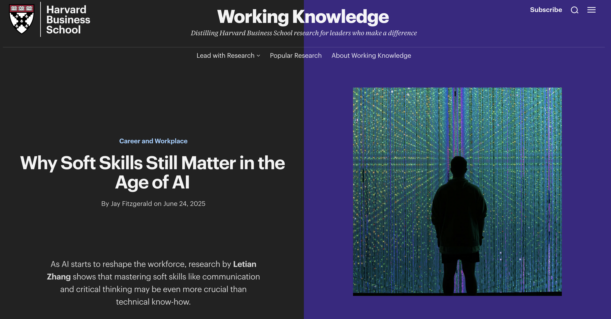{width="100%"}](#){data-modal-type="image" data-modal-url="figures/valuable-skills.png"}

Source: [Harvard Business School](https://www.library.hbs.edu/working-knowledge/why-soft-skills-still-matter-in-the-age-of-ai)

:::{style="background: rgba(45, 69, 99, 0.1); padding: 15px; border-radius: 10px; font-size: 18px; margin-top: 15px;"}
["Soft skills"]{.alert}, once dismissed as fluffy, may be the hardest to automate
:::
:::
:::
:::
:::

## Adapting to an AI-influenced economy

:::{style="margin-top: 40px; font-size: 19px;"}
:::{.columns}
:::{.column width=55%}
**Be AI-literate:**

- Know what AI can and can't do
- Use the tools well and spot the hype
- [This course is a start!]{.alert} 🤓

**Build skills that complement AI:**

- [Orchestration]{.alert}: directing, checking and combining AI outputs
- Don't over-specialise too early

**Keep perspective:**

- Your career will last 40+ years, and AI in 2066 will look very different
- [Learning how to learn]{.alert} beats any specific prediction
:::

:::{.column width=45%}
:::{style="text-align: center;"}
[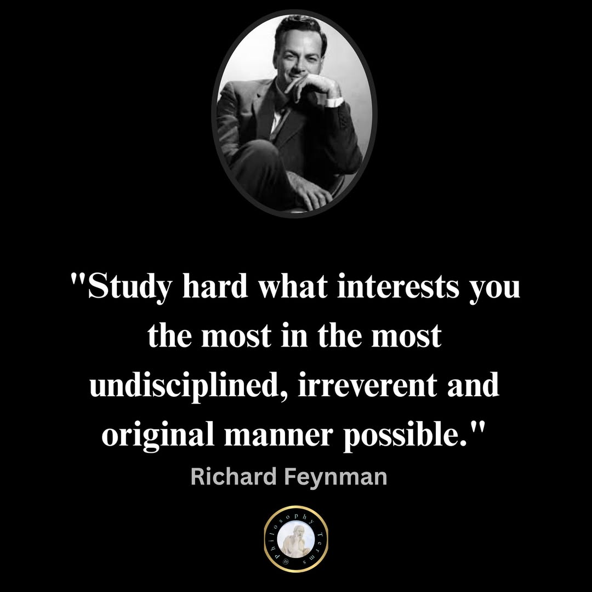{width="100%"}](#){data-modal-type="image" data-modal-url="figures/feynman.jpg"}

:::{style="font-size: 18px; margin-top: 15px;"}
[Become someone who can keep learning]{.alert}!
:::
:::
:::
:::
:::

## The graduate market in 2026

:::{style="margin-top: 40px; font-size: 21px;"}
:::{.columns}
:::{.column width=55%}
- Entry-level hiring is down in [AI-exposed jobs]{.alert}, so competition is intense
- A degree alone is no longer enough

**How to prepare:**

- Build [applied projects]{.alert} that show you use AI well (a portfolio beats a transcript)
- Get internships or work experience while you can
- [Build a network]{.alert} (still a human activity!)
- Be open to non-traditional paths
:::

:::{.column width=45%}
:::{style="background: rgba(45, 69, 99, 0.1); padding: 15px; border-radius: 10px; font-size: 20px; margin-top: 40px;"}
The job market [changed while you were in university]{.alert}, and that is hard. Learning to [work with AI]{.alert} helps
:::

:::{style="text-align: center; margin-top: 15px;"}
[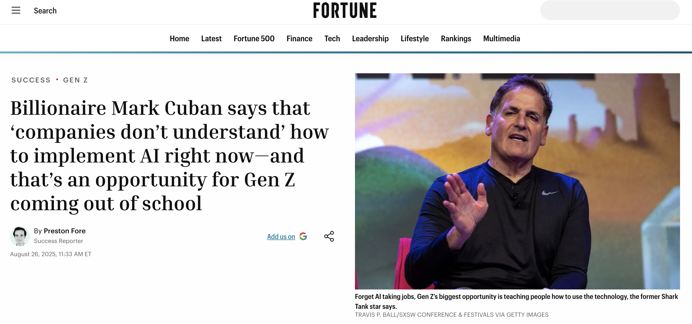{width="80%"}](#){data-modal-type="image" data-modal-url="figures/mark-cuban.png"}

Source: [Fortune](https://fortune.com/2025/08/26/billionaire-mark-cuban-gen-z-job-opportunity-teach-ai-implementation-companies-struggles-to-understand-future-of-work-former-shark-tank-star/)
:::
:::
:::
:::

## What would you advise?

:::{style="margin-top: 40px; font-size: 24px;"}
:::{.columns}
:::{.column width=50%}
**Scenario:**

Your younger sibling is about to start university. They ask:

> "What should I study? I keep hearing AI will take all the jobs. Should I even bother with a degree? What career should I aim for?"

- What would you tell them?
- What field would you recommend?
- What skills should they prioritise?
- How would you address their anxiety?
:::

:::{.column width=50%}
**Points to discuss:**

- Education is more than job training
- Chasing "hot" fields is risky
- Nobody can predict the job market
:::
:::
:::

# Summary {background-color="#1B3A6B"}

## Main takeaways

:::{style="margin-top: 40px; font-size: 22px;"}
:::{.columns}
:::{.column width=55%}
**What we know**

- Past automation was [net positive]{.alert} over time
- AI exposes [cognitive tasks]{.alert} too
- Productivity gains are real but task-specific
- No [aggregate effect]{.alert} on earnings or hours yet
- [Entry-level hiring]{.alert} takes the first hit
- [Policy]{.alert} can push AI toward augmentation

**What we don't know**

- Augmentation or displacement?
- How long the transition takes
- Who loses out
:::

:::{.column width=45%}
**For your career**

- Think [tasks, not jobs]{.alert}
- Complement AI rather than compete with it
- Adaptability beats any specific bet on the future

:::{style="background: rgba(45, 69, 99, 0.1); padding: 15px; border-radius: 10px; margin-top: 15px; font-size: 18px;"}
Nobody predicted "YouTuber" in 1990. The jobs of 2036 probably don't have names yet!
:::
:::
:::
:::

# ... and that's all for today! {background-color="#1B3A6B"}
