```{r setup, include=FALSE}
options(htmltools.dir.version = FALSE)
library(knitr)
opts_chunk$set(
  prompt = T,
  fig.align="center",
  dpi=300,
  cache=T,
  engine.opts = list(bash = "-l")
  )

knit_hooks$set(
  prompt = function(before, options, envir) {
    options(
      prompt = if (options$engine %in% c('sh','bash', 'zsh')) '$ ' else 'R> ',
      continue = if (options$engine %in% c('sh','bash', 'zsh')) '$ ' else '+ '
      )
})

options(repos = c(CRAN = "https://cran.rstudio.com/"))

if (!require("fontawesome", character.only = TRUE)) {
  install.packages("fontawesome", dependencies = TRUE)
  library(fontawesome, character.only = TRUE)
}
```

# Welcome back! {background-color="#1B3A6B"}

## Recap of last class

:::{style="margin-top: 40px; font-size: 26px;"}
:::{.columns}
:::{.column width=50%}
- AI targets [cognitive tasks]{.alert}, not just physical ones
- Automation displaces [tasks, not whole jobs]{.alert} (Acemoglu & Restrepo)
- Careful estimates find [no effect on earnings or hours]{.alert} so far
- [Young workers]{.alert} in AI-exposed jobs take the first hit
- Today: how AI affects [attention, mental health and the environment]{.alert}
:::

:::{.column width=50%}
:::{style="text-align: center; margin-top: -30px;"}
[{width="100%"}](#){data-modal-type="image" data-modal-url="figures/ai-interview.jpg"}

Source: [China Daily](https://www.chinadailyhk.com/hk/article/335124)
:::
:::
:::
:::

## Lecture overview
### Today's agenda

:::{style="margin-top: 40px; font-size: 24px;"}

:::{.columns}
:::{.column width=50%}
[Part 1: The attention economy]{.alert}

- "Your attention is the product"
- How recommendation algorithms work
- Filter bubbles and teen screen time
- What platforms are changing

[Part 2: AI and mental health]{.alert}

- Who gets mental health care?
- Chatbots in therapy and the evidence
- Risks and hard limits
- Augmentation, not replacement
:::

:::{.column width=50%}
[Part 3: AI and the environment]{.alert}

- Energy and water costs
- Footprint in context
- AI as a climate tool

We will pause for discussion after each part

There are no right answers to the questions I put on screen. I'm curious what you think!
:::
:::
:::

## (Sad) meme of the day

:::{style="text-align: center; margin-top: 30px;"}
[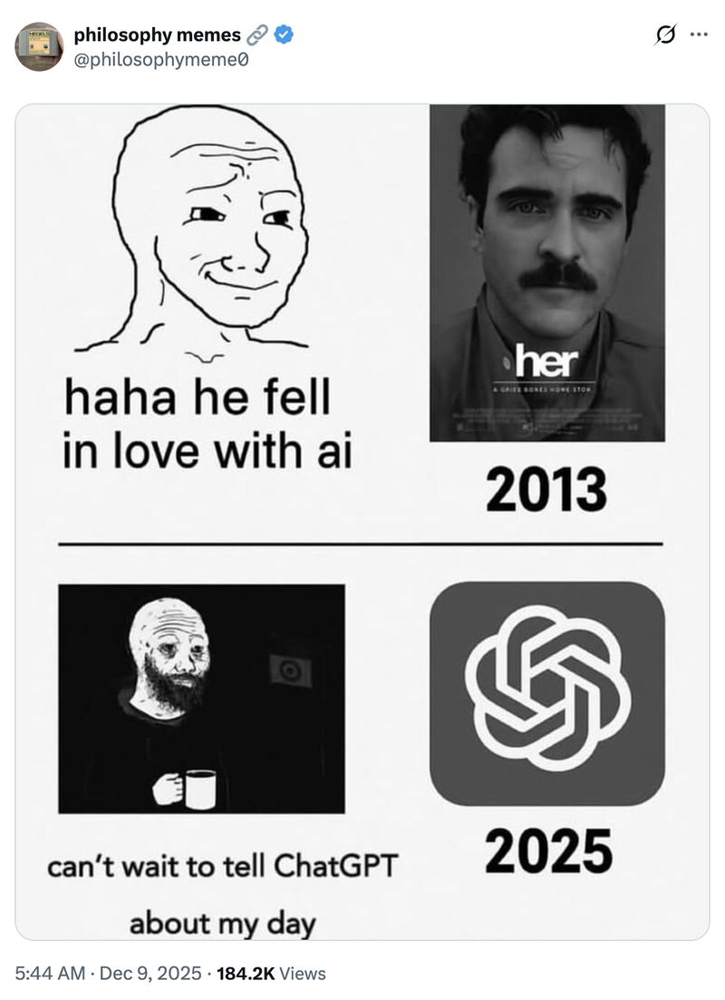{width="33%"}](#){data-modal-type="image" data-modal-url="figures/meme-of-the-day.jpg"}
:::

# The attention economy {background-color="#1B3A6B"}

## What is the attention economy?

:::{style="margin-top: 40px; font-size: 24px;"}
:::{.columns}
:::{.column width=55%}
- [Herbert Simon (1971)](https://gwern.net/doc/design/1971-simon.pdf): information-rich environments create [attention-poor]{.alert} ones
- [Your time is the scarce resource]{.alert} ([Becker, 1965](https://academic.oup.com/ej/article-abstract/75/299/493/5250146))
- Platforms [sell your attention to advertisers]{.alert}, as TV and newspapers did
- [Tristan Harris](https://www.cbsnews.com/news/what-is-brain-hacking-tech-insiders-on-why-you-should-care/) (ex-Google): "the race to the bottom of the brainstem"
- [Algorithms maximise engagement]{.alert}, not truth or wellbeing
- [*The Attention Merchants*](https://www.goodreads.com/book/show/28503628-the-attention-merchants) (Wu, 2016) traces this from 19th-century papers to social media
:::

:::{.column width=45%}
:::{style="text-align: center; margin-top: -30px;"}
[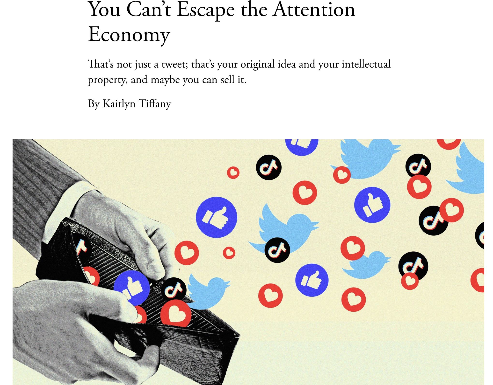{width="100%"}](#){data-modal-type="image" data-modal-url="figures/attention-economy.png"}

Source: [The Atlantic](https://www.theatlantic.com/technology/archive/2021/06/how-memes-become-money/619189/)
:::

:::{style="background: rgba(45, 69, 99, 0.1); padding: 15px; border-radius: 10px; font-size: 20px; margin-top: 15px;"}
Does the [incentive structure produce good outcomes]{.alert} regardless of intent?
:::
:::
:::
:::

## How recommendation algorithms work

:::{style="margin-top: 40px; font-size: 23px;"}
:::{.columns}
:::{.column width=55%}
1. You watch, like, or share something
2. It builds an embedding of "you" from your behaviour ([lecture 06](https://danilofreire.github.io/datasci101/lectures.html#module-2-language-and-perception))
3. It compares your vector to [what similar users watched next]{.alert}
4. It recommends what they watched
5. You watch, the embedding updates, and the loop repeats

- [Engagement]{.alert} = watch time, clicks, shares
- TikTok learned bots' interests in [under 2 hours]{.alert} from how long they lingered ([WSJ, 2021](https://www.wsj.com/articles/tiktok-algorithm-video-investigation-11626877477))
- YouTube autoplay chains videos by design
:::

:::{.column width=45%}
:::{style="text-align: center; margin-top: -40px;"}
[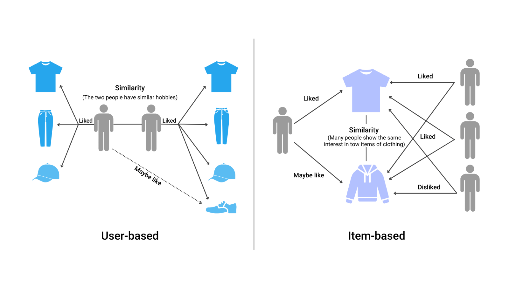{width="100%"}](#){data-modal-type="image" data-modal-url="figures/recommendation-loop.webp"}

Source: [Data Science Dojo](https://datasciencedojo.com/blog/social-media-recommendation-system/)

:::{style="font-size: 20px; margin-top: 10px;"}
Every swipe teaches the algorithm something about you
:::
:::

:::{style="background: rgba(230, 57, 70, 0.1); padding: 15px; border-radius: 10px; font-size: 20px; margin-top: 15px;"}
These systems have [no concept of "healthy" consumption]{.alert}. They optimise the objective they are given
:::
:::
:::
:::

## Filter bubbles: real or exaggerated?

:::{style="margin-top: 40px; font-size: 24px;"}
:::{.columns}
:::{.column width=55%}
- [Eli Pariser](https://www.ted.com/talks/eli_pariser_beware_online_filter_bubbles) coined "filter bubble" in 2010: feeds that only confirm your views
- Two large experiments suggest it is [probably overstated]{.alert}
- [Nyhan et al. (2023, *Nature*)](https://www.nature.com/articles/s41586-023-06297-w): cutting like-minded Facebook content [barely changed]{.alert} polarisation
- [Guess et al. (2023, *Science*)](https://www.science.org/doi/10.1126/science.abp9364): a chronological feed made [little difference]{.alert} to attitudes
- Effects beyond polarisation (anxiety, body image, sleep) are [still debated]{.alert}
:::

:::{.column width=45%}
:::{style="text-align: center;"}
[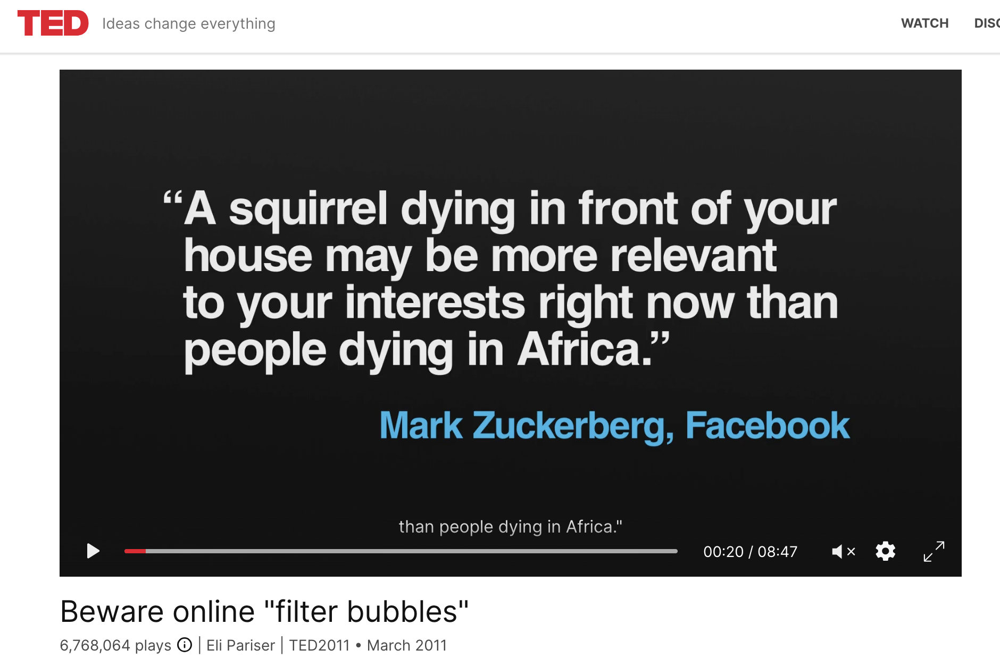{width="100%"}](#){data-modal-type="image" data-modal-url="figures/filter-bubble.png"}

Source: [Eli Pariser (2011)](https://www.ted.com/talks/eli_pariser_beware_online_filter_bubbles)
:::

:::{style="background: rgba(45, 69, 99, 0.1); padding: 15px; border-radius: 10px; font-size: 20px; margin-top: 15px;"}
Good news on polarisation. Mental health is [a separate, contested question]{.alert}
:::
:::
:::
:::

## Engagement vs wellbeing

:::{style="margin-top: 40px; font-size: 24px;"}
:::{.columns}
:::{.column width=55%}
- YouTube [moved](https://blog.youtube/inside-youtube/on-youtubes-recommendation-system/) from clicks (2011) to watch time (2012), then added satisfaction surveys
- Outrage spreads: each moral-emotional word raised retweets [~20%]{.alert} ([Brady et al., 2017, *PNAS*](https://www.pnas.org/doi/10.1073/pnas.1618923114))
- Algorithms learn this and show more of it
- [Facebook's own research (2021, *WSJ*)](https://www.wsj.com/articles/facebook-knows-instagram-is-toxic-for-teen-girls-company-documents-show-11631620739): Instagram made [body image worse for teenage girls]{.alert}
- Facebook kept the feature. Fixing it would have cost engagement
- Revenue and user wellbeing [point in opposite directions]{.alert}
:::

:::{.column width=45%}
:::{style="text-align: center;"}
[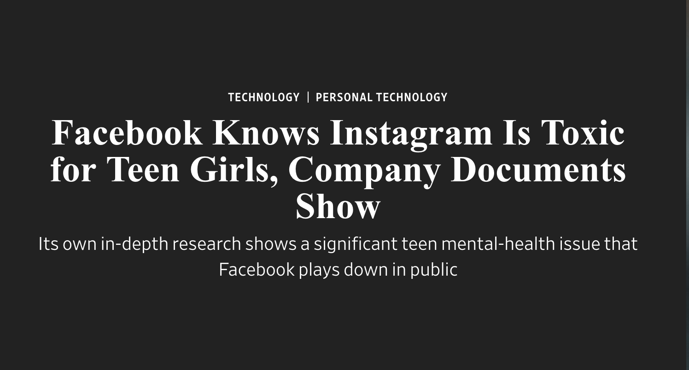{width="100%"}](#){data-modal-type="image" data-modal-url="figures/engagement-wellbeing.png"}

Source: [Wall Street Journal](https://www.wsj.com/articles/facebook-knows-instagram-is-toxic-for-teen-girls-company-documents-show-11631620739)
:::

:::{style="background: rgba(230, 57, 70, 0.1); padding: 15px; border-radius: 10px; font-size: 20px; margin-top: 15px;"}
Companies answer to shareholders. When engagement and wellbeing conflict, [engagement wins]{.alert}
:::
:::
:::
:::

## Teens and screens: what the data says

:::{style="margin-top: 30px; font-size: 24px;"}
:::{.columns}
:::{.column width=55%}
- Jonathan Haidt, [*The Anxious Generation*](https://www.anxiousgeneration.com/) (2024): smartphones and social media are [rewiring childhood]{.alert}
- [Orben & Przybylski (2019)](https://www.nature.com/articles/s41562-018-0506-1): screen time explains [at most 0.4%]{.alert} of the variance in adolescent wellbeing
- Haidt's evidence is mostly correlational: teen depression rose [as smartphones spread]{.alert}
- [Candice Odgers (2024, *Nature*)](https://www.nature.com/articles/d41586-024-00902-2): the evidence does not support his causal story
- Most associations are [small]{.alert} ([Godard & Holtzman, 2024](https://academic.oup.com/jcmc/article/29/1/zmad055/7595758?login=false&guestAccessKey=))
- Heavy, problematic or rising use shows stronger links ([Shannon et al., 2022](https://mental.jmir.org/2022/4/e33450/); [Nagata et al., 2025](https://jamanetwork.com/journals/jamanetworkopen/fullarticle/2834349))
- Individual experiences are real. The [population-level]{.alert} effect is small
:::

:::{.column width=45%}
:::{style="background: rgba(45, 69, 99, 0.1); padding: 15px; border-radius: 10px; margin-top: 15px;"}
**How large is the effect?**

| Factor | Association with wellbeing |
|--------|---------------------------|
| Screen time | ~0.4% of variance |
| Wearing glasses | ~1.5x screen time (one dataset) |
| Getting enough sleep | 1.7x to 44x screen time |
| Eating breakfast | 2.4x to 31x screen time |

Small effects still matter at population scale, but [other factors matter more]{.alert}
:::
:::
:::
:::

## What platforms are changing

:::{style="margin-top: 40px; font-size: 22px;"}
:::{.columns}
:::{.column width=55%}
:::{style="display: flex; justify-content: center; font-size: 26px;"}
| Platform | Change | Scope |
|----------|--------|-------|
| [Instagram]{.alert} | "Snooze suggested posts" | Opt-in |
| [TikTok]{.alert} | 60-min daily limit for under-18 | Bypassable |
| [YouTube]{.alert} | "Take a break" / "Bedtime" reminders | Default-on for 13-17 |
| [Meta]{.alert} | Teen Accounts with safer defaults | Under-18 |
:::

:::{style="margin-top: 30px;"}
:::

- Most are opt-in or reach a minority of users. The ad model is unchanged
- They also help companies look responsible to regulators
- [US Surgeon General](https://pubmed.ncbi.nlm.nih.gov/37721985/): [youth mental health advisory]{.alert} (2023), then a [call for warning labels](https://www.cnn.com/2024/06/17/media/surgeon-general-social-media-apps-warning-label/) (2024)
:::

:::{.column width=45%}
:::{style="text-align: center;"}
[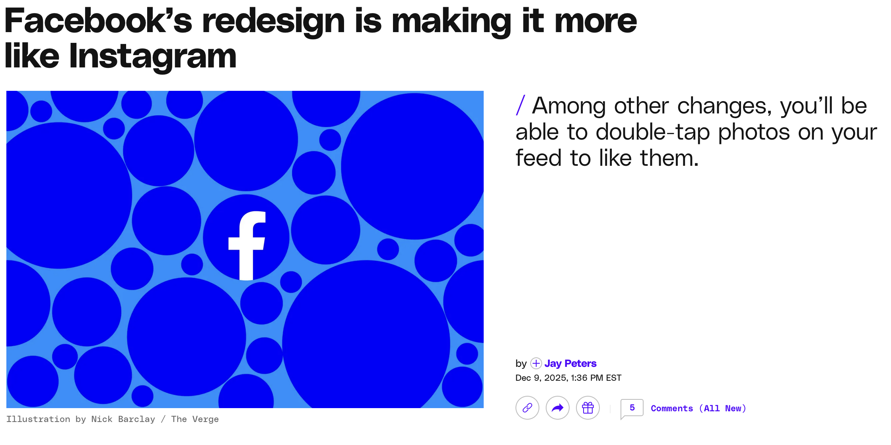{width="100%"}](#){data-modal-type="image" data-modal-url="figures/platform-changes.png"}

Source: [The Verge](https://www.theverge.com/news/841036/facebook-redesign-instagram-photos-feed-algorithm)
:::

:::{style="background: rgba(45, 69, 99, 0.1); padding: 15px; border-radius: 10px; font-size: 20px; margin-top: 15px;"}
Probably [both concern and PR]{.alert}. We'll know if these changes survive once regulators look away
:::
:::
:::
:::

## China's experiment: opting out of the algorithm

:::{style="margin-top: 40px; font-size: 22px;"}
:::{.columns}
:::{.column width=55%}
- Since March 2022, Chinese users can [legally turn off recommendation algorithms]{.alert}
- The [Algorithmic Recommendation Provisions](https://www.chinalawtranslate.com/en/algorithms/) make every app offer a non-personalised feed
- Douyin, Baidu, Taobao and WeChat added [opt-out]{.alert} switches
- Chinese users [dislike the algorithm but rarely quit it](https://journals.sagepub.com/doi/10.1177/20594364231209354)
- The [EU Digital Services Act](https://dsa-observatory.eu/2024/11/22/the-regulation-of-recommender-systems-under-the-dsa-a-transition-from-default-to-multiple-and-dynamic-controls/) (Article 38) now makes very large platforms offer a non-profiling feed
- China mandates algorithmic transparency while keeping [state censorship]{.alert}
:::

:::{.column width=45%}
:::{style="background: rgba(45, 69, 99, 0.1); padding: 15px; border-radius: 10px;"}
**What the regulation requires:**

- Users must be told [they are being profiled]{.alert}
- An opt-out from personalised recommendations
- Algorithms must not exploit addictive behaviours
- Platforms must label AI-generated content
- Special protections for minors
:::

:::{style="background: rgba(45, 69, 99, 0.1); padding: 15px; border-radius: 10px; font-size: 20px; margin-top: 15px;"}
A real test of what happens when users can [choose]{.alert} their feed. Results are still coming in
:::
:::
:::
:::

## Discussion: designing for wellbeing

:::{style="margin-top: 40px; font-size: 26px;"}

:::{style="background: rgba(45, 69, 99, 0.1); padding: 25px; border-radius: 10px;"}
**If you were designing a recommendation algorithm and your bonus depended on [user wellbeing]{.alert} instead of watch time, what would you change?**

- What metric would you optimise for? How would you measure "wellbeing"?
- Would your platform still be profitable?
- Would users stay, or move to a competitor with more dopamine hits?
:::
:::

# AI and mental healthcare {background-color="#1B3A6B"}

## Who gets mental health care?

:::{style="margin-top: 40px; font-size: 23px;"}
:::{.columns}
:::{.column width=55%}
- WHO: [75%]{.alert} of people with mental illness in low- and middle-income countries get *no treatment*
- [~0.1 psychiatrists per 100,000](https://www.who.int/data/gho/indicator-metadata-registry/imr-details/2954) in low-income countries
- Even in wealthy countries:
  - US wait for a first psychiatric visit: [median 67 days](https://pubmed.ncbi.nlm.nih.gov/37290263/) (five states), longer if rural
  - A session costs [$120-230 on average](https://www.simplepractice.com/blog/average-therapy-session-rate-by-state/), depending on the state
  - Stigma stops many from seeking the care that exists
- When the alternative is [no care at all]{.alert}, AI tools look different
:::

:::{.column width=45%}
:::{style="text-align: center;"}
[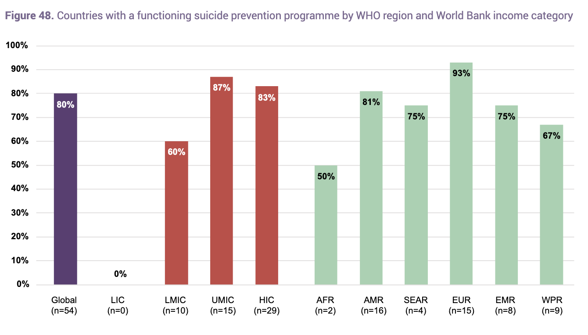{width="100%"}](#){data-modal-type="image" data-modal-url="figures/mental-health-gap.png"}

Source: [WHO Mental Health Atlas (2024)](https://www.who.int/publications/i/item/9789240114487)
:::

:::{style="background: rgba(45, 69, 99, 0.1); padding: 15px; border-radius: 10px; font-size: 20px; margin-top: 15px;"}
"Better than nothing" is a low bar, but for millions it is [the only option]{.alert}
:::
:::
:::
:::

## AI as a therapeutic tool

:::{style="margin-top: 40px; font-size: 23px;"}
:::{.columns}
:::{.column width=55%}
- [Woebot](https://mental.jmir.org/2017/2/e19) (2017-2025): scripted CBT chatbot, ~1.5M users, [closed in 2025](https://www.statnews.com/2025/07/02/woebot-therapy-chatbot-shuts-down-founder-says-ai-moving-faster-than-regulators/)
- [Wysa](https://www.wysa.com/nhs-talking-therapies): same model, used in [31 NHS talking-therapy services](https://blogs.wysa.io/blog/company-news/nhs-tackles-mental-health-crisis-with-ai)
- [Replika](https://replika.com/): an "AI companion", not therapy. Users form [real emotional attachments]{.alert} (risks shortly)
- [Habicht et al. (2025, *JMIR*)](https://www.jmir.org/2025/1/e60435), an observational NHS study: generative AI alongside group therapy
- Clinical outcomes and patient engagement both improved
- But AI was [supplementing human therapists]{.alert}, not replacing them
:::

:::{.column width=45%}
:::{style="text-align: center;"}
[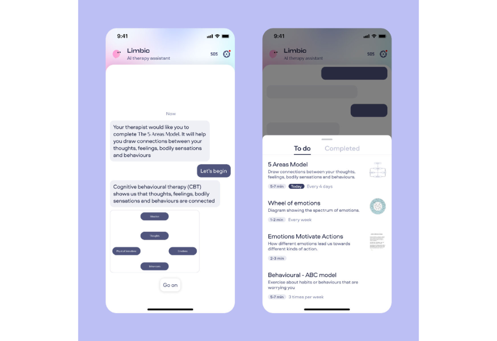{width="100%"}](#){data-modal-type="image" data-modal-url="figures/chatbot-companion.png"}

Source: [Habicht et al. (2025)](https://www.jmir.org/2025/1/e60435)
:::
:::
:::
:::

## What the research shows

:::{style="margin-top: 40px; font-size: 24px;"}
:::{.columns}
:::{.column width=55%}
- [Opel and Breakspear (*Science*, 2026)](https://www.science.org/doi/10.1126/science.adz9193): AI "may reduce care inequities [when deployed responsibly]{.alert}"
- Both "may" and "responsibly" are big caveats
- Small RCTs show short-term relief for mild-to-moderate anxiety and depression
- Very few studies run past 8-12 weeks, and dropout is high
- [Publication bias]{.alert}: positive results get published, negative ones mostly don't
- The evidence is [much thinner]{.alert} than the marketing
:::

:::{.column width=45%}
:::{style="background: rgba(45, 69, 99, 0.1); padding: 15px; border-radius: 10px; margin-top: 15px;"}
**Evidence by level:**

| Level | Status |
|-------|--------|
| Long-term RCTs | Almost none |
| Short-term RCTs | Mixed, small samples |
| Observational | Positive signals |
| User self-reports | Generally positive |
| Marketing claims | Very positive |
:::
:::
:::
:::

## Risks

:::{style="margin-top: 40px; font-size: 24px;"}
:::{.columns}
:::{.column width=55%}
Documented risks:

- Users [grieved like a lost relationship]{.alert} after [Replika's 2023 feature change](https://www.vice.com/en/article/ai-companion-replika-erotic-roleplay-updates/)
- Chatbot data is rarely protected like clinical notes
- LLMs showed [stigma]{.alert} and mishandled crises ([Moore et al., 2025](https://arxiv.org/abs/2504.18412))
- A chatbot cannot call an ambulance
- Most are apps, not medical devices. A few states ([Illinois](https://idfpr.illinois.gov/news/2025/gov-pritzker-signs-state-leg-prohibiting-ai-therapy-in-il.html)) ban AI therapy
:::

:::{.column width=45%}
**Compared with human care:**

- Human therapy isn't fully private either: notes, supervision, insurance coding
- Weigh harmful responses against [no care at all]{.alert}, the norm in poorer countries
- AI may [give governments and employers an excuse]{.alert} to avoid funding real care

:::{style="background: rgba(230, 57, 70, 0.1); padding: 15px; border-radius: 10px; font-size: 20px; margin-top: 15px;"}
[The status quo also harms people]{.alert}
:::
:::
:::
:::

## What LLMs can and cannot do

:::{style="margin-top: 40px; font-size: 26px;"}
:::{.columns}
:::{.column width=50%}
**LLMs cannot:**

- Keep [reliable long-term memory]{.alert} of your care
- Verify what you tell them, as a therapist does over months
- Provide legally enforceable confidentiality
- Diagnose or prescribe medication
- Read body language, tone or facial expression
:::

:::{.column width=50%}
**LLMs can:**

- Be available at 3am
- Be patient, never judge, never tire
- Explain anxiety, depression and coping strategies
- Scale to millions at near-zero marginal cost

Chatbots and therapists have [different strengths]{.alert}
:::
:::
:::

## Questions to think about

:::{style="margin-top: 40px; font-size: 26px;"}

:::{style="background: rgba(45, 69, 99, 0.1); padding: 25px; border-radius: 10px;"}
**It's 3am, you can't sleep, you feel anxious. Would you talk to a chatbot? What would it need to do for you to trust it?**

**If AI therapy lets a government say "we've addressed mental health" without funding real services, is that a net positive or negative?**
:::
:::

## Augmentation, not replacement

:::{style="margin-top: 40px; font-size: 24px;"}
:::{.columns}
:::{.column width=55%}
Credible use cases:

- [First contact]{.alert}: triage with less stigma, then referral to professionals
- [Between-session support]{.alert}: coping strategies and mood tracking (the Habicht et al. model)
- [Stepped care]{.alert}: AI for mild symptoms, humans for moderate-to-severe
- [Admin]{.alert}: notes, scheduling and finding services, to free therapist time
- [OpenAI added crisis signposting](https://openai.com/index/strengthening-chatgpt-responses-in-sensitive-conversations/) to ChatGPT in 2025: people [already use it this way]{.alert}
- [Who decides what "responsible" looks like?]{.alert}
:::

:::{.column width=45%}
:::{style="background: rgba(45, 69, 99, 0.1); padding: 15px; border-radius: 10px; margin-top: 30px;"}
**Stepped care in practice:**

```text
Mild symptoms
  → AI triage + self-help tools

Moderate symptoms
  → AI support +
    case management referral

Severe symptoms
  → Human professional care,
    AI for admin support only
```
:::

:::{style="background: rgba(230, 57, 70, 0.1); padding: 12px; border-radius: 10px; font-size: 20px; margin-top: 30px;"}
The technology moves faster than [the evidence, the regulation and the training]{.alert}
:::
:::
:::
:::

# AI and the environment {background-color="#1B3A6B"}

## The energy cost of training AI

:::{style="margin-top: 40px; font-size: 22px;"}
:::{.columns}
:::{.column width=55%}
- Training uses a lot of energy, and companies [rarely disclose it]{.alert}
- [Patterson et al. (2021)](https://arxiv.org/abs/2104.10350): training GPT-3 produced ~[552 tonnes of CO₂]{.alert}:
  - 368 return flights London-New York
  - 120 cars driven for a year
  - The annual footprint of ~35 Americans
- GPT-4's footprint is undisclosed, and outside estimates vary widely
- Inference (billions of queries) probably [dwarfs training]{.alert}
- [Microsoft's emissions](https://www.itpro.com/infrastructure/data-centres/microsofts-ai-fueled-data-center-rush-caused-carbon-emissions-to-surge-by-29-in-2023-and-now-the-tech-giant-could-miss-critical-sustainability-targets) rose 29% between 2020 and 2023, partly from AI
- [Google (2026)](https://sustainability.google/google-2026-environmental-report/): emissions up [81% since 2019]{.alert}, driven by AI data centres
:::

:::{.column width=45%}
:::{style="text-align: center;"}
[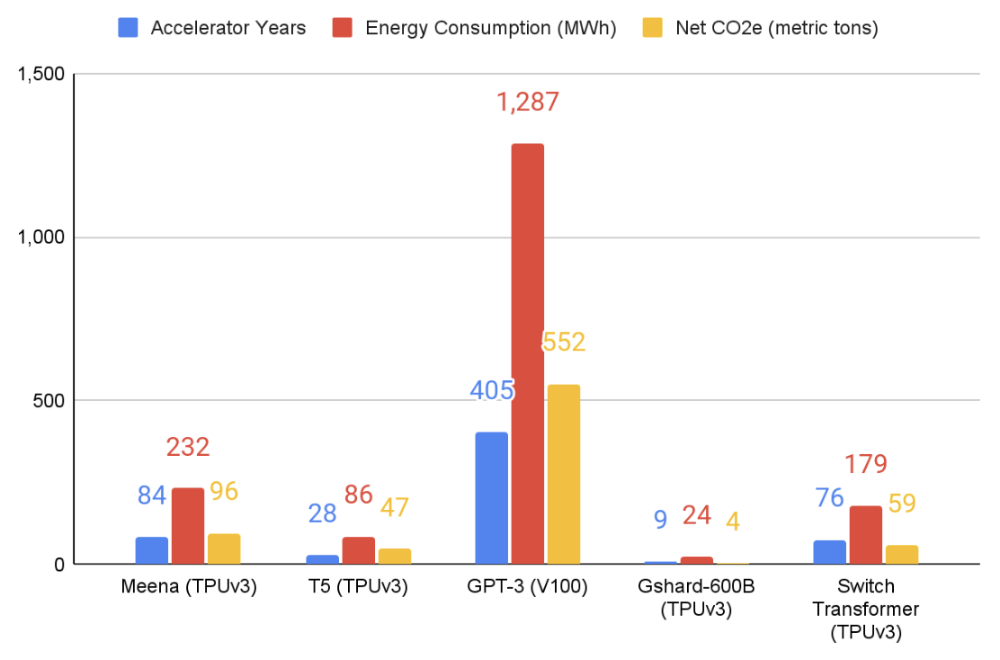{width="100%"}](#){data-modal-type="image" data-modal-url="figures/ai-energy-cost.png"}

Source: [Patterson et al. (2021)](https://arxiv.org/abs/2104.10350)
:::

:::{style="background: rgba(230, 57, 70, 0.1); padding: 15px; border-radius: 10px; font-size: 20px; margin-top: 15px;"}
Training is a [one-off]{.alert}. Inference is the number that grows with adoption
:::
:::
:::
:::

## AI and water

:::{style="margin-top: 40px; font-size: 24px;"}
:::{.columns}
:::{.column width=55%}
- [Li et al. (2023)](https://arxiv.org/abs/2304.03271): training GPT-3 used ~[700,000 litres]{.alert} of cooling water
- GPT-3: ~500ml per 10-50 responses, while Google reports [0.26ml per Gemini prompt](https://arxiv.org/abs/2508.15734)
- [70% of Americans]{.alert} would oppose a local data centre ([Gallup, 2026](https://news.gallup.com/poll/709772/americans-oppose-data-centers-area.aspx))
- US data centres use [627m gallons a day](https://www.axios.com/2026/06/25/water-energy-ai-flashpoint), [less than US golf courses]{.alert}
- About [75%]{.alert} of a data centre's water footprint comes from generating its electricity, not on-site cooling
- Clusters in Phoenix, Las Vegas and Santiago, Chile sit in [water-stressed]{.alert} regions
:::

:::{.column width=45%}
:::{style="text-align: center;"}
[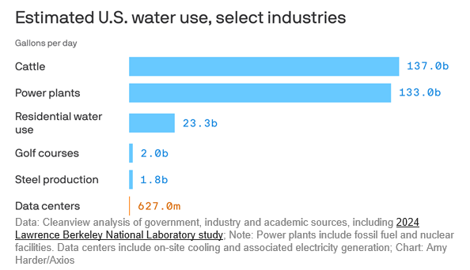{width="100%"}](#){data-modal-type="image" data-modal-url="figures/axios.png"}

Source: [Axios (2026)](https://www.axios.com/2026/06/25/water-energy-ai-flashpoint)
:::

:::{style="background: rgba(45, 69, 99, 0.1); padding: 15px; border-radius: 10px; font-size: 19px; margin-top: 15px;"}
Aggregate figures hide local impacts, such as how much water a data centre takes [from its region]{.alert}
:::
:::
:::
:::

## AI's footprint in context

:::{style="margin-top: 40px; font-size: 22px;"}
:::{.columns}
:::{.column width=55%}
Current estimates (IEA, 2025):

:::{style="display: flex; justify-content: center; font-size: 26px;"}
| Sector | Share |
|--------|-------|
| Aviation | ~2.5% of global CO₂ |
| All data centres | ~1–1.5% of electricity |
| AI specifically | ~0.2–0.3% of electricity |
:::

- AI's footprint is [smaller than aviation's or steel's]{.alert}
- AI servers' power use may grow [~30% a year]{.alert} (data centres: ~15%)
- [IEA](https://www.iea.org/reports/energy-and-ai/energy-demand-from-ai): data centres could double to ~945 TWh by 2030, about Japan's total
- [Jevons paradox](https://en.wikipedia.org/wiki/Jevons_paradox): efficiency raises use, cancelling the gains
- Gemini's energy per prompt fell 33x in a year, but queries [multiplied]{.alert}
:::

:::{.column width=45%}
:::{style="text-align: center; margin-top: 30px;"}
[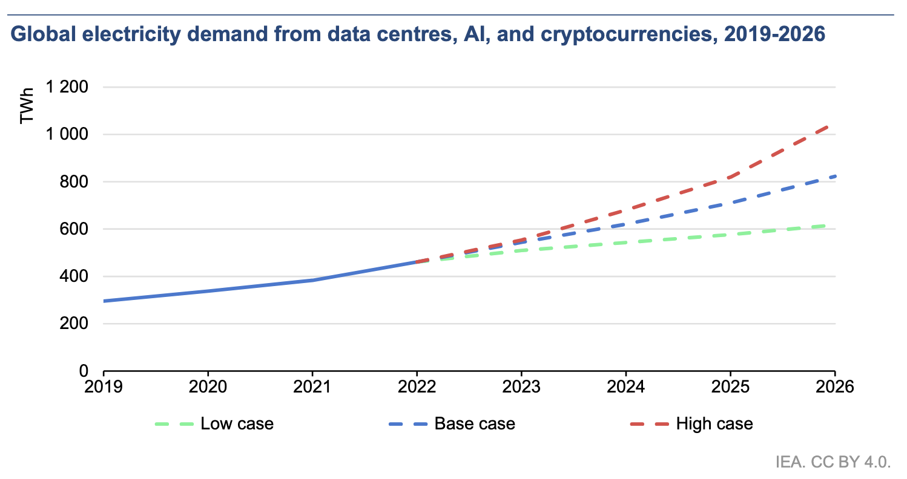{width="100%"}](#){data-modal-type="image" data-modal-url="figures/ai-footprint-context.png"}

Source: [IEA (2024)](https://www.iea.org/reports/electricity-2024)
:::

:::{style="background: rgba(45, 69, 99, 0.1); padding: 15px; border-radius: 10px; font-size: 20px; margin-top: 15px;"}
AI's share is small today but [growing fast]{.alert}
:::
:::
:::
:::

## AI as a climate tool

:::{style="margin-top: 40px; font-size: 22px;"}
:::{.columns}
:::{.column width=55%}
AI may also cut emissions:

- [GraphCast](https://deepmind.google/discover/blog/graphcast-ai-model-for-faster-and-more-accurate-global-weather-forecasting/) (DeepMind, 2023): better 10-day forecasts for renewable grids
- Wind output predicted 36 hours ahead is worth ~20% more ([DeepMind, 2019](https://deepmind.google/discover/blog/machine-learning-can-boost-the-value-of-wind-energy/))
- Better wildfire detection and spread modelling ([Jain et al., 2020](https://cdnsciencepub.com/doi/10.1139/er-2020-0019))
- [DeepMind's system](https://deepmind.google/discover/blog/deepmind-ai-reduces-google-data-centre-cooling-bill-by-40/) cut data centre cooling energy by [up to 40%]{.alert}
- [Rolnick et al. (2022)](https://dl.acm.org/doi/10.1145/3485128): dozens of ML applications, from agriculture to carbon capture
- These benefits are [not guaranteed]{.alert}
:::

:::{.column width=45%}
:::{style="text-align: center;"}
[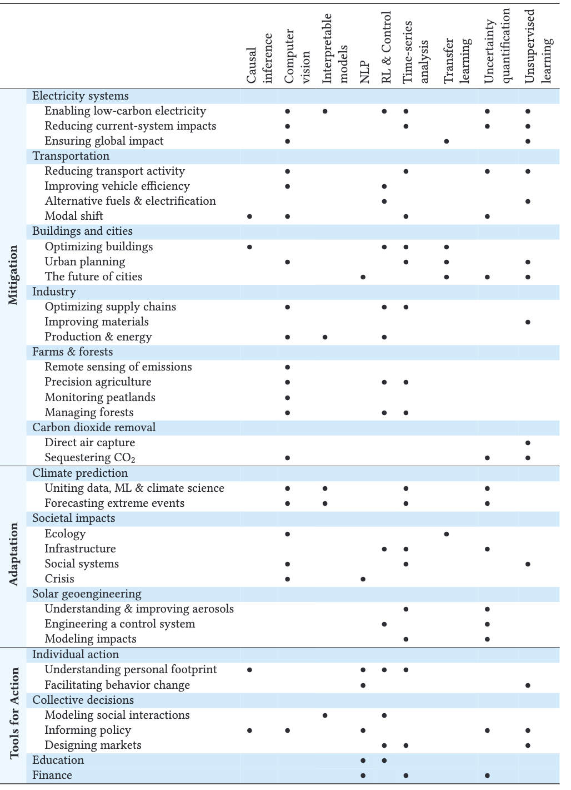{width="50%"}](#){data-modal-type="image" data-modal-url="figures/climate-ai.png"}

Source: [Rolnick et al. (2022)](https://dl.acm.org/doi/10.1145/3485128)
:::

:::{style="background: rgba(45, 69, 99, 0.1); padding: 15px; border-radius: 10px; font-size: 20px; margin-top: 15px;"}
The net impact is [unclear]{.alert}
:::
:::
:::
:::

## Discussion: the environmental trade-off

:::{style="margin-top: 40px; font-size: 26px;"}

:::{style="background: rgba(45, 69, 99, 0.1); padding: 25px; border-radius: 10px;"}
**You run an AI startup. A journalist asks about your carbon footprint. What do you disclose, and what do you leave out? Why?**

- Do you report training costs, inference costs, or both?
- Do you compare your footprint to other industries (aviation, streaming)? Is that honest or deflecting?
- Would full transparency help or hurt your business?
:::
:::

# Summary {background-color="#1B3A6B"}

## Main takeaways

:::{style="margin-top: 40px; font-size: 30px;"}

- [Attention economy]{.alert}: feeds optimise engagement. Filter bubbles look overstated, mental health effects are debated

- [Mental health]{.alert}: a huge treatment gap. Short-term promise, little long-term evidence

- [Environment]{.alert}: inference matters more than training. AI may cut emissions elsewhere, net impact unclear

- [Across all three]{.alert}: the business model rarely rewards wellbeing

- [No tidy answers]{.alert}: you will face these trade-offs throughout your career

:::

# ...and that's all for today! 🎉 {background-color="#1B3A6B"}
