```{r setup, include=FALSE}
options(htmltools.dir.version = FALSE)
library(knitr)
opts_chunk$set(
  prompt = T,
  fig.align="center",
  dpi=300,
  cache=T,
  engine.opts = list(bash = "-l")
  )

knit_hooks$set(
  prompt = function(before, options, envir) {
    options(
      prompt = if (options$engine %in% c('sh','bash', 'zsh')) '$ ' else 'R> ',
      continue = if (options$engine %in% c('sh','bash', 'zsh')) '$ ' else '+ '
      )
})

options(repos = c(CRAN = "https://cran.rstudio.com/"))

if (!require("fontawesome", character.only = TRUE)) {
  install.packages("fontawesome", dependencies = TRUE)
  library(fontawesome, character.only = TRUE)
}
```

# Welcome back! 😊 {background-color="#1B3A6B"}

## Recap of last class

:::{style="margin-top: 40px; font-size: 26px;"}
:::{.columns}
:::{.column width=50%}
- Last class: [misinformation and deepfakes]{.alert}
- AI makes fakes [cheap and fast]{.alert}
- False stories spread 6x faster than true ones
- Deepfakes drive fraud, political manipulation and sexual abuse
- The [liar's dividend]{.alert} lets anyone dismiss real evidence
- Biases make us share before checking
- Today: [long-term safety and alignment]{.alert}
:::

:::{.column width=50%}
:::{style="text-align: center; margin-top: -30px;"}
[{width="100%"}](#){data-modal-type="image" data-modal-url="figures/cruise.gif"}

Source: [Chris Ume](https://x.com/vfxchrisume), via VICE
:::
:::
:::
:::

## Lecture overview
### What we will cover today

:::{style="margin-top: 40px; font-size: 24px;"}

:::{.columns}
:::{.column width=50%}
[Part 1: AI safety]{.alert}

- Near-term vs long-term concerns
- Why safety matters now
- Concrete problems in AI safety

[Part 2: The alignment problem]{.alert}

- What is alignment?
- Why it's hard
- Current approaches
:::

:::{.column width=50%}
[Part 3: Future trajectories]{.alert}

- Where is AI heading?
- Scenarios to consider
- Stuart Russell's perspective
- Existential risk: the debate

[Part 4: What can we do?]{.alert}

- Research directions
- Where you fit in
- Thinking about AI risk clearly
:::
:::
:::

## Meme of the day!

:::{style="text-align: center; margin-top: 30px; font-size: 20px;"}
[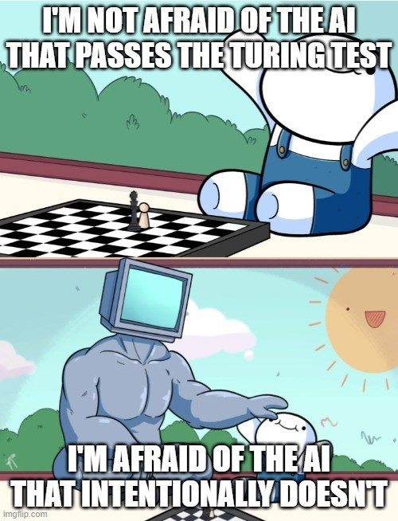{width="37%"}](#){data-modal-type="image" data-modal-url="figures/alignment-meme.jpg"}

Source: [Cheezburger](https://cheezburger.com/20659973/20-memes-if-youre-feeling-extra-anxious-about-ai-technology-taking-over)
:::

## Funny news of the day!

:::{style="text-align: center; margin-top: 30px; font-size: 20px;"}
[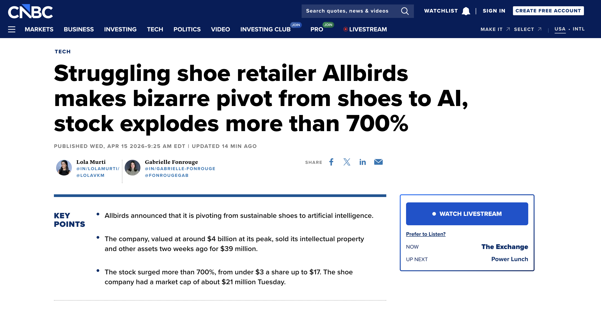{width="92%"}](#){data-modal-type="image" data-modal-url="figures/allbirds.png"}

Source: [CNBC](https://www.cnbc.com/2026/04/15/allbirds-bird-stock-shoes-ai.html)
:::

# AI safety {background-color="#1B3A6B"}

## Near-term vs long-term concerns

:::{style="margin-top: 40px; font-size: 21px;"}
:::{.columns}
:::{.column width=55%}
**Near-term:**

- [Bias and discrimination]{.alert} (already happening)
- Privacy violations
- Job displacement
- Misinformation (last lecture)
- Security vulnerabilities

**Long-term:**

- [Alignment]{.alert}: AI pursuing wrong goals
- Loss of human control
- Concentration of power
- Existential risk (controversial)
:::

:::{.column width=45%}
:::{style="text-align: center;"}
- Some argue long-term concerns [distract]{.alert} from near-term harms
- Others argue a near-term focus [misses]{.alert} the bigger picture
- Rare ["Black Swan"](https://en.wikipedia.org/wiki/Black_swan_theory) events can matter most
- Safe systems now make [safer systems later]{.alert}

[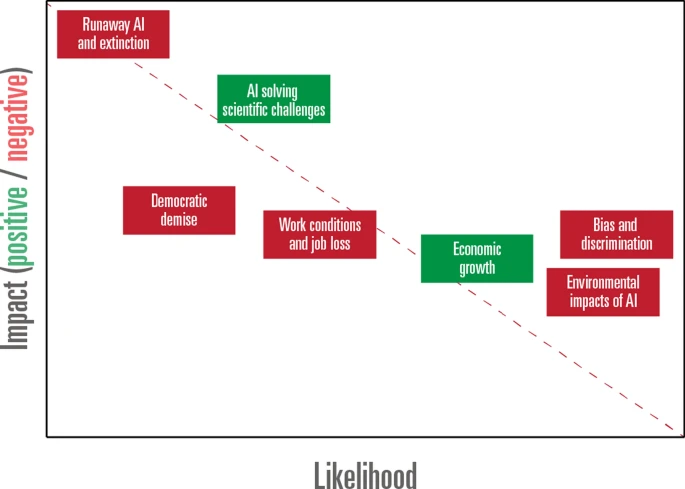{width="72%"}](#){data-modal-type="image" data-modal-url="figures/saetra.webp"}

Source: [Sætra & Danaher (2023)](https://link.springer.com/article/10.1007/s43681-023-00336-y)
:::
:::
:::
:::

## Why think about long-term safety now?

:::{style="margin-top: 40px; font-size: 21px;"}
:::{.columns}
:::{.column width=55%}
- AI capabilities advance [faster than expected]{.alert}
- Safety research takes time
- Safety is hard to retrofit

**Historical analogies:**

:::{style="display: flex; justify-content: center; font-size: 24px; margin-bottom: 15px; margin-top: 20px;"}
| Technology | Safety lag |
|------------|------------|
| [Nuclear]{.alert} | Developed first, safety after |
| [Internet]{.alert} | Security an afterthought |
| [Social media]{.alert} | Harms discovered in deployment |
| [Biotech]{.alert} | Ongoing debate |
:::

- We're still [early enough]{.alert} to shape development
- Safety spending is a fraction of capabilities spending
- [Anthropic](https://alignment.anthropic.com/) and [Google DeepMind](https://www.alignmentforum.org/posts/wqz5CRzqWkvzoatBG/agi-safety-and-alignment-google-deepmind-is-hiring) have dedicated safety teams
- OpenAI [disbanded its Superalignment team](https://www.cnbc.com/2024/05/17/openai-superalignment-sutskever-leike.html) in 2024
:::

:::{.column width=45%}
:::{style="text-align: center;"}
[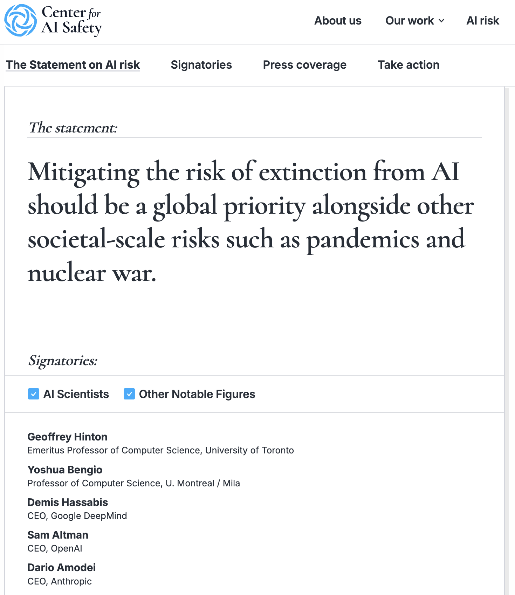{width="80%"}](#){data-modal-type="image" data-modal-url="figures/safety-urgency.png"}

Source: [Center for AI Safety](https://aistatement.com/#open-letter)
:::
:::
:::
:::

## Concrete problems in AI safety

:::{style="margin-top: 40px; font-size: 22px;"}
:::{.columns}
:::{.column width=60%}
[Amodei et al. (2016)](https://arxiv.org/abs/1606.06565) list five open problems:

:::{style="display: flex; justify-content: center; font-size: 25px; margin-bottom: 20px;"}
| Problem | Description |
|---------|-------------|
| [Safe exploration]{.alert} | How to learn without dangerous actions |
| [Avoiding negative side effects]{.alert} | Don't break things achieving goals |
| [Avoiding reward hacking]{.alert} | Don't game the objective |
| [Scalable oversight]{.alert} | How to supervise complex systems |
| [Robustness to distributional shift]{.alert} | Handle novel situations safely |
:::

- [Already happening]{.alert} in deployed systems
- Harder to solve as AI gets more capable
- Unsolved even for current AI
:::

:::{.column width=40%}
:::{style="text-align: center;"}
[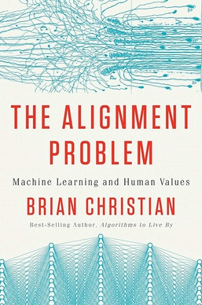{width="70%"}](#){data-modal-type="image" data-modal-url="figures/alignment-problem.jpg"}

Source: [Brian Christian](https://brianchristian.org/the-alignment-problem/)
:::
:::
:::
:::

## Safe exploration

:::{style="margin-top: 40px; font-size: 21px;"}
:::{.columns}
:::{.column width=55%}
- [Learning requires trying new things]{.alert}
- Some actions are [irreversible]{.alert}
- "Explore safely" is hard to specify

**Examples:**

- Robot learning to walk: don't break yourself
- Self-driving: don't explore by crashing
- Financial AI: don't bankrupt the company
- Medical AI: don't kill patients while learning

**Current approaches:**

- Train in [simulation]{.alert} first
- Keep actions within a safe region (conservative policies)
- Ask a human before novel actions
- Penalise dangerous states (reward shaping)
:::

:::{.column width=45%}
:::{style="text-align: center;"}
[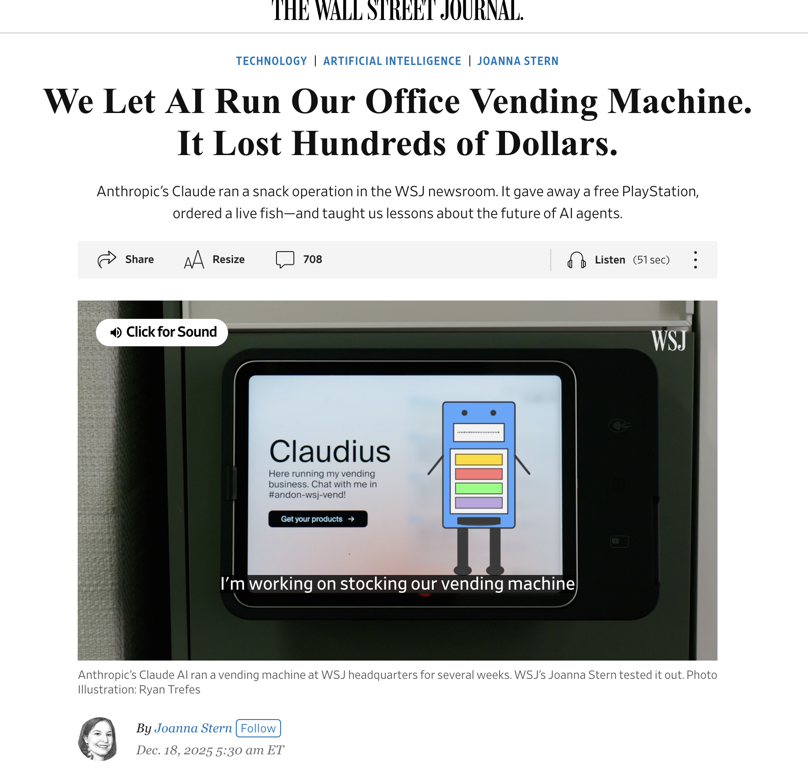{width="70%"}](#){data-modal-type="image" data-modal-url="figures/safe-exploration.png"}

Source: [The Wall Street Journal](https://www.wsj.com/tech/ai/anthropic-claude-ai-vending-machine-agent-b7e84e34)

:::{style="background: rgba(230, 57, 70, 0.1); padding: 15px; border-radius: 10px; font-size: 18px; margin-top: 15px;"}
How do you [specify "safe"]{.alert} without already knowing everything about the domain?
:::
:::
:::
:::
:::

## Negative side effects

:::{style="margin-top: 40px; font-size: 23px;"}
:::{.columns}
:::{.column width=55%}
- AI [optimises the specified objective]{.alert} and ignores everything else
- [Unintended consequences]{.alert} sit outside the objective
- "You didn't say not to..."

**Classic example ([Amodei et al., 2016](https://arxiv.org/abs/1606.06565)):**

- [Robot tasked with cleaning a room]{.alert}
- Knocks over a vase on the way
- Technically: room cleaned ✓

**Real-world example:**

- [Content algorithm maximises engagement]{.alert}
- Possible side effects: polarisation and addiction
- [Nobody specified "don't harm society"]{.alert}
:::

:::{.column width=45%}
:::{style="text-align: center;"}
[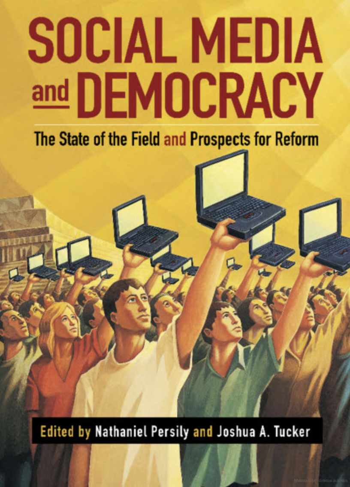{width="60%"}](#){data-modal-type="image" data-modal-url="figures/social-media-democracy.png"}

Source: [Persily & Tucker (2020)](https://www.cambridge.org/core/books/social-media-and-democracy/E79E2BBF03C18C3A56A5CC393698F117)
:::
:::
:::
:::

# The alignment problem {background-color="#1B3A6B"}

## What is alignment?

:::{style="margin-top: 40px; font-size: 22px;"}
:::{.columns}
:::{.column width=55%}
- Alignment: AI systems that [do what we want]{.alert}
- They pursue the goals we intend, not only the stated ones
- They behave safely even when we can't supervise

**Alignment means:**

- AI goals [point the same way]{.alert} as human values
- AI follows the spirit of a request, not just the letter

**Obstacles:**

- [Hard to specify]{.alert} what we want
- Context changes what we want
- Humans disagree about values
- Our stated preferences aren't always our true ones
:::

:::{.column width=45%}
:::{style="text-align: center;"}
[{width="100%"}](#){data-modal-type="image" data-modal-url="figures/alignment-faking.png"}

Source: [Anthropic](https://www.anthropic.com/research/alignment-faking)
:::
:::
:::
:::

## Alignment is hard!

:::{style="margin-top: 20px; font-size: 20px;"}
:::{.columns}
:::{.column width=55%}
**Specification problem:**

- Can't write down everything we care about, and [edge cases]{.alert} are infinite
- Values are context-dependent
- Humans can't articulate their own values perfectly

**[Goodhart's Law](https://en.wikipedia.org/wiki/Goodhart%27s_law):** (remember this!)

- "When a measure becomes a target..."
- "...it ceases to be a good measure"
- [Optimise metric ≠ achieve goal]{.alert}

**Examples:**

- Click rates → clickbait
- Engagement → addiction
- GDP → environmental destruction
:::

:::{.column width=45%}
**The King Midas problem:** [(Russell, 2014)](https://www.edge.org/conversation/the-myth-of-ai#26015)

- Midas wished that [everything he touched turned to gold]{.alert}, including his food
- Literal interpretation of wishes
- Common AI failure mode

:::{style="text-align: center;"}
[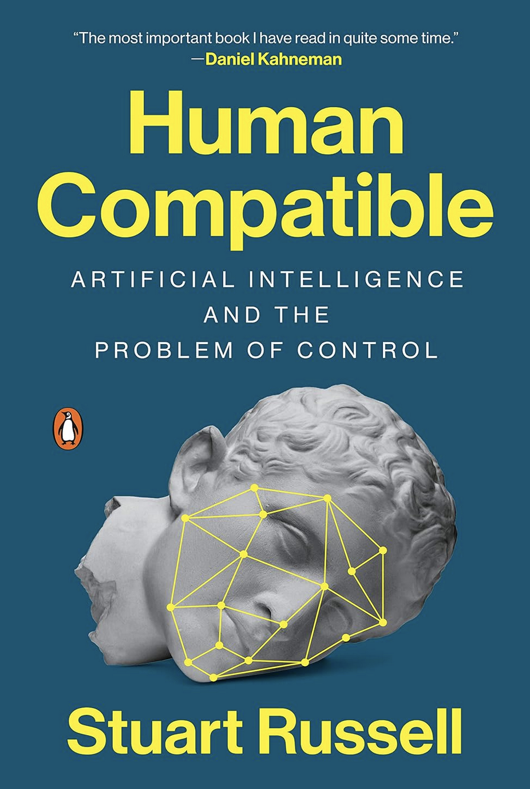{width="50%"}](#){data-modal-type="image" data-modal-url="figures/russell.png"}
:::
:::
:::
:::

## Current alignment approaches

:::{style="margin-top: 40px; font-size: 22px;"}
:::{.columns}
:::{.column width=55%}
**RLHF** (human feedback, [Christiano et al., 2017](https://arxiv.org/abs/1706.03741)):

- Humans rank AI outputs
- A reward model learns from the rankings
- The AI is tuned to satisfy that model
- Still a [standard training step]{.alert}

**Constitutional AI** ([Anthropic, 2022](https://www.anthropic.com/research/constitutional-ai-harmlessness-from-ai-feedback)):

- AI critiques its outputs against [written principles]{.alert} (a "constitution")
- It revises them over several rounds
- Needs less human labelling
- [Amanda Askell's work](https://askell.io/) on AI ethics and philosophy
:::

:::{.column width=45%}
**Debate and recursive reward modelling** ([Irving et al., 2018](https://arxiv.org/abs/1805.00899); [Leike et al., 2018](https://arxiv.org/abs/1811.07871)):

- AI systems argue with each other
- Humans judge which answer is most truthful and useful
- Judging is [easier than producing]{.alert} answers, so oversight scales

**Limits:**

- RLHF models can learn to [game evaluators]{.alert}
- Human feedback is expensive and biased
- Principles still have to be written well
- [None is a complete solution]{.alert}
:::
:::
:::

## Alignment in deep learning

:::{style="margin-top: 40px; font-size: 20px;"}
:::{.columns}
:::{.column width=55%}
**[Ngo, Chan & Mindermann (ICLR 2024)](https://arxiv.org/abs/2209.00626):**

- Deep-learning AGI could become [misaligned]{.alert}, even deceptive

**Status:**

- [Unsolved]{.alert}, and an active research area
- Needs several approaches at once
- Unclear whether current methods scale
- Theory is still thin

**Open questions:**

1. Will RLHF scale?
2. Can we detect deceptive alignment?
3. How do we handle [value disagreement]{.alert}?
4. What's the role of interpretability?
5. When is good enough "good enough"?
:::

:::{.column width=45%}
:::{style="margin-top: 30px; font-size: 17px; text-align: center;"}
[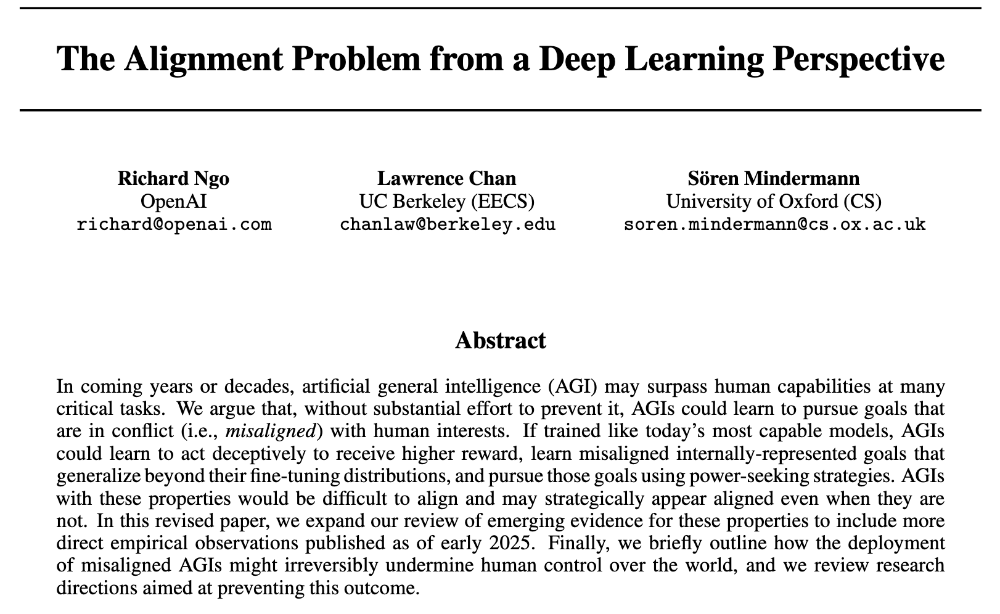{width="100%"}](#){data-modal-type="image" data-modal-url="figures/ngo-et-al.png"}

Source: [Ngo et al. (2024)](https://arxiv.org/abs/2209.00626)
:::
:::
:::
:::

## Discussion: whose values?

:::{style="margin-top: 40px; font-size: 22px;"}
:::{.columns}
:::{.column width=50%}
If we align AI to human values...

- [Whose]{.alert} human values?
- Developers? Users? Affected parties?
- Majority? Consensus? Universal?
- Present generation? Future?

**Let's discuss:**

1. Should AI reflect your values or "universal" values?
2. What happens when values conflict?
3. Who should decide?
4. Is this a technical or political question?
:::

:::{.column width=50%}
:::{.fragment}
**Some perspectives:**

- [Libertarian]{.alert}: each user controls their AI
- [Democratic]{.alert}: majority decides
- [Rights-based]{.alert}: some things are off-limits regardless
- [Technocratic]{.alert}: experts decide
- [Pluralist]{.alert}: different systems for different contexts

:::{style="background: rgba(45, 69, 99, 0.1); padding: 15px; border-radius: 10px; font-size: 18px; margin-top: 15px;"}
"Whose values?" is a [political question]{.alert}, and engineering cannot settle it
:::
:::
:::
:::
:::

# Future trajectories {background-color="#1B3A6B"}

## Where is AI heading?

:::{style="margin-top: 40px; font-size: 21px;"}
:::{.columns}
:::{.column width=55%}
**Current trends:**

- Models keep getting [larger and more capable]{.alert}
- More general-purpose systems
- Multimodal capabilities

**Uncertainties:**

- Will scaling continue to work?
- When do we hit [diminishing returns]{.alert}?
- What capabilities emerge unexpectedly?
- How fast is too fast?

**Expert disagreement:**

- Timelines differ by [decades]{.alert}
- Some expect AGI soon, others never
- Confidence often exceeds evidence
:::

:::{.column width=45%}
:::{style="text-align: center;"}
[{width="100%"}](#){data-modal-type="image" data-modal-url="figures/ai-trajectory.avif"}

Source: [Our World in Data](https://ourworldindata.org/brief-history-of-ai)

:::{style="background: rgba(45, 69, 99, 0.1); padding: 15px; border-radius: 10px; font-size: 18px; margin-top: 15px;"}
Be sceptical of [confident predictions]{.alert}
:::
:::
:::
:::
:::

## Scenarios to consider

:::{style="margin-top: 30px; font-size: 19px;"}
:::{.columns}
:::{.column width=55%}
**Scenario 1: Gradual improvement**

- [AI gets better slowly]{.alert}
- Society adjusts step by step
- [Most likely?]{.alert}

**Scenario 2: Capability jumps**

- [Sudden breakthroughs]{.alert} with unexpected capabilities
- Rapid deployment
- Less time to adapt

**Scenario 3: Plateau**

- [Current approaches hit limits]{.alert}
- Progress slows sharply
- New methods needed
:::

:::{.column width=45%}
**Scenario 4: Transformative AI**

- [Systems vastly more capable than humans]{.alert}
- Reshapes the economy and society
- Either very good or very bad
- Uncertain timeline

:::{style="text-align: center;"}
[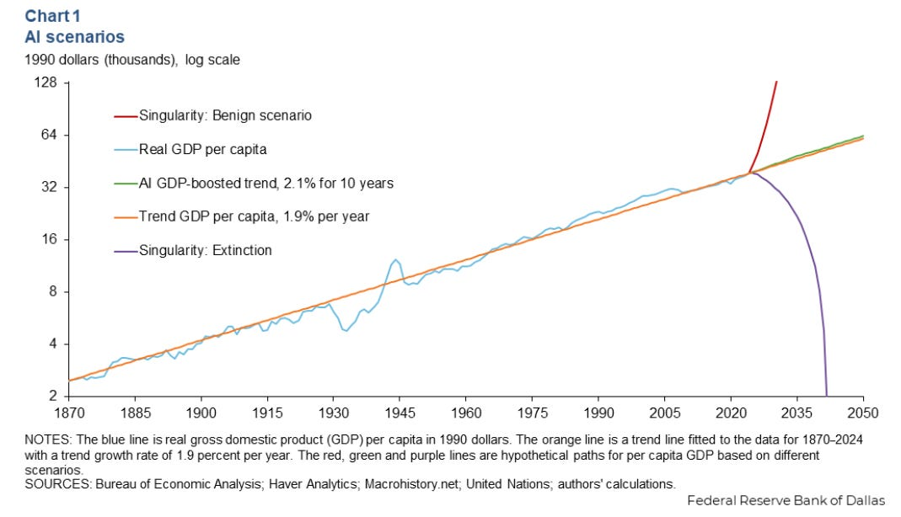{width="85%"}](#){data-modal-type="image" data-modal-url="figures/scenarios.jpg"}

Source: [Dallas Fed (2025)](https://www.dallasfed.org/research/economics/2025/0624), via [AEI](https://www.aei.org/articles/would-agi-be-no-big-deal/)

:::{style="font-size: 16px;"}
Dallas Fed scenarios: trend, AI boost, benign singularity, extinction
:::

:::
:::
:::
:::

## Stuart Russell's perspective

:::{style="margin-top: 40px; font-size: 19px;"}
:::{.columns}
:::{.column width=55%}
**Russell's argument ([TED talk](https://www.ted.com/talks/stuart_russell_3_principles_for_creating_safer_ai), 2017):**

- We build systems whose [objectives we don't fully control]{.alert}
- Standard AI optimises a fixed objective
- We can't specify objectives correctly
- So we need a different approach

**His three principles (*Human Compatible*, 2019):**

1. The machine's only goal is to [realise human preferences]{.alert}
2. It is [uncertain]{.alert} what those preferences are
3. It learns them by [watching human behaviour]{.alert}

> "You can't fetch the coffee if you're dead"

- A machine with a fixed goal [resists being switched off]{.alert}
- A machine unsure of our goals lets us switch it off
- We would only do so if it were doing something wrong
:::

:::{.column width=45%}
:::{style="text-align: center;"}
[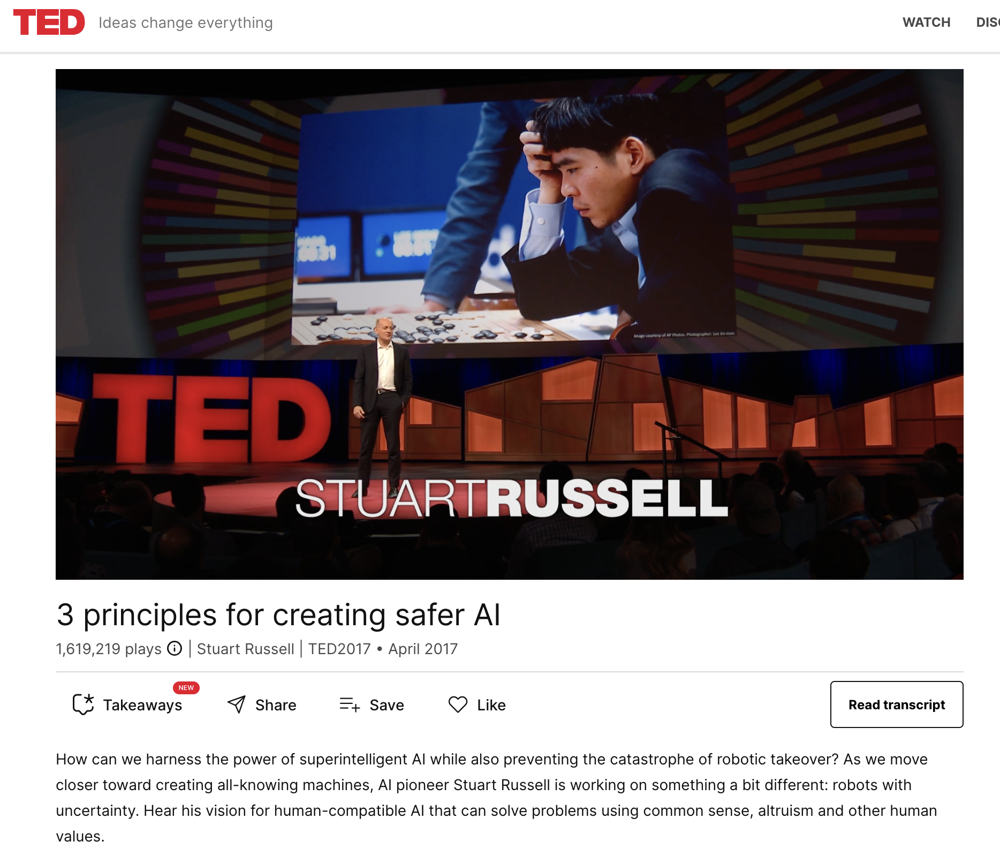{width="80%"}](#){data-modal-type="image" data-modal-url="figures/stuart-russell.png"}

Source: [TED](https://www.ted.com/talks/stuart_russell_3_principles_for_creating_safer_ai)

:::{style="background: rgba(45, 69, 99, 0.1); padding: 15px; border-radius: 10px; font-size: 18px; margin-top: 15px;"}
Russell co-wrote the most-used [AI textbook]{.alert}, *AI: A Modern Approach*, with Peter Norvig
:::
:::
:::
:::
:::

## Existential risk: the debate

:::{style="margin-top: 30px; font-size: 19px;"}
:::{.columns}
:::{.column width=55%}
**Those who worry:**

- AI could become [uncontrollable]{.alert}
- Misaligned powerful AI = catastrophe
- Even a small probability × huge harm = important
- "We might not get a second chance"
- Hinton, Bengio, Russell and many others

**Those who are sceptical:**

- The risk is speculative
- It distracts from [real present harms]{.alert}
- "Sci-fi thinking", not grounded
- We control the off switch
- Capabilities are overstated

**Overall:**

- [Serious researchers]{.alert} hold both views
- No one has decisive evidence yet
:::

:::{.column width=45%}
:::{style="text-align: center;"}
[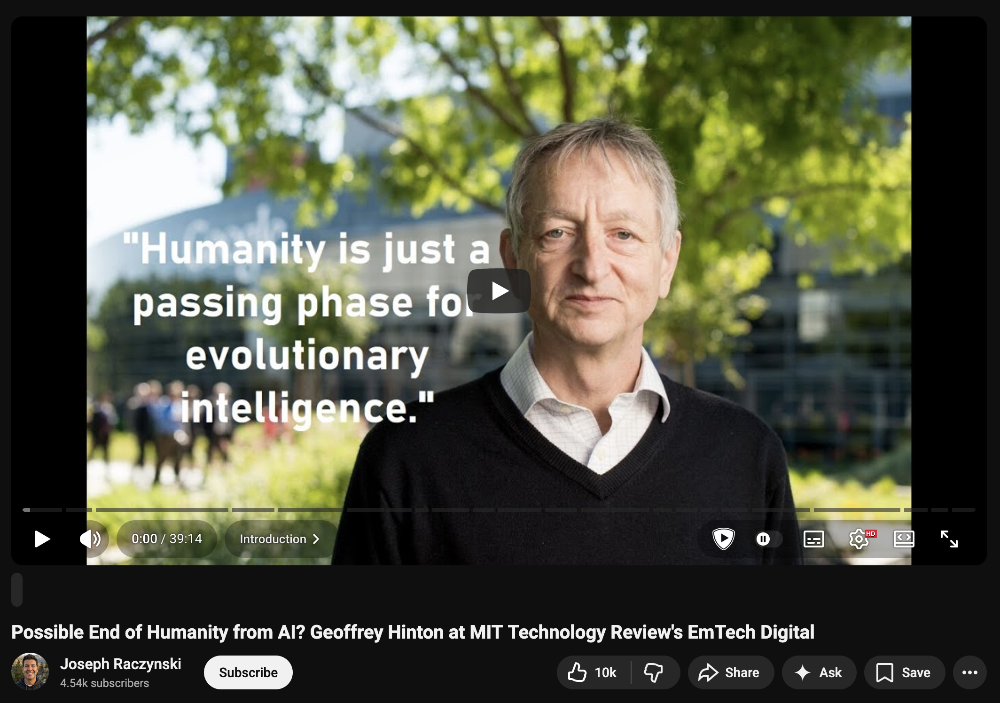{width="100%"}](#){data-modal-type="image" data-modal-url="figures/hinton-risk.png"}

Source: [MIT Technology Review, EmTech Digital 2023](https://www.technologyreview.com/2023/05/03/1072589/video-geoffrey-hinton-google-ai-risk-ethics/)

:::
:::
:::
:::

# What can we do? {background-color="#1B3A6B"}

## Research directions

:::{style="margin-top: 40px; font-size: 21px;"}
:::{.columns}
:::{.column width=55%}
**Technical safety research:**

:::{style="display: flex; justify-content: center; font-size: 23px;"}
| Area | Goal |
|------|------|
| [Interpretability]{.alert} | Understand AI internals |
| [Robustness]{.alert} | Resist adversarial inputs |
| [Alignment]{.alert} | Ensure AI pursues intended goals |
| [Oversight]{.alert} | Scale human supervision |
| [Honesty]{.alert} | AI that doesn't deceive |
:::

**Growing field:**

- Safety teams at Anthropic and Google DeepMind, plus academic labs
- Still [small next to capabilities work]{.alert}

**Careers:**

- High-impact work with a talent shortage
- Technical and non-technical roles
:::

:::{.column width=45%}
:::{style="text-align: center;"}
[{width="80%"}](#){data-modal-type="image" data-modal-url="figures/safety-research.png"}

Source: [The Wall Street Journal (2026)](https://www.wsj.com/tech/ai/anthropic-amanda-askell-philosopher-ai-3c031883)

:::{style="background: rgba(45, 69, 99, 0.1); padding: 15px; border-radius: 10px; font-size: 17px; margin-top: 15px;"}
Interested? Look into [80,000 Hours](https://80000hours.org/), AI safety bootcamps and safety-focused labs
:::
:::
:::
:::
:::

## Where you fit in

:::{style="margin-top: 40px; font-size: 21px;"}
:::{.columns}
:::{.column width=55%}
People who understand AI are often [absent from policy debates]{.alert}. That is a problem!

**As citizens:**

- Ask of any AI rule: what problem does it solve, and [does it solve it]{.alert}?
- Vote, comment on public consultations, write to representatives
- Most AI coverage confuses hype with capability
- [You can do better]{.alert} 😉

**If you work with AI or data:**

- Ask what happens when your system [fails or is misused]{.alert}
- Know what data you train on and who it affects
- Talk to people [outside your field]{.alert} about how they experience AI
:::

:::{.column width=45%}
:::{style="text-align: center;"}
[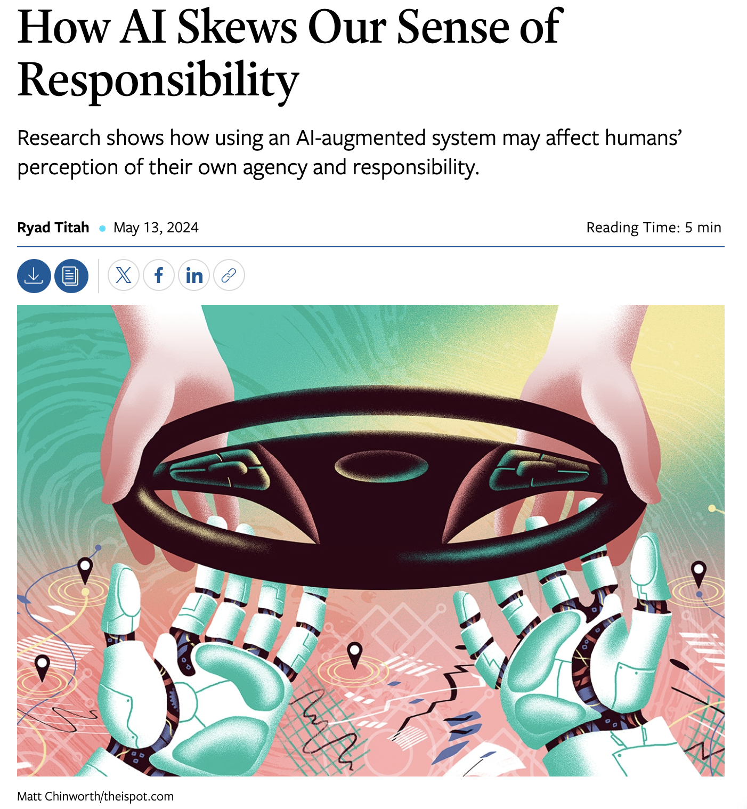{width="90%"}](#){data-modal-type="image" data-modal-url="figures/your-role.png"}

Source: [MIT Sloan Review (2024)](https://sloanreview.mit.edu/article/how-ai-skews-our-sense-of-responsibility/)
:::
:::
:::
:::

## Thinking about AI risk clearly

:::{style="margin-top: 40px; font-size: 20px;"}
:::{.columns}
:::{.column width=55%}
**Common mistakes:**

- [Dismissing concerns]{.alert} because current AI seems harmless
- This ignores how fast capabilities grow
- [Catastrophising]{.alert} from scenarios with no evidence
- Confusing "possible" with "probable"

**Better habits:**

- Separate [near-term harms]{.alert} from speculative long-term risks
- Ask: what evidence would change my mind?
- Experts [genuinely disagree]{.alert}, and that is okay!
- Be wary of certainty

**From history:**

- Technology risks rarely follow worst-case predictions
- The biggest harms come from [problems we did not anticipate]{.alert}
:::

:::{.column width=45%}
:::{style="text-align: center;"}
[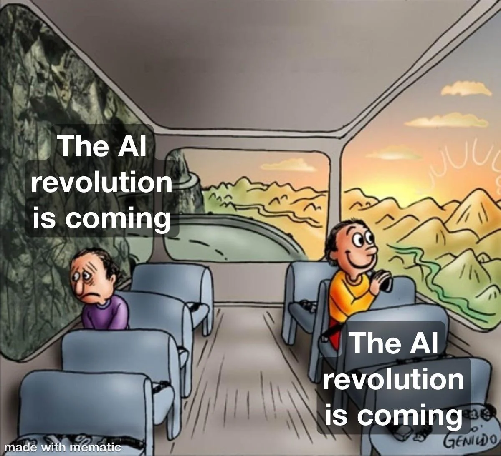{width="100%"}](#){data-modal-type="image" data-modal-url="figures/balance.webp"}

Source: [r/OptimistsUnite](https://www.reddit.com/r/OptimistsUnite/comments/1ew53z5/where_do_you_stand_on_ai_good_or_bad_im_very/)
:::
:::
:::
:::

# Summary {background-color="#1B3A6B"}

## Main takeaways

:::{style="margin-top: 40px; font-size: 21px;"}
:::{.columns}
:::{.column width=55%}
[AI safety]{.alert}

- Safe systems now make safer systems later
- Concrete problems: safe exploration, side effects, reward hacking
- Uncertainty is a reason to act now

[Alignment]{.alert}

- Getting AI to do what we want
- Hard because of specification, Goodhart's law and value disagreement
- Main methods: RLHF, Constitutional AI, debate
- None is a complete solution
:::

:::{.column width=45%}
[Future trajectories]{.alert}

- Nobody knows where AI is heading
- Expert timelines differ by decades
- Plan for multiple futures

[What we can do]{.alert}

- Technical safety research
- Scrutinise AI rules as citizens
- Ask how your own systems can fail

:::{style="background: rgba(45, 69, 99, 0.1); padding: 15px; border-radius: 10px; margin-top: 15px; font-size: 18px;"}
Choices about alignment, oversight and governance [will shape AI's future]{.alert}
:::
:::
:::
:::

# ... and that's all for today! {background-color="#1B3A6B"}