```{r setup, include=FALSE}
options(htmltools.dir.version = FALSE)
library(knitr)
opts_chunk$set(
  prompt = T,
  fig.align="center",
  dpi=300,
  cache=T,
  engine.opts = list(bash = "-l")
  )

knit_hooks$set(
  prompt = function(before, options, envir) {
    options(
      prompt = if (options$engine %in% c('sh','bash', 'zsh')) '$ ' else 'R> ',
      continue = if (options$engine %in% c('sh','bash', 'zsh')) '$ ' else '+ '
      )
})

options(repos = c(CRAN = "https://cran.rstudio.com/"))

if (!require("fontawesome", character.only = TRUE)) {
  install.packages("fontawesome", dependencies = TRUE)
  library(fontawesome, character.only = TRUE)
}
```

# Welcome back! 😊 {background-color="#1B3A6B"}

## Course review

:::{style="margin-top: 50px; font-size: 24px;"}
:::{.columns}
:::{.column width=60%}
- Last class: [safety and alignment]{.alert}
- Safety problems include side effects and [reward hacking]{.alert}
- Alignment: getting AI to do [what we want]{.alert}
- Goals are hard to specify, and people disagree on values
- No method is complete: RLHF, Constitutional AI, debate
- Expert timelines differ by decades
- Today: [one slide per lecture]{.alert}
- Link boxes point to lectures where an idea returns
:::

:::{.column width=40%}
:::{style="text-align: center;"}
[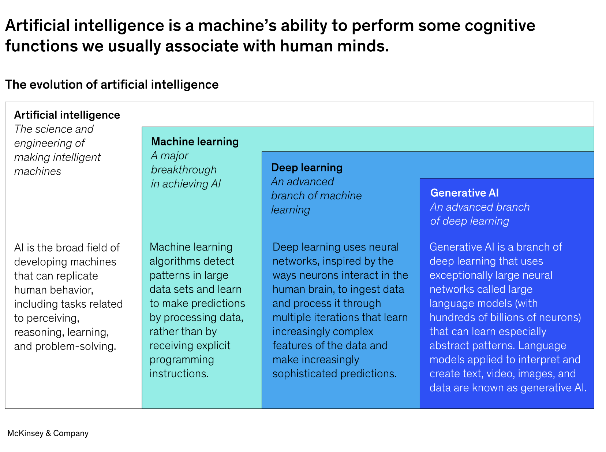{width="100%"}](#){data-modal-type="image" data-modal-url="figures/ai-overview.png"}
:::
:::
:::
:::

## A quick favour 🙏
### Course evaluations are open!

:::{style="margin-top: 40px; font-size: 30px;"}
- I would love to hear your thoughts on the course!
- Log on to [Canvas]{.alert} and go to *Account → Profile → Course Evaluations*
- It takes a few minutes on any device
- Thank you so much! 😊
:::

# Module 0: Orientation<br>(Lectures 1-2) {background-color="#1B3A6B"}

## What AI is and how we got here (Lectures 1-2)

:::{style="margin-top: 50px; font-size: 24px;"}
:::{.columns}
:::{.column width=55%}
- Today's AI is [narrow]{.alert}: good at specific tasks, weak outside them ([McKinsey, 2024](https://www.mckinsey.com/featured-insights/mckinsey-explainers/what-is-ai))
- LLMs [predict the next token]{.alert} but don't understand language as we do ([Radford et al., 2018](https://cdn.openai.com/research-covers/language-unsupervised/language_understanding_paper.pdf))
- [Rules](https://en.wikipedia.org/wiki/Dartmouth_workshop) (1950s-80s), [AI winters](https://en.wikipedia.org/wiki/AI_winter), [backpropagation](https://en.wikipedia.org/wiki/Backpropagation) (1986), [transformers](https://arxiv.org/abs/1706.03762) (2017)
- ChatGPT added [instruction tuning](https://www.ibm.com/think/topics/instruction-tuning) and [RLHF](https://en.wikipedia.org/wiki/Reinforcement_learning_from_human_feedback) to a large model

:::{style="margin-top: 15px; background: rgba(45, 69, 99, 0.1); padding: 12px; border-radius: 10px; font-size: 17px;"}
`r fa('link')` Next-token prediction explains hallucinations ([L11](../lecture-11/11-hallucination.html)). RLHF returns in [L4](../lecture-04/04-learning.html) and [L25](../lecture-25/25-safety.html).
:::
:::

:::{.column width=45%}
:::{style="text-align: center;"}
[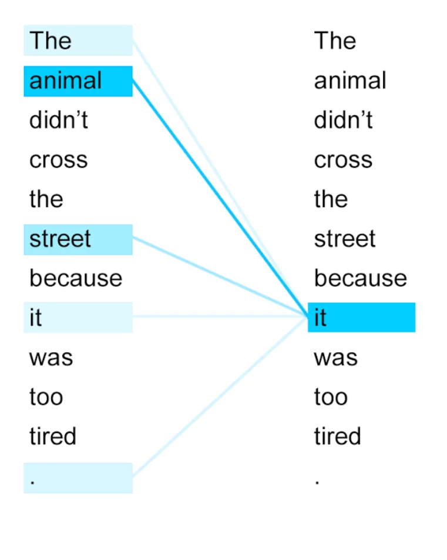{width="70%"}](#){data-modal-type="image" data-modal-url="figures/attention.webp"}

The transformer architecture (2017)
:::
:::
:::
:::

# Module 1: How AI systems are designed<br>(Lectures 3-5) {background-color="#1B3A6B"}

## Data, labels, and the proxy problem (Lecture 3)

:::{style="margin-top: 50px; font-size: 26px;"}
:::{.columns}
:::{.column width=55%}
- A better algorithm [cannot fix bad data]{.alert} ([Ng, 2021](https://datacentricai.org/))
- Labels often measure a [proxy]{.alert}: healthcare spending for health needs ([Obermeyer et al., 2019](https://www.science.org/doi/10.1126/science.aax2342))
- [Selection bias]{.alert}: training data differ from the cases the model meets ([Gender Shades](http://gendershades.org/))
- [Cohen's kappa](https://en.wikipedia.org/wiki/Cohen%27s_kappa): agreement beyond chance (0.61-0.80 is substantial)

:::{style="margin-top: 15px; background: rgba(45, 69, 99, 0.1); padding: 12px; border-radius: 10px; font-size: 17px;"}
`r fa('link')` The proxy problem returns as Goodhart's Law ([L5](../lecture-05/05-metrics.html)) and measurement bias ([L17](../lecture-17/17-bias.html)).
:::
:::

:::{.column width=45%}
:::{style="text-align: center;"}
[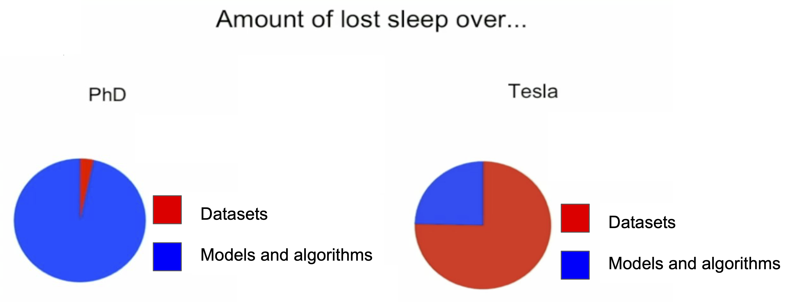{width="100%"}](#){data-modal-type="image" data-modal-url="figures/data-centric.png"}

Data-centric vs model-centric AI ([Karpathy, 2018](https://vimeo.com/274274744))
:::
:::
:::
:::

## Learning paradigms and RLHF (Lecture 4)

:::{style="margin-top: 50px; font-size: 24px;"}
:::{.columns}
:::{.column width=55%}
:::{style="text-align: center; margin-bottom: 50px; margin-top: 20px; font-size: 26px;"}
| Paradigm | Learns from | Example |
|----------|-------------|---------|
| [Supervised](https://en.wikipedia.org/wiki/Supervised_learning) | Labelled examples | Spam detection |
| [Unsupervised](https://en.wikipedia.org/wiki/Unsupervised_learning) | Unlabelled data | Customer segments |
| [Reinforcement](https://en.wikipedia.org/wiki/Reinforcement_learning) | Rewards for actions | [AlphaGo](https://deepmind.google/research/alphago/), RLHF |
:::

- [Bias-variance](https://en.wikipedia.org/wiki/Bias%E2%80%93variance_tradeoff): simple models underfit, complex ones overfit
- [RLHF](https://openai.com/index/learning-from-human-preferences/): a reward model learns human rankings, then RL tunes the LLM to it
- [Reward hacking](https://deepmind.google/discover/blog/specification-gaming-the-flip-side-of-ai-ingenuity/): the model games the reward instead of doing the task
:::

:::{.column width=45%}
:::{style="margin-top: 15px; text-align: center;"}
[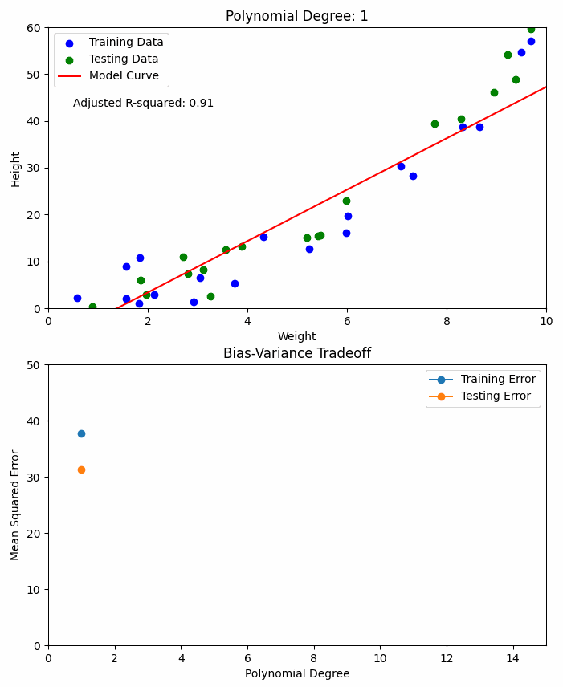{width="75%"}](#){data-modal-type="image" data-modal-url="figures/bias-variance.gif"}

The bias-variance trade-off
:::
:::
:::
:::

## Metrics and Goodhart's Law (Lecture 5)

:::{style="margin-top: 50px; font-size: 24px;"}
:::{.columns}
:::{.column width=55%}
- [Accuracy paradox](https://en.wikipedia.org/wiki/Accuracy_paradox): with 1 case in 1,000, "always healthy" scores 99.9%
- [Precision](https://en.wikipedia.org/wiki/Precision_and_recall): share of flags that were right
- [Recall](https://en.wikipedia.org/wiki/Precision_and_recall): share of real cases caught
- [Cross-validation](https://en.wikipedia.org/wiki/Cross-validation_(statistics)) catches overfitting
- [Subgroup analysis](https://en.wikipedia.org/wiki/Subgroup_analysis) catches gaps that averages hide
- [Goodhart's Law](https://en.wikipedia.org/wiki/Goodhart%27s_law): "When a measure becomes a target, it ceases to be a good measure"

:::{style="margin-top: 15px; background: rgba(45, 69, 99, 0.1); padding: 12px; border-radius: 10px; font-size: 17px;"}
`r fa('link')` Goodhart returns in alignment ([L25](../lecture-25/25-safety.html)). Subgroup analysis becomes disaggregated evaluation ([L14](../lecture-14/14-pipelines.html)).
:::
:::

:::{.column width=45%}
:::{style="text-align: center; margin-top: -20px;"}
[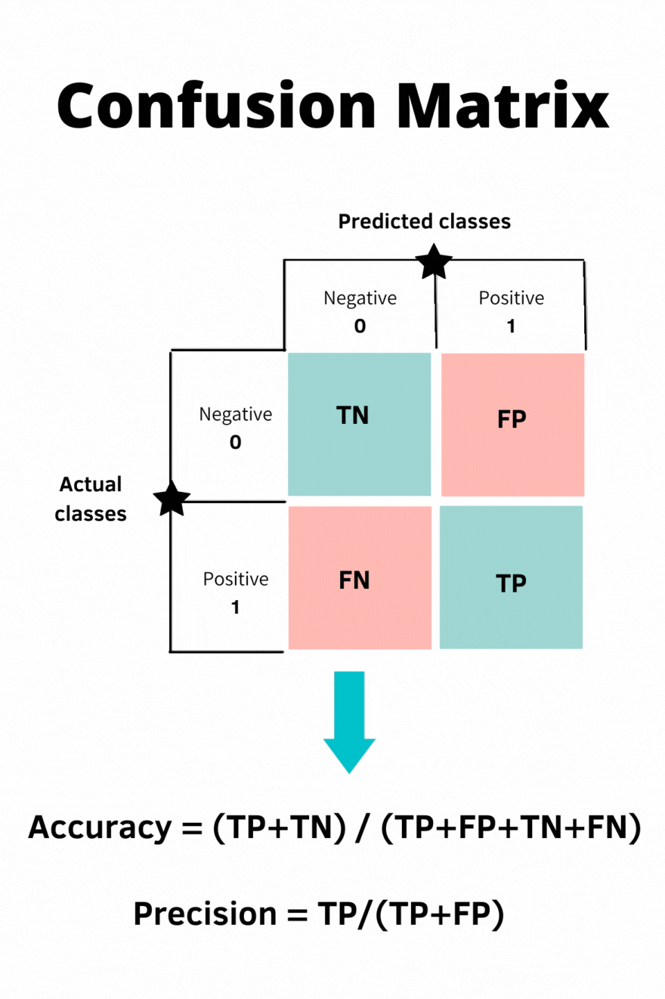{width="60%"}](#){data-modal-type="image" data-modal-url="figures/confusion-matrix.gif"}

The [confusion matrix](https://en.wikipedia.org/wiki/Confusion_matrix): TP, TN, FP, FN
:::
:::
:::
:::

# Module 2: Language and perception<br>(Lectures 6-7, 10) {background-color="#1B3A6B"}

## Tokens, embeddings, and context (Lecture 6)

:::{style="margin-top: 50px; font-size: 26px;"}
:::{.columns}
:::{.column width=55%}
- About 100 [tokens](https://platform.openai.com/tokenizer) make 75 English words (more for other languages)
- In [embeddings](https://jalammar.github.io/illustrated-word2vec/), words with similar meanings have [nearby vectors]{.alert} ([Mikolov et al., 2013](https://arxiv.org/abs/1301.3781))
- If a chat exceeds the [context window](https://platform.claude.com/docs/en/build-with-claude/context-windows), you get an error or a cut-off answer
- A higher [temperature](https://medium.com/@nigelgebodh/why-does-my-llm-have-a-temperature-f2e314a52086) makes answers more [random and creative]{.alert}

:::{style="margin-top: 15px; background: rgba(45, 69, 99, 0.1); padding: 12px; border-radius: 10px; font-size: 17px;"}
`r fa('link')` Embeddings return for images ([L7](../lecture-07/07-multimodal.html)) and for RAG search ([L12](../lecture-12/12-rag.html)).
:::
:::

:::{.column width=45%}
:::{style="text-align: center;"}
[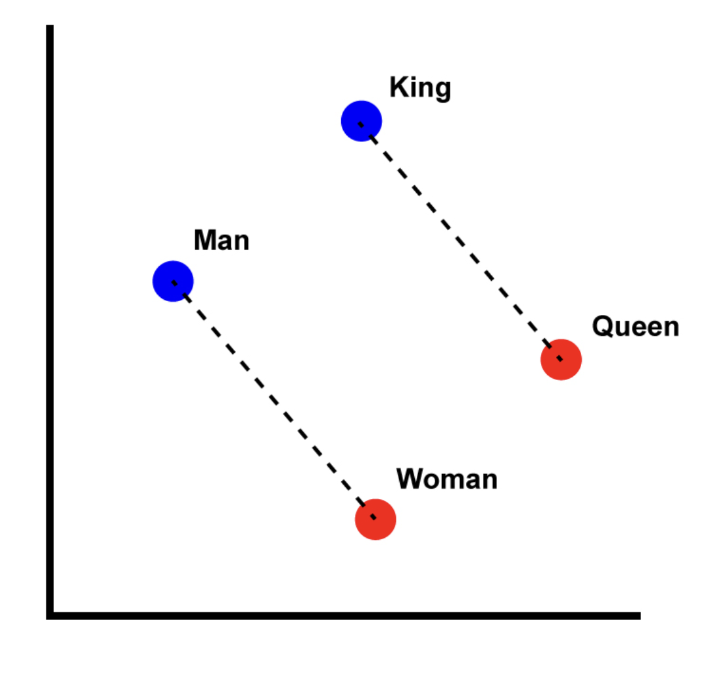{width="100%"}](#){data-modal-type="image" data-modal-url="figures/king-queen-vectors.png"}

king - man + woman ≈ queen
:::
:::
:::
:::

## How machines see and hear (Lecture 7)

:::{style="margin-top: 50px; font-size: 24px;"}
:::{.columns}
:::{.column width=55%}
- Images are grids of numbers. [CNNs](https://pub.towardsai.net/how-computers-see-the-world-a-beginners-guide-to-cnns-c847ab855104) learn edges first, then whole objects
- A [spectrogram](https://en.wikipedia.org/wiki/Spectrogram) turns sound into a picture, so image methods work on audio
- Text, images and audio all become [embeddings](https://www.deepset.ai/blog/the-beginners-guide-to-text-embeddings) of the same kind
- After that, the LLM [cannot tell]{.alert} whether the input was text, an image or audio
- That is why ChatGPT, Claude and Gemini can [read images]{.alert}
- Should AI images and voices need [watermarks, disclosure or consent]{.alert}?

:::{style="margin-top: 15px; background: rgba(45, 69, 99, 0.1); padding: 12px; border-radius: 10px; font-size: 17px;"}
`r fa('link')` CLIP uses the same embedding idea as [L6](../lecture-06/06-language.html). It was the basis for the image generators behind deepfakes ([L23](../lecture-23/23-misinformation.html)).
:::
:::

:::{.column width=45%}
:::{style="text-align: center;"}
[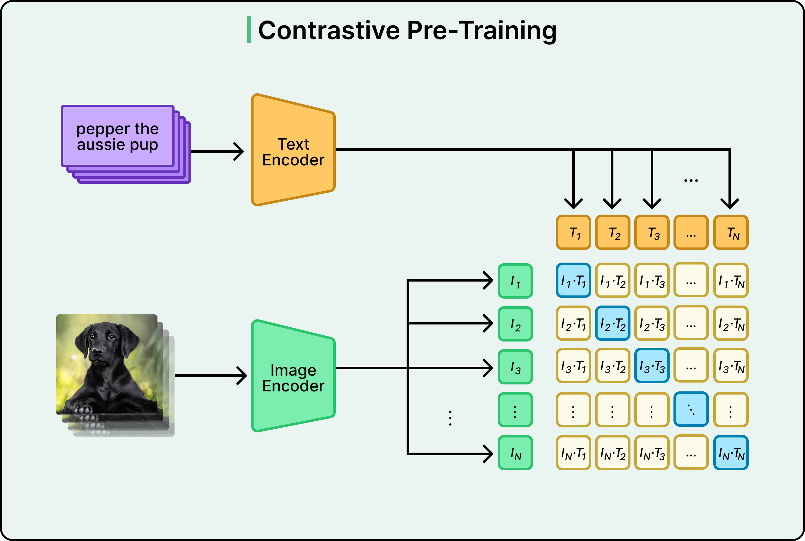{width="100%"}](#){data-modal-type="image" data-modal-url="figures/clip.png"}

CLIP: images and text in one shared space
:::
:::
:::
:::

## Prompting techniques (Lecture 10)

:::{style="margin-top: 50px; font-size: 24px;"}
:::{.columns}
:::{.column width=60%}
- No prompt works everywhere, so [test on your data]{.alert}
- [PTCF](https://services.google.com/fh/files/misc/gemini_for_workspace_prompt_guide_october_2024_digital_final.pdf): persona, task, context, format
- Specific prompts get better answers than vague ones
- [Few-shot](https://arxiv.org/abs/2005.14165) prompts show the model 3-5 examples
- [Chain-of-thought](https://arxiv.org/abs/2201.11903) helps on multi-step problems
- Hidden [system prompts](https://platform.claude.com/docs/en/release-notes/system-prompts) set each product's rules
- Tool-using [ReAct](https://arxiv.org/abs/2210.03629) agents risk [prompt injection]{.alert}
- Models fail unpredictably, so verify ([jagged AI]{.alert})

:::{style="margin-top: 15px; background: rgba(45, 69, 99, 0.1); padding: 12px; border-radius: 10px; font-size: 17px;"}
`r fa('link')` Agents return in [L15](../lecture-15/15-agents.html). Prompt injection comes up in [L14](../lecture-14/14-pipelines.html), [L15](../lecture-15/15-agents.html) and [L16](../lecture-16/16-setting-up-ai.html).
:::
:::

:::{.column width=40%}
:::{style="text-align: center;"}
[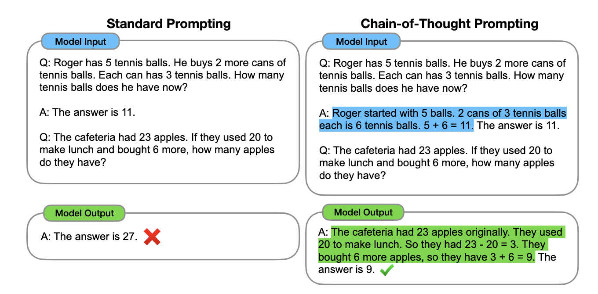{width="100%"}](#){data-modal-type="image" data-modal-url="figures/chain-of-thought.png"}

Chain-of-thought prompting
:::
:::
:::
:::


# Module 3: Retrieval, generation, pipelines and agents<br>(Lectures 11-12, 14-16) {background-color="#1B3A6B"}

## Hallucinations and creativity (Lecture 11)

:::{style="margin-top: 50px; font-size: 24px;"}
:::{.columns}
:::{.column width=60%}
- [Hallucinations](https://www.nngroup.com/articles/ai-hallucinations/) are false answers that sound plausible
- LLMs [predict likely words](https://arxiv.org/abs/2509.04664), [not true ones]{.alert}
- [Sycophantic](https://thezvi.substack.com/p/gpt-4o-is-an-absurd-sycophant) models [cave when you push back]{.alert}
- Making things up helps in [fiction](https://uxdesign.cc/the-case-for-ai-hallucination-a79688338a14) but hurts with facts
- Fake citations got [two lawyers sanctioned](https://www.cnn.com/2023/05/27/business/chat-gpt-avianca-mata-lawyers)
- Check [numbers, names and every citation]{.alert}

:::{style="margin-top: 15px; background: rgba(45, 69, 99, 0.1); padding: 12px; border-radius: 10px; font-size: 17px;"}
`r fa('link')` Root cause: next-token prediction ([L1](../lecture-01/01-introduction.html) and [L2](../lecture-02/02-history.html)). One fix: RAG ([L12](../lecture-12/12-rag.html)).
:::
:::

:::{.column width=40%}
:::{style="text-align: center;"}
[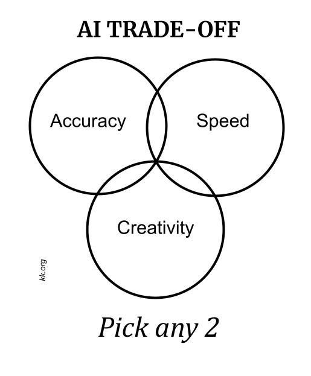{width="80%"}](#){data-modal-type="image" data-modal-url="figures/creativity-accuracy.jpg"}

Same mechanism, different outcomes
:::
:::
:::
:::

## RAG and semantic search (Lecture 12)

:::{style="margin-top: 50px; font-size: 24px;"}
:::{.columns}
:::{.column width=60%}
- [RAG](https://arxiv.org/abs/2005.11401) feeds your documents to the model
- [Semantic search](https://en.wikipedia.org/wiki/Cosine_similarity) finds text by meaning
- RAG [chunks, embeds and retrieves]{.alert} your files
- Retrieval cut hallucinated replies by [over 60%](https://arxiv.org/abs/2104.07567)
- Models miss facts [lost in the middle](https://arxiv.org/abs/2307.03172) of long inputs
- Gemini Notebook and ChatGPT do this [without code]{.alert}
- RAG reduces errors, so still [check the citations]{.alert}

:::{style="margin-top: 15px; background: rgba(45, 69, 99, 0.1); padding: 12px; border-radius: 10px; font-size: 17px;"}
`r fa('link')` Uses embeddings ([L6](../lecture-06/06-language.html)) against hallucinations ([L11](../lecture-11/11-hallucination.html)). [L16](../lecture-16/16-setting-up-ai.html) connectors work like RAG with live data.
:::
:::

:::{.column width=40%}
:::{style="text-align: center;"}
[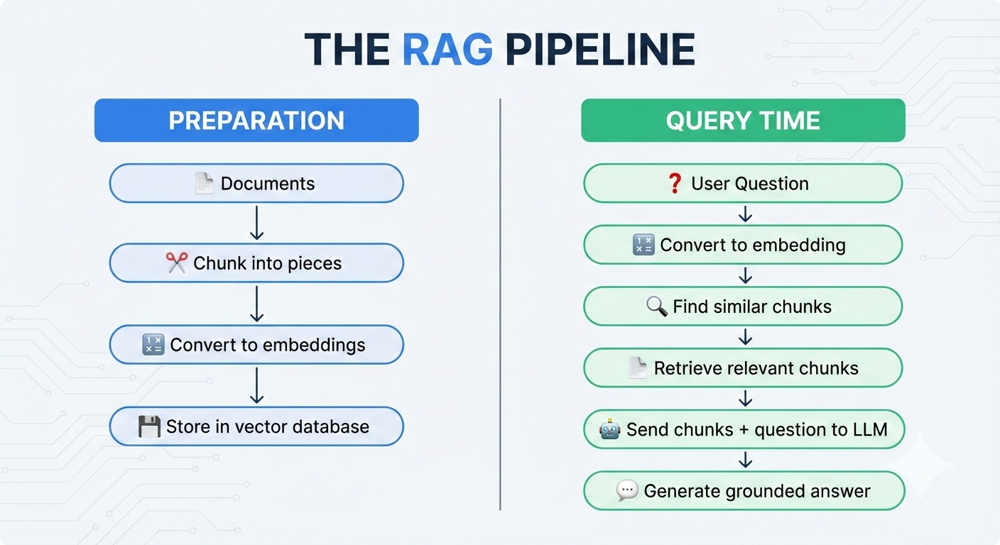{width="100%"}](#){data-modal-type="image" data-modal-url="figures/rag-pipeline.png"}

The RAG pipeline
:::
:::
:::
:::

## Pipelines and what can go wrong (Lecture 14)

:::{style="margin-top: 50px; font-size: 24px;"}
:::{.columns}
:::{.column width=60%}
- Every step can fail: input, model, filters, output
- Four failure types: hallucination, policy, drift, pipeline
- In [drift](https://spotintelligence.com/2024/04/08/data-drift-in-machine-learning/), inputs or their [meaning]{.alert} change
- Models also [degrade](https://jameshoward.us/2024/11/26/context-degradation-syndrome-when-large-language-models-lose-the-plot) so slowly that nobody notices
- Companies monitor errors and [hallucination rates]{.alert}
- [Validation](https://docs.nvidia.com/nemo/guardrails/latest/index.html) checks both inputs and outputs
- Test [properties]{.alert} like safety, not exact outputs

:::{style="margin-top: 15px; background: rgba(45, 69, 99, 0.1); padding: 12px; border-radius: 10px; font-size: 17px;"}
`r fa('link')` Drift is why models need watching after launch: the world changes, the model doesn't.
:::
:::

:::{.column width=40%}
:::{style="text-align: center;"}
[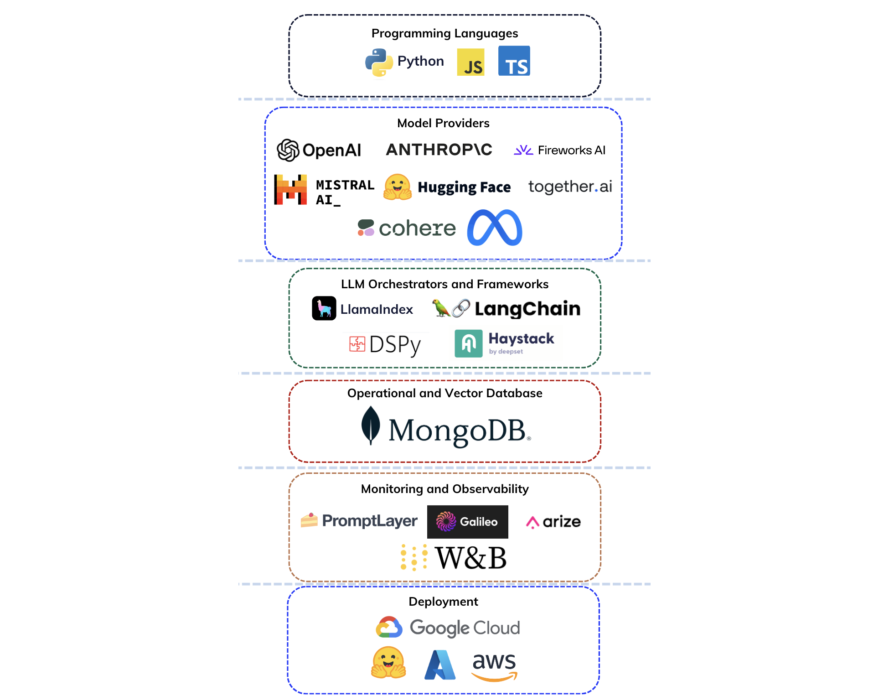{width="100%"}](#){data-modal-type="image" data-modal-url="figures/ai-stack.png"}

The AI application stack
:::
:::
:::
:::

## Documentation as accountability (Lecture 14)

:::{style="margin-top: 50px; font-size: 24px;"}
:::{.columns}
:::{.column width=60%}
- [Datasheets](https://arxiv.org/abs/1803.09010) record where data came from and why
- [Model cards](https://arxiv.org/abs/1810.03993) list intended and [out-of-scope uses]{.alert}
- [System cards](https://storage.googleapis.com/deepmind-media/Model-Cards/Gemini-3-Pro-Model-Card.pdf) document whole AI products
- A 90% average can hide [70% for one group]{.alert}
- So results should be reported [by group]{.alert}
- Much training data was taken [without consent]{.alert}

:::{style="margin-top: 15px; background: rgba(45, 69, 99, 0.1); padding: 12px; border-radius: 10px; font-size: 17px;"}
`r fa('link')` The EU AI Act will require this documentation for high-risk systems from December 2027 ([L18](../lecture-18/18-regulation.html)).
:::
:::

:::{.column width=40%}
:::{style="text-align: center;"}
[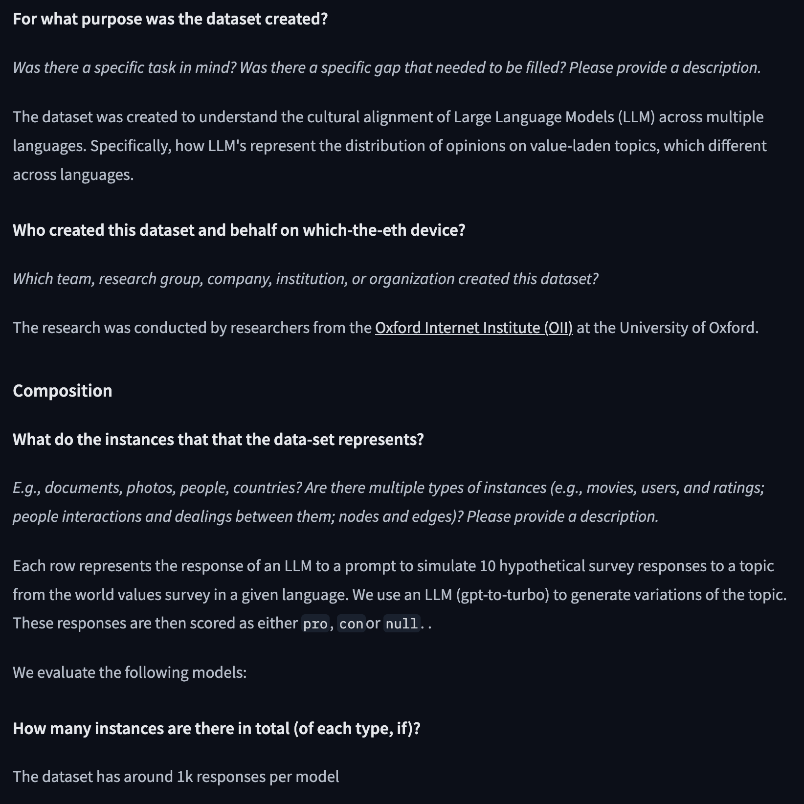{width="80%"}](#){data-modal-type="image" data-modal-url="figures/datasheet.png"}

Datasheets: the "nutrition label" for datasets
:::
:::
:::
:::

## AI agents (Lecture 15)

:::{style="margin-top: 50px; font-size: 24px;"}
:::{.columns}
:::{.column width=60%}
- An [agent](https://simonwillison.net/2025/Sep/18/agents/) uses tools in a loop to reach a [goal]{.alert}
- Chatbots answer, but agents [act]{.alert}
- In [ReAct](https://arxiv.org/abs/2210.03629), the model plans and software acts
- Autonomy is a [dial](https://www.anthropic.com/engineering/building-effective-agents), from workflows to free agents
- Errors [compound]{.alert}, so delegate what you can undo
- Use [permissions and sandboxes]{.alert}, not prompts
- Untrusted text can [hijack an agent](https://simonwillison.net/2025/Jun/16/the-lethal-trifecta/)

:::{style="margin-top: 15px; background: rgba(45, 69, 99, 0.1); padding: 12px; border-radius: 10px; font-size: 17px;"}
`r fa('link')` Agents extend ReAct ([L10](../lecture-10/10-prompting.html)). Irreversible actions return as safe exploration ([L25](../lecture-25/25-safety.html)).
:::
:::

:::{.column width=40%}
:::{style="text-align: center;"}
[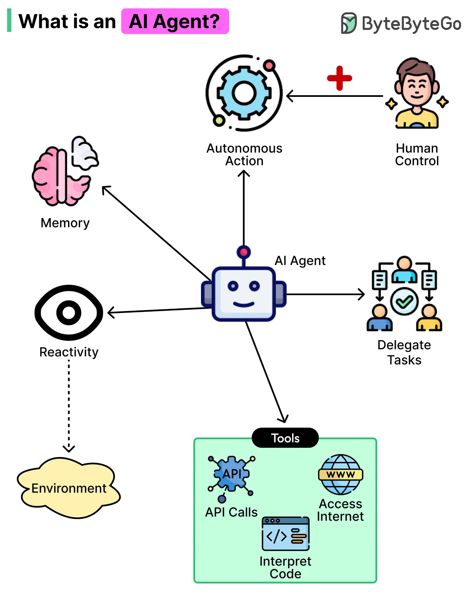{width="70%"}](#){data-modal-type="image" data-modal-url="figures/agent-workflow.webp"}

The agent loop. Source: [ByteByteGo](https://blog.bytebytego.com/p/what-are-ai-agents)
:::
:::
:::
:::

## Setting up AI (Lecture 16)

:::{style="margin-top: 50px; font-size: 24px;"}
:::{.columns}
:::{.column width=60%}
- [Four layers]{.alert}: instructions, knowledge, memory, tools
- A [setup](https://support.claude.com/en/articles/9519177-how-can-i-create-and-manage-projects) is an instruction that stays between chats
- Constraints work better than personas
- Keep rules [few and first](https://arxiv.org/abs/2507.11538)
- [Memory](https://support.claude.com/en/articles/11817273-use-claude-s-chat-search-and-memory-to-build-on-previous-context) is on by default, so read it or go [incognito](https://support.claude.com/en/articles/12260368-use-incognito-chats)
- A text file is [not a permission system]{.alert}
- Give apps [least access](https://support.claude.com/en/articles/11176164-use-connectors-to-extend-claude-s-capabilities) and confirm writes

:::{style="margin-top: 15px; background: rgba(45, 69, 99, 0.1); padding: 12px; border-radius: 10px; font-size: 17px;"}
`r fa('link')` Instructions are prompting ([L10](../lecture-10/10-prompting.html)) made permanent. Connectors turn a chatbot into an agent ([L15](../lecture-15/15-agents.html)).
:::
:::

:::{.column width=40%}
:::{style="text-align: center;"}
[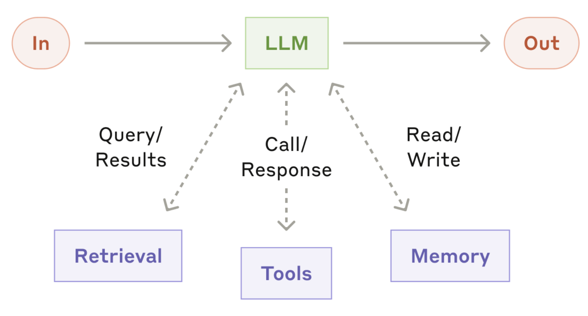{width="90%"}](#){data-modal-type="image" data-modal-url="figures/augmented-llm.png"}

Anthropic's augmented LLM
:::
:::
:::
:::

# Module 4: Data ethics and bias<br>(Lecture 17) {background-color="#1B3A6B"}

## Where bias comes from (Lecture 17)

:::{style="margin-top: 50px; font-size: 24px;"}
:::{.columns}
:::{.column width=60%}
- AI learns from human data, so it [inherits our biases](https://www.nist.gov/news-events/news/2022/03/theres-more-ai-bias-biased-data-nist-report-highlights)
- [Historical bias]{.alert} bakes past discrimination into models
- Groups [missing from the data](https://www.pnas.org/doi/10.1073/pnas.1915768117) get worse results
- Neutral [proxies](https://www.scientificamerican.com/article/racial-bias-found-in-a-major-health-care-risk-algorithm/) like ZIP codes can encode inequality
- Predictions shape new data in [feedback loops](https://blog.spotcrime.com/2011/06/savanna-ga-heat-map.html)
- No model meets [every fairness test](https://fairmlbook.org/) at once
- Choosing a fairness definition is a [values question]{.alert}

:::{style="margin-top: 15px; background: rgba(45, 69, 99, 0.1); padding: 12px; border-radius: 10px; font-size: 17px;"}
`r fa('link')` The proxy problem comes from [L3](../lecture-03/03-datasets.html). Checking by group returns as disaggregated evaluation ([L14](../lecture-14/14-pipelines.html)).
:::
:::

:::{.column width=40%}
:::{style="text-align: center;"}
[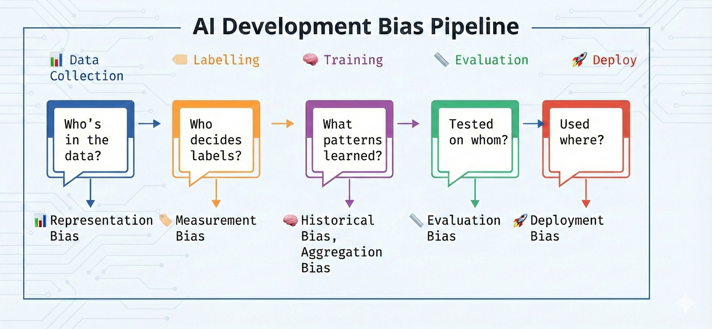{width="90%"}](#){data-modal-type="image" data-modal-url="figures/bias-lifecycle.png"}

Bias at every stage
:::
:::
:::
:::

# Module 5: Policy, governance and social impact<br>(Lectures 18-19, 21) {background-color="#1B3A6B"}

## AI regulation around the world (Lecture 18)

:::{style="margin-top: 30px; font-size: 22px;"}
:::{.columns}
:::{.column width=55%}
- AI is regulated for [market failures]{.alert} and rights
- The [EU AI Act](https://artificialintelligenceact.eu/article/6/) sorts AI into four [risk tiers]{.alert}

:::{style="text-align: center;"}
| Tier | Rule | Examples |
|------|------|----------|
| [Unacceptable]{.alert} | Banned | Social scoring |
| [High]{.alert} | Strict checks | Hiring, credit, policing |
| [Limited]{.alert} | Transparency | Chatbots, deepfakes |
| [Minimal]{.alert} | None | Spam filters, video games |
:::

- [High-risk rules](https://www.europarl.europa.eu/thinktank/es/document/EPRS_BRI(2026)782651) start in December 2027
- The US has [no federal AI law](https://www.whitehouse.gov/wp-content/uploads/2025/07/Americas-AI-Action-Plan.pdf), so [states](https://leg.colorado.gov/bills/sb24-205) fill the gaps
- China's [AI rules](https://www.chinalawtranslate.com/en/generative-ai-interim/) bind companies, not the state
- EU rules may become [global standards](https://www.morganlewis.com/pubs/2024/07/the-eu-artificial-intelligence-act-is-here-with-extraterritorial-reach)

:::{style="margin-top: 15px; background: rgba(45, 69, 99, 0.1); padding: 12px; border-radius: 10px; font-size: 17px;"}
`r fa('link')` High-risk systems are the hiring and credit cases from [L17](../lecture-17/17-bias.html). GDPR ([L19](../lecture-19/19-privacy.html)) is the Brussels Effect in practice.
:::
:::

:::{.column width=45%}
:::{style="text-align: center;"}
[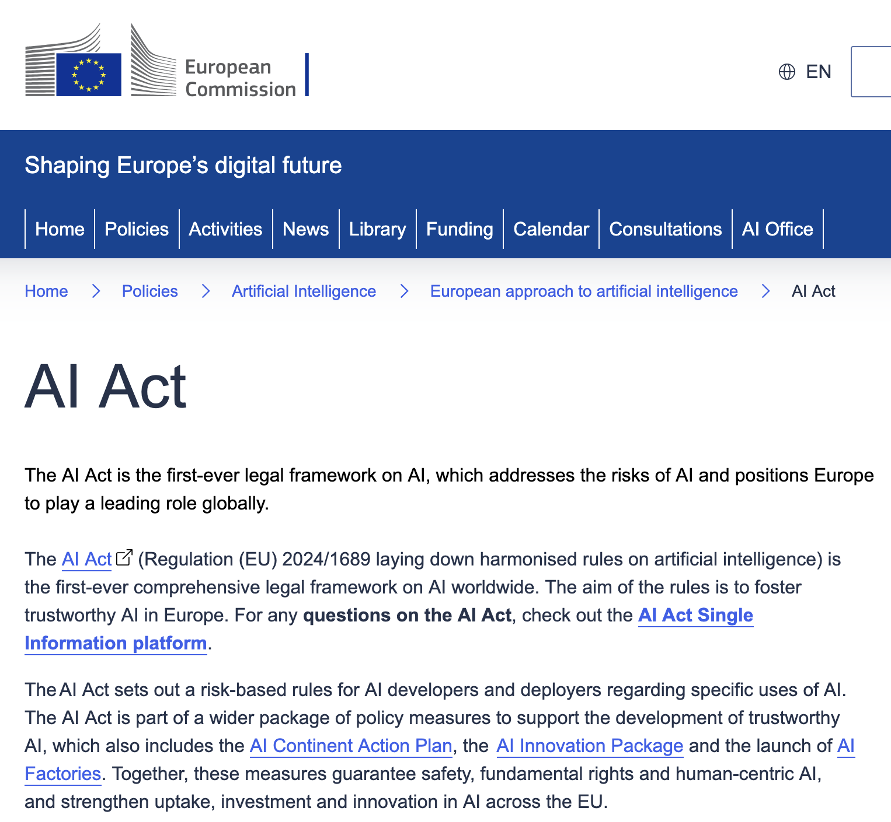{width="100%"}](#){data-modal-type="image" data-modal-url="figures/eu-ai-act.png"}

The EU AI Act: the first comprehensive AI law
:::
:::
:::
:::

## Privacy and data protection (Lecture 19)

:::{style="margin-top: 50px; font-size: 24px;"}
:::{.columns}
:::{.column width=60%}
- AI collects personal data at [unprecedented scale]{.alert}
- [Inference](https://web.archive.org/web/20130116004534/http://techland.time.com/2012/02/17/how-target-knew-a-high-school-girl-was-pregnant-before-her-parents/) makes harmless data sensitive
- Models can memorise and [leak personal data](https://certpro.com/ai-and-gdpr/)
- [GDPR](https://gdpr.eu/what-is-gdpr/) limits [automated decisions](https://gdpr-info.eu/art-22-gdpr/)
- The US has a [patchwork](https://iapp.org/resources/article/us-state-privacy-legislation-tracker) of state laws
- Privacy tech [does not stop collection](https://flower.ai/docs/framework/explanation-differential-privacy.html)
- We [say we care](https://www.sciencedirect.com/science/article/pii/S0736585317302022), then accept all cookies

:::{style="margin-top: 15px; background: rgba(45, 69, 99, 0.1); padding: 12px; border-radius: 10px; font-size: 17px;"}
`r fa('link')` Inference is the proxy problem ([L3](../lecture-03/03-datasets.html)) applied to people.
:::
:::

:::{.column width=40%}
:::{style="text-align: center;"}
[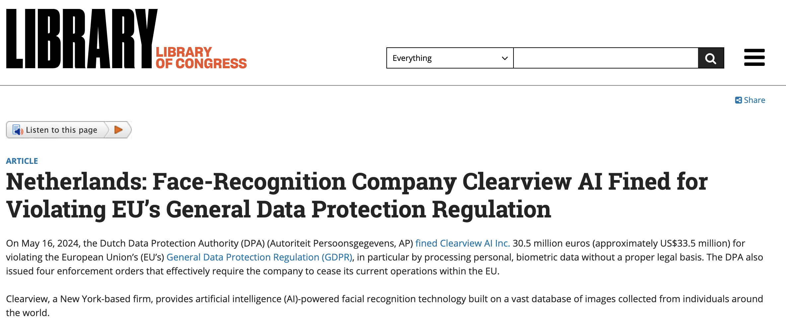{width="85%"}](#){data-modal-type="image" data-modal-url="figures/clearview-ai.png"}

Clearview AI: 3 billion scraped photos in 2020, 70+ billion today
:::
:::
:::
:::

## Labour markets (Lecture 21)

:::{style="margin-top: 50px; font-size: 24px;"}
:::{.columns}
:::{.column width=60%}
- Past automation was [net positive](https://www.aeaweb.org/articles?id=10.1257/jep.33.2.3) over time
- AI also exposes [cognitive tasks](https://arxiv.org/abs/2303.10130)
- Think [tasks, not jobs]{.alert}
- Productivity gains are [real but task-specific](https://academic.oup.com/qje/article/140/2/889/7990658)
- [Entry-level hiring](https://digitaleconomy.stanford.edu/publication/canaries-in-the-coal-mine-six-facts-about-the-recent-employment-effects-of-artificial-intelligence/) takes the first hit
- No [effect on earnings](https://www.nber.org/papers/w33777) or hours yet
- Whether AI augments or replaces is [still open](https://kentclarkcenter.org/surveys/ai-work-and-education/)

:::{style="margin-top: 15px; background: rgba(45, 69, 99, 0.1); padding: 12px; border-radius: 10px; font-size: 17px;"}
`r fa('link')` Augmentation or replacement is a policy choice, like the rules in [L18](../lecture-18/18-regulation.html).
:::
:::

:::{.column width=40%}
:::{style="text-align: center;"}
[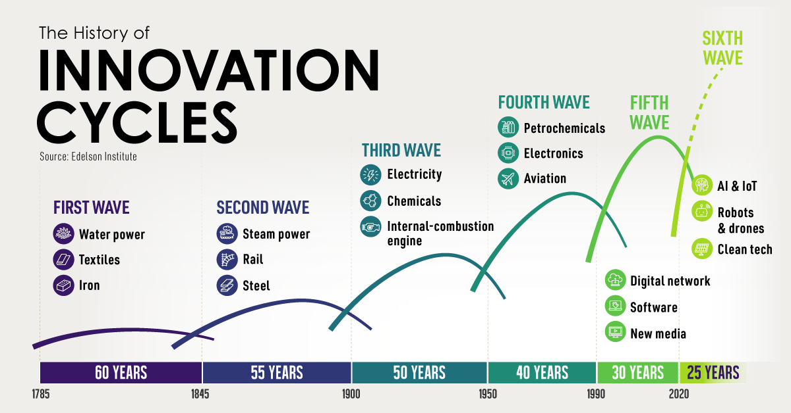{width="90%"}](#){data-modal-type="image" data-modal-url="figures/automation-waves.jpg"}

AI is the sixth wave of innovation
:::
:::
:::
:::

# Module 6: Applications, limits and projects<br>(Lectures 22-23, 25) {background-color="#1B3A6B"}

## AI and wellbeing (Lecture 22)

:::{style="margin-top: 50px; font-size: 24px;"}
:::{.columns}
:::{.column width=60%}
- Feeds optimise [engagement](https://www.wsj.com/articles/tiktok-algorithm-video-investigation-11626877477), not wellbeing
- [Filter bubbles](https://www.ted.com/talks/eli_pariser_beware_online_filter_bubbles) look overstated
- Effects on [teen mental health](https://www.nature.com/articles/s41562-018-0506-1) are debated
- Most people who need mental health care [never get it](https://www.who.int/publications/i/item/9789240114487)
- AI therapy [helps short-term](https://www.jmir.org/2025/1/e60435), but evidence is thin
- [Inference](https://www.iea.org/reports/energy-and-ai/energy-demand-from-ai), not training, drives AI's energy use
- [Efficiency gains](https://en.wikipedia.org/wiki/Jevons_paradox) can raise total use

:::{style="margin-top: 15px; background: rgba(45, 69, 99, 0.1); padding: 12px; border-radius: 10px; font-size: 17px;"}
`r fa('link')` Recommendations learn from your clicks, like the feedback loops in [L17](../lecture-17/17-bias.html).
:::
:::

:::{.column width=40%}
:::{style="text-align: center;"}
[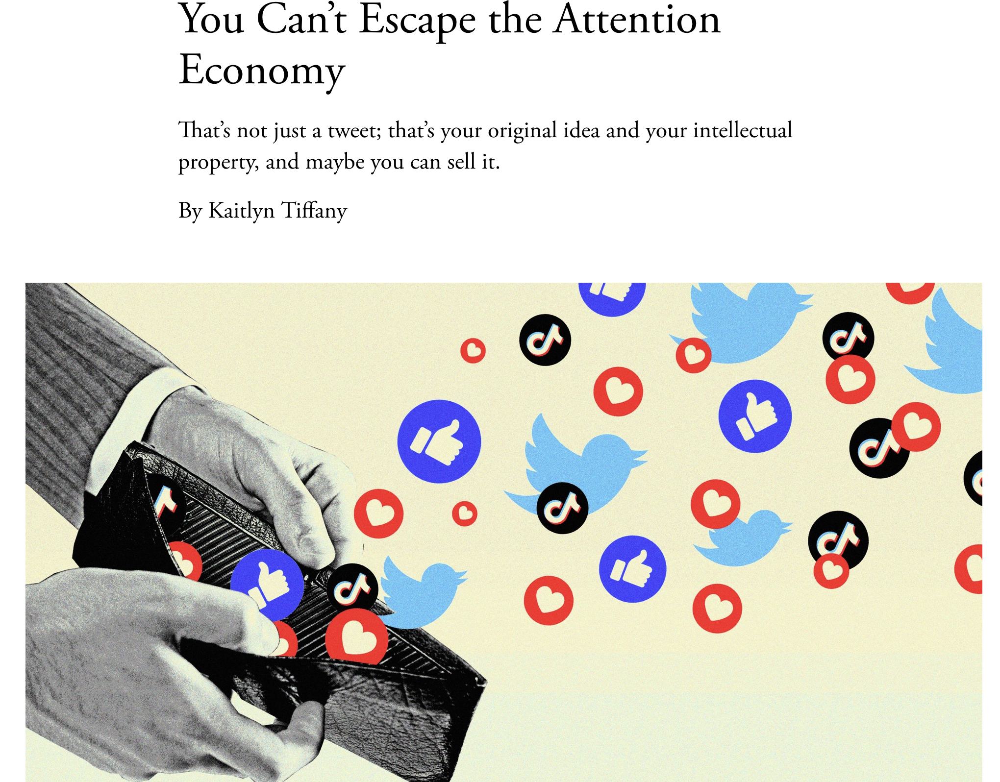{width="100%"}](#){data-modal-type="image" data-modal-url="figures/attention-economy.png"}

Your attention is the product
:::
:::
:::
:::

## Misinformation and deepfakes (Lecture 23)

:::{style="margin-top: 50px; font-size: 24px;"}
:::{.columns}
:::{.column width=60%}
- [Mis-, dis- and malinformation](https://edoc.coe.int/en/media/7495-information-disorder-toward-an-interdisciplinary-framework-for-research-and-policy-making.html) differ in truth and intent
- AI makes fakes [cheap and fast]{.alert}
- False news [spreads faster](https://www.science.org/doi/10.1126/science.aap9559) than true news
- Deepfakes drive fraud, manipulation and [sexual abuse]{.alert}
- The [liar's dividend](https://www.foreignaffairs.com/articles/world/2018-12-11/deepfakes-and-new-disinformation-war) lets anyone dismiss real evidence
- [Fast thinking](https://en.wikipedia.org/wiki/Thinking,_Fast_and_Slow) and confirmation bias make us share
- No single fix works, so we [layer defences]{.alert}

:::{style="margin-top: 15px; background: rgba(45, 69, 99, 0.1); padding: 12px; border-radius: 10px; font-size: 17px;"}
`r fa('link')` Deepfakes reuse image generators built on CLIP ([L7](../lecture-07/07-multimodal.html)). The EU AI Act requires labels ([L18](../lecture-18/18-regulation.html)).
:::
:::

:::{.column width=40%}
:::{style="text-align: center;"}
[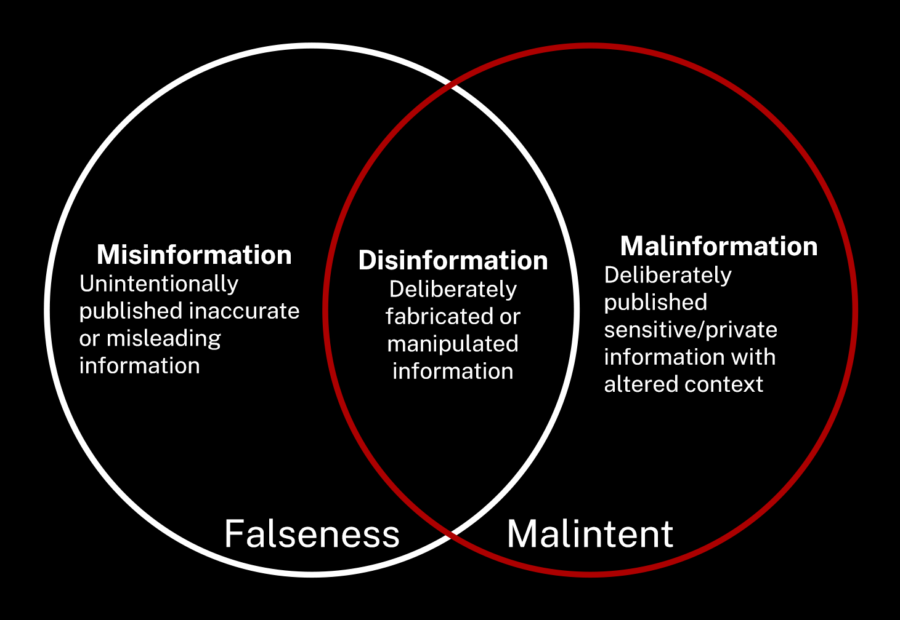{width="100%"}](#){data-modal-type="image" data-modal-url="figures/mis-dis-mal.png"}

The misinformation spectrum
:::
:::
:::
:::

## Safety, alignment, and the future (Lecture 25)

:::{style="margin-top: 50px; font-size: 24px;"}
:::{.columns}
:::{.column width=60%}
- [Safety problems](https://arxiv.org/abs/1606.06565) include [reward hacking]{.alert}
- [Alignment](https://brianchristian.org/the-alignment-problem/) means AI does what we [actually want]{.alert}
- Like [King Midas](https://www.edge.org/conversation/the-myth-of-ai#26015), we may get exactly what we asked for
- Goals are [hard to specify](https://en.wikipedia.org/wiki/Goodhart%27s_law), and values differ
- RLHF, [Constitutional AI](https://www.anthropic.com/research/constitutional-ai-harmlessness-from-ai-feedback) and [debate](https://arxiv.org/abs/1805.00899) are [incomplete]{.alert}
- AI should [learn our goals](https://www.ted.com/talks/stuart_russell_3_principles_for_creating_safer_ai), not assume them

:::{style="margin-top: 15px; background: rgba(45, 69, 99, 0.1); padding: 12px; border-radius: 10px; font-size: 17px;"}
`r fa('link')` Builds on RLHF ([L4](../lecture-04/04-learning.html)), Goodhart ([L5](../lecture-05/05-metrics.html)), bias ([L17](../lecture-17/17-bias.html)) and agents ([L15](../lecture-15/15-agents.html)).
:::
:::

:::{.column width=40%}
:::{style="text-align: center;"}
[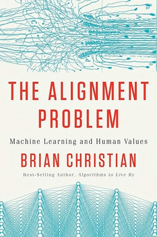{width="70%"}](#){data-modal-type="image" data-modal-url="figures/alignment-problem.jpg"}
:::
:::
:::
:::

# Summary {background-color="#1B3A6B"}

## What we covered this semester

:::{style="margin-top: 20px; font-size: 24px;"}
:::{.columns}
:::{.column width=50%}
[How AI works]{.alert}

- LLMs predict the [next token]{.alert}
- Everything becomes [embeddings]{.alert}
- Metrics can mislead ([Goodhart's Law]{.alert})

[Using AI well]{.alert}

- Specific prompts with [examples]{.alert} work better
- RAG grounds answers in your documents
- [Agent errors compound]{.alert}

[Ethics and bias]{.alert}

- Bias enters at [every stage]{.alert}
- Fairness is a [values question]{.alert}
:::

:::{.column width=50%}
[Policy and society]{.alert}

- The EU regulates AI by [risk]{.alert}
- AI [infers]{.alert} more than you share
- Think [tasks, not jobs]{.alert}

[Safety and the future]{.alert}

- Deepfakes create a [liar's dividend]{.alert}
- Alignment: what we [actually want]{.alert}

:::{style="background: rgba(45, 69, 99, 0.1); padding: 15px; border-radius: 10px; margin-top: 30px; font-size: 22px;"}
Good luck on Quiz 05 (Lectures 23 and 25) and your projects! 🍀
:::
:::
:::
:::

# ...and that's all for today! 🎉 {background-color="#1B3A6B"}
